# Supervision Prometheus / Grafana - AP 1 GSBLOLO

Je présente ici la mise en place de la supervision de mon infrastructure avec **Prometheus**, avec mes propres captures d'écran. Le premier objectif est de superviser l'antivirus **ClamAV** et son interface graphique **ClamUI**, installés sur ma VM Debian.

> **Prérequis :** ClamAV et ClamUI sont déjà installés et fonctionnels sur la VM 812 (voir les documentations [ClamAV](../../Structure%20du%20r%C3%A9seau/Docs/ClamAV/ClamAV.md) et [ClamUI](../../Structure%20du%20r%C3%A9seau/Docs/ClamUI/ClamUI.md)).
>
> **Dates de réalisation :** 12/11/2026 (étapes 1 à 4), 13/11/2026 (étape 5) et 19/11/2026 (étapes 6, 7 et 8)
> **État :** étapes 1 à 8 terminées (supervision, tableaux de bord et alertes en service). Amélioration prévue ensuite : superviser les contrôleurs de domaine (windows_exporter) (voir [l'avancement](README.md)).

---

## Sommaire

1. [Présentation et architecture](#1-présentation-et-architecture)
2. [Étape 1 : la VM SUPERVISION](#2-étape-1--la-vm-supervision)
3. [Étape 2 : Prometheus et node_exporter](#3-étape-2--prometheus-et-node_exporter)
4. [Étape 3 : superviser la VM ClamAV](#4-étape-3--superviser-la-vm-clamav)
5. [Étape 4 : l'exporter ClamAV](#5-étape-4--lexporter-clamav)
6. [Étape 5 : script de métriques ClamAV et ClamUI](#6-étape-5--script-de-métriques-clamav-et-clamui)
7. [Étape 6 : Grafana relié à Prometheus](#7-étape-6--grafana-relié-à-prometheus)
8. [Étape 7 : connexion à Grafana avec l'Active Directory](#8-étape-7--connexion-à-grafana-avec-lactive-directory)
9. [Étape 8 : tableau de bord et alertes](#9-étape-8--tableau-de-bord-et-alertes)
10. [Dépannage : erreurs rencontrées](#10-dépannage--erreurs-rencontrées)
11. [Récapitulatif](#11-récapitulatif)

---

## 1. Présentation et architecture

| Outil | Rôle |
|---|---|
| **Prometheus** | Interroge régulièrement des « exporters » en HTTP, stocke les valeurs reçues (base de séries temporelles) et permet de les interroger avec le langage **PromQL**. |
| **node_exporter** | Exporter système : CPU, mémoire, disques, réseau… Il sait aussi lire des fichiers `.prom` déposés dans un dossier (**collecteur textfile**). |
| **clamav_exporter** | Interroge le démon `clamd` et expose son état : démon joignable, version de la base de signatures, etc. |
| **Grafana** | Tableaux de bord graphiques à partir des données de Prometheus. |

J'ai choisi une **VM dédiée** à la supervision : si la VM ClamAV tombe, la supervision continue de fonctionner et peut le signaler.

```
┌──────────────────────────────┐                ┌──────────────────────────────────────┐
│ VM 804 SUPERVISION           │                │ VM 812 Client-Linux-Debian (ClamAV)   │
│ 10.2.121.15                  │                │ 10.2.121.12                           │
│                              │  HTTP :9100    │                                      │
│  Prometheus :9090  ──────────┼───────────────▶│  node_exporter :9100                 │
│     │                        │                │     └─ textfile : clamav_scans.prom  │
│     │                        │  HTTP :9906    │          ▲ (cron 5 min)              │
│     │          ──────────────┼───────────────▶│  clamav_exporter :9906               │
│     │                        │                │     └─ clamd TCP 127.0.0.1:3310      │
│     └─▶ node_exporter :9100  │                │  clamav_metrics.sh                   │
│         (la VM elle-même)    │                │     ├─ journaux et dossiers ClamAV   │
│                              │                │     └─ données de ClamUI (Flatpak)   │
└──────────────────────────────┘                └──────────────────────────────────────┘
```

| VM | Nom | IP | Rôle |
|---|---|---|---|
| 804 | SUPERVISION | 10.2.121.15 (fixe) | Prometheus, node_exporter, Grafana |
| 812 | Client-Linux-Debian | 10.2.121.12 (fixe) | ClamAV, ClamUI, node_exporter, clamav_exporter, script de métriques |

---

## 2. Étape 1 : la VM SUPERVISION

### 2.1 Installation de Debian 12

J'ai créé la VM **804 SUPERVISION** dans mon pool Proxmox, sur le réseau 10.2.121.0/24 (VLAN 800), et installé **Debian 12** sans environnement de bureau.

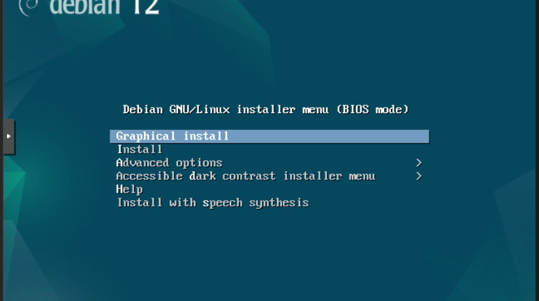

Pendant l'installation, l'installeur lance automatiquement une configuration **DHCP**. Pour donner une IP fixe, j'ai **annulé** cette configuration automatique, puis choisi la configuration manuelle du réseau :

| Paramètre | Valeur |
|---|---|
| Nom d'hôte | `Supervision` |
| Adresse IP | `10.2.121.15/24` |
| Passerelle | `10.2.121.1` |
| DNS | Mon contrôleur de domaine (`10.2.121.2`) |
| Utilisateur | `supervison1` |

Au premier redémarrage, la VM est restée bloquée sur `Booting from Hard Disk...` : GRUB n'avait pas été installé sur le disque (voir [§ 10.1](#101-booting-from-hard-disk-bloqué-grub-absent)).

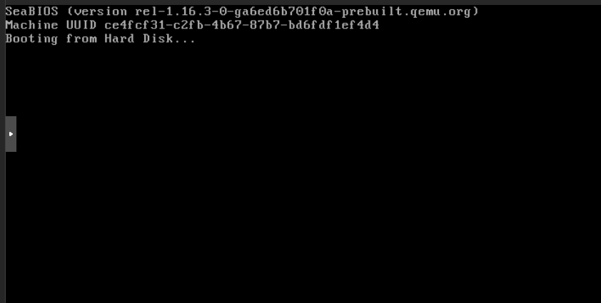

### 2.2 Vérification du réseau et de SSH

```bash
ip a
ping -c 2 deb.debian.org
```

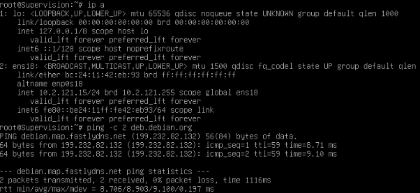

**Résultat :** l'interface `ens18` a bien l'adresse `10.2.121.15/24`, et la VM joint Internet (les dépôts Debian répondent).

J'ai ensuite testé le serveur SSH en local :

```bash
ssh supervison1@10.2.121.15
```

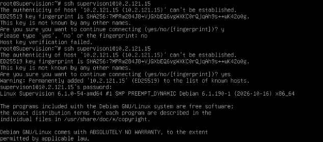

À la première connexion, SSH demande de valider l'empreinte de la machine. Il faut taper **`yes`** en entier : une simple réponse `y` est refusée (`Host key verification failed`).

### 2.3 Poste de travail

Mon PC Windows est sur un autre réseau et n'a pas de route vers 10.2.121.0/24 (voir [§ 10.2](#102-pc-windows-sans-route-vers-le-réseau-du-labo)). Je travaille donc depuis la **VM ClamAV**, qui a un bureau : son navigateur me sert pour l'interface de Prometheus, et son terminal pour me connecter en SSH à SUPERVISION.

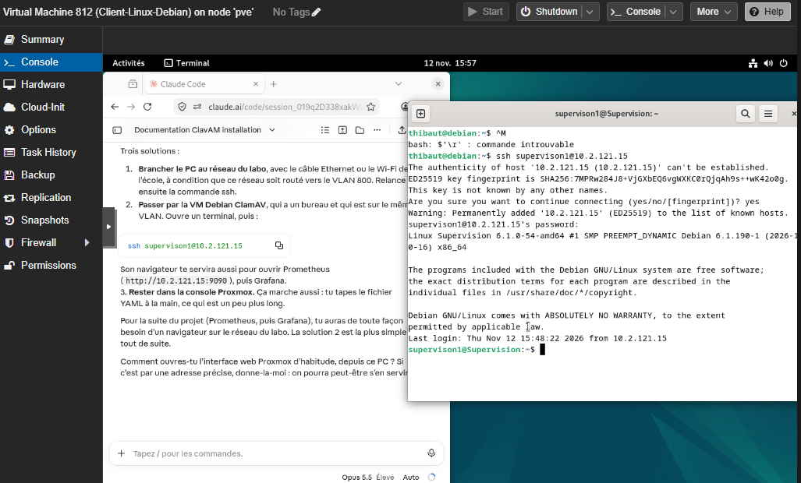

---

## 3. Étape 2 : Prometheus et node_exporter

### 3.1 Installation

J'utilise le paquet Debian (version 2.42), plus simple à maintenir qu'une installation manuelle :

```bash
apt update
apt install -y prometheus
```

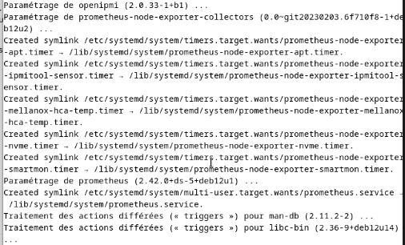

**Résultat :** le paquet `prometheus` (2.42.0) installe aussi **`prometheus-node-exporter`** et ses collecteurs. Ceux-ci ajoutent des timers systemd (`apt`, `smartmon`, `nvme`…) qui déposent des fichiers `.prom` dans `/var/lib/prometheus/node-exporter/`. C'est ce même mécanisme que j'utilise à l'étape 5.

```bash
systemctl status prometheus prometheus-node-exporter grafana-server --no-pager
```

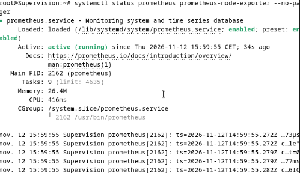
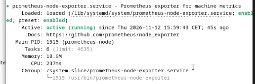

Les deux services sont `active (running)` et `enabled` : ils redémarrent avec la VM.

### 3.2 Configuration

La configuration se trouve dans `/etc/prometheus/prometheus.yml`. J'y ai ajouté un label **`machine`** sur chaque cible, pour savoir d'un coup d'œil de quelle VM vient une métrique. Après chaque modification, je vérifie la syntaxe avec `promtool` avant de redémarrer :

```bash
promtool check config /etc/prometheus/prometheus.yml && systemctl restart prometheus
```

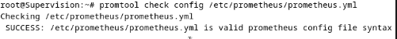

### 3.3 Interface web

L'interface est accessible sur **`http://10.2.121.15:9090`** :

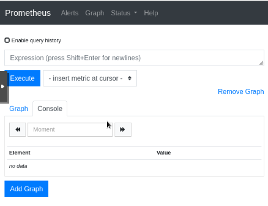

Dans **Status → Targets**, les deux cibles sont **UP** :

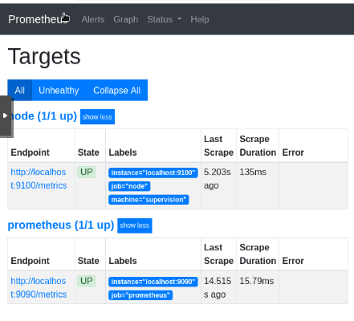

La requête `up` vaut **1** pour chaque cible joignable :

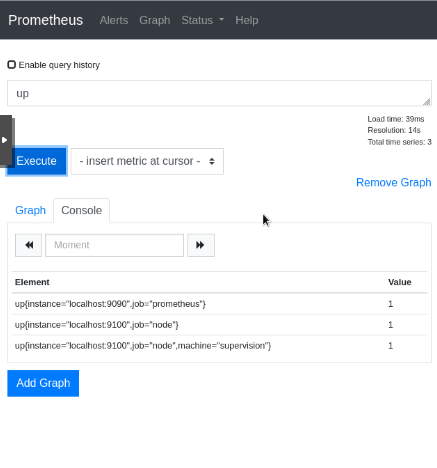

On voit 3 lignes pour 2 cibles : la ligne `localhost:9100` **sans** label `machine` est l'ancienne série, d'avant l'ajout du label. Prometheus la garde affichée quelques minutes, puis elle disparaît.

---

## 4. Étape 3 : superviser la VM ClamAV

### 4.1 node_exporter sur la VM ClamAV

Sur la VM 812, en root :

```bash
apt install -y prometheus-node-exporter
systemctl status prometheus-node-exporter --no-pager
ss -tlnp | grep 9100
```

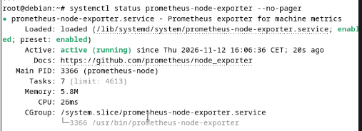
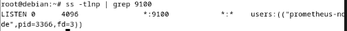

**Résultat :** le service tourne et écoute sur le port **9100**, sur toutes les interfaces (`*:9100`), donc il est joignable depuis SUPERVISION.

### 4.2 Test depuis SUPERVISION : la VM ClamAV avait changé d'IP

Au moment de cette étape, la VM ClamAV avait l'adresse `10.2.121.10` :

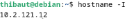

Le test depuis SUPERVISION a d'abord échoué parce que `curl` n'était pas installé (voir [§ 10.3](#103-curl-absent-sur-supervision)) :

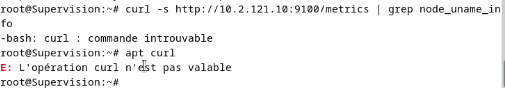

Une fois `curl` installé, il n'y avait toujours **aucune réponse** :

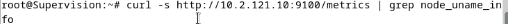

J'ai cherché la cause pas à pas :

| Test | Résultat | Conclusion |
|---|---|---|
| `ping 10.2.121.10` depuis SUPERVISION | `Destination Host Unreachable` | Aucune machine ne répond à cette adresse |
| `curl -v …:9100` | `Aucun chemin d'accès pour atteindre l'hôte cible` | Ce n'est pas un pare-feu : l'hôte est introuvable |
| `ping 10.2.121.15` depuis la VM ClamAV | OK | Le réseau entre les deux VM fonctionne |
| `ip neigh show 10.2.121.10` | `FAILED` | Aucune réponse ARP : l'adresse n'est plus utilisée |
| `ip a` sur la VM ClamAV | `10.2.121.12/24 … dynamic` | **La VM ClamAV avait reçu une nouvelle IP par DHCP** |

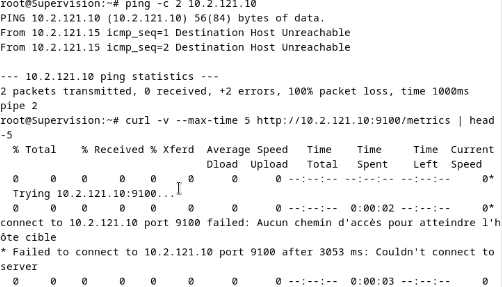
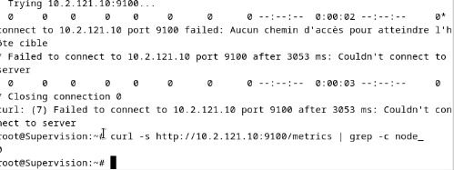
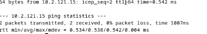
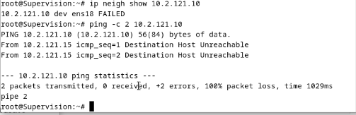
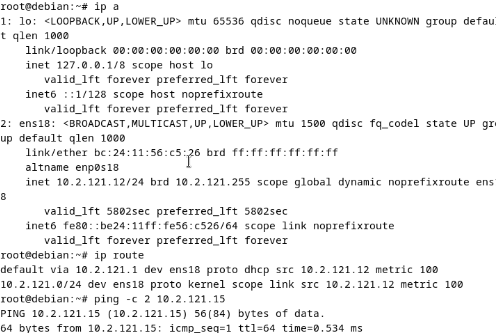

Avec la nouvelle adresse, `node_exporter` répond bien :

```bash
curl -s http://10.2.121.12:9100/metrics | grep node_uname_info
```

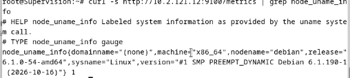

### 4.3 Passage de la VM ClamAV en IP fixe

Une machine supervisée doit garder la même adresse. J'ai d'abord identifié le serveur DHCP :

```bash
nmcli -f DHCP4 device show ens18 | grep -i server
```

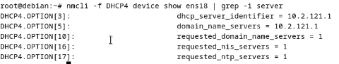

Le DHCP est fourni par la passerelle `10.2.121.1`. La VM ayant un bureau, son réseau est géré par **NetworkManager** : je fixe donc l'adresse avec `nmcli`, en gardant `10.2.121.12`.

```bash
nmcli connection modify "Wired connection 1" ipv4.method manual \
  ipv4.addresses 10.2.121.12/24 ipv4.gateway 10.2.121.1 ipv4.dns "10.2.121.2 10.2.121.1"
nmcli connection up "Wired connection 1"
ip a show ens18
```

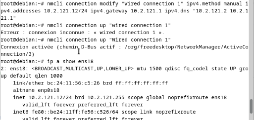

> ⚠️ Le nom de la connexion respecte les majuscules : `"wired connection 1"` donne `Erreur : connexion inconnue`.

L'adresse n'est plus `dynamic`, la route par défaut est maintenant `proto static`, et Internet répond toujours :

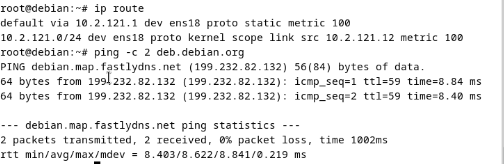

> 💡 La plage du serveur DHCP n'est pas connue : il faudra vérifier que `10.2.121.12` et `10.2.121.15` sont en dehors, pour éviter un conflit d'adresses.

### 4.4 Ajout de la cible dans Prometheus

J'ai voulu remplacer `10.2.121.10` par `10.2.121.12` avec `sed`, mais `grep` ne trouvait aucune ligne : la cible ClamAV n'avait **jamais été ajoutée** au fichier (voir [§ 10.4](#104-cible-clamav-absente-de-prometheusyml)). Prometheus n'avait donc qu'une cible `node` :

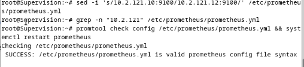
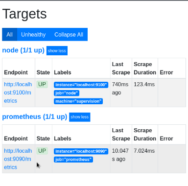
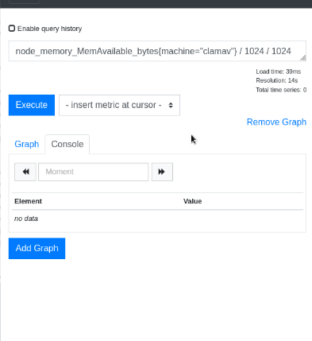

J'ai réécrit la section `scrape_configs` avec les deux cibles `node` :

```yaml
scrape_configs:
  - job_name: "prometheus"
    static_configs:
      - targets: ["localhost:9090"]

  - job_name: "node"
    static_configs:
      - targets: ["localhost:9100"]
        labels:
          machine: "supervision"
      - targets: ["10.2.121.12:9100"]
        labels:
          machine: "clamav"
```

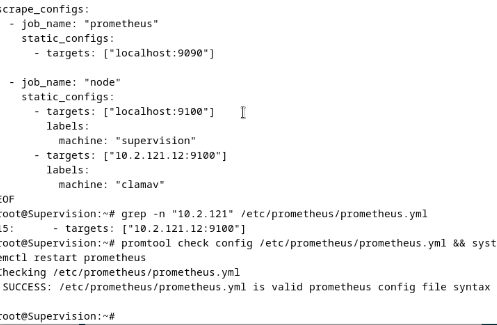

**Résultat :** le job `node` a maintenant **2 cibles sur 2 UP** :

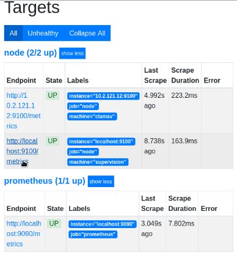

Premier test d'une vraie métrique, la mémoire disponible de la VM ClamAV en Mo :

```
node_memory_MemAvailable_bytes{machine="clamav"} / 1024 / 1024
```

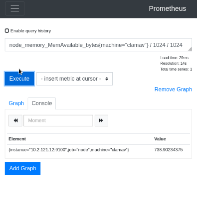

---

## 5. Étape 4 : l'exporter ClamAV

### 5.1 clamd en TCP

`clamav_exporter` dialogue avec `clamd`. Par défaut, `clamd` n'écoute que sur un socket Unix. Je lui ajoute un socket **TCP limité à la machine elle-même** (`127.0.0.1`), pour qu'il ne soit pas exposé sur le réseau.

```bash
cat >> /etc/clamav/clamd.conf <<'EOF'
TCPSocket 3310
TCPAddr 127.0.0.1
EOF

mkdir -p /etc/systemd/system/clamav-daemon.socket.d
cat > /etc/systemd/system/clamav-daemon.socket.d/tcp.conf <<'EOF'
[Socket]
ListenStream=127.0.0.1:3310
EOF

systemctl daemon-reload
systemctl restart clamav-daemon.socket clamav-daemon
ss -tlnp | grep 3310
```

Sur Debian, `clamd` est lancé par **activation de socket** (`clamav-daemon.socket`) : c'est systemd qui ouvre les ports. Il faut donc déclarer le port à la fois dans `clamd.conf` et dans un drop-in du socket systemd.

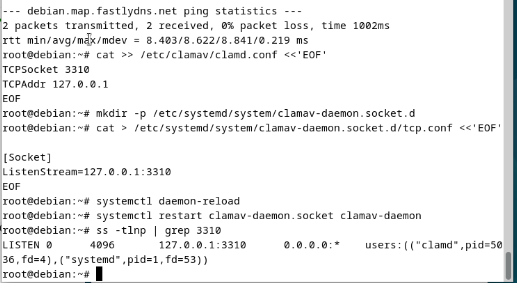

### 5.2 Installation de clamav_exporter

J'utilise [sergeymakinen/clamav_exporter](https://github.com/sergeymakinen/clamav_exporter) en version **2.1.13**. Il n'existe pas en paquet Debian : je télécharge le binaire depuis la page des releases et je vérifie son empreinte SHA-256 avant de l'installer.

```bash
cd /tmp
curl -LO https://github.com/sergeymakinen/clamav_exporter/releases/download/v2.1.13/clamav_exporter_2.1.13_linux_amd64.tar.gz
echo "<empreinte publiée sur la release>  clamav_exporter_2.1.13_linux_amd64.tar.gz" | sha256sum -c
tar xzf clamav_exporter_2.1.13_linux_amd64.tar.gz
install -m 0755 clamav_exporter /usr/local/bin/
clamav_exporter --version
```

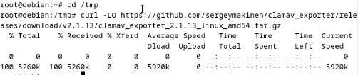
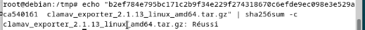
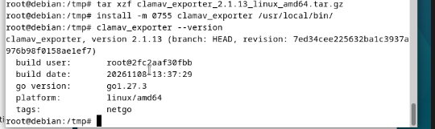

### 5.3 Service systemd

L'exporter tourne sous un **compte système dédié**, sans shell ni dossier personnel : il n'a pas besoin des droits root.

```bash
useradd --system --no-create-home --shell /usr/sbin/nologin clamav_exporter
```

`/etc/systemd/system/clamav-exporter.service` :

```ini
[Unit]
Description=Prometheus ClamAV exporter
After=network-online.target clamav-daemon.service
Wants=network-online.target

[Service]
User=clamav_exporter
ExecStart=/usr/local/bin/clamav_exporter --clamav.address=tcp://127.0.0.1:3310
Restart=on-failure

[Install]
WantedBy=multi-user.target
```

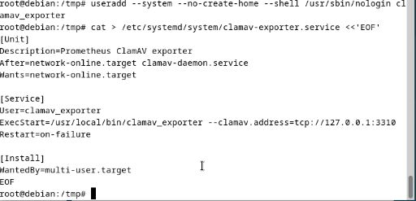

```bash
systemctl daemon-reload && systemctl enable --now clamav-exporter
systemctl status clamav-exporter --no-pager
curl -s http://localhost:9906/metrics | grep -E '^clamav_(up|version|db_)'
```

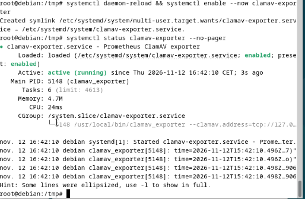
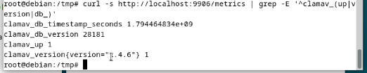

**Résultat :** l'exporter écoute sur le port **9906** :
- `clamav_up 1` : il joint bien `clamd` ;
- `clamav_version` : ClamAV 1.4.6 ;
- `clamav_db_version 28181` : version de la base de signatures ;
- `clamav_db_timestamp_seconds` : date de cette base.

### 5.4 Job clamav dans Prometheus

Sur SUPERVISION :

```bash
cat >> /etc/prometheus/prometheus.yml <<'EOF'

  - job_name: "clamav"
    static_configs:
      - targets: ["10.2.121.12:9906"]
        labels:
          machine: "clamav"
EOF
promtool check config /etc/prometheus/prometheus.yml && systemctl restart prometheus
```

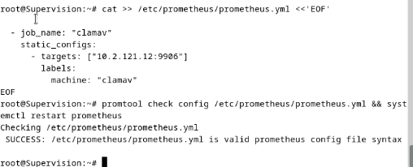
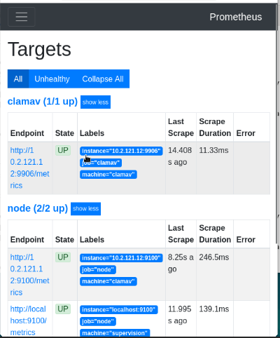

Requêtes de vérification :

| Requête | Valeur | Signification |
|---|---|---|
| `clamav_up` | 1 | `clamd` répond |
| `clamav_db_version` | 28181 | Version de la base `daily` |
| `(time() - clamav_db_timestamp_seconds) / 3600` | 9,28 | Âge des signatures en heures, futur seuil d'alerte |
| `clamav_memory_used_bytes / 1024 / 1024` | *no data* | Voir [§ 10.5](#105-clamav_memory_used_bytes-sans-données) |

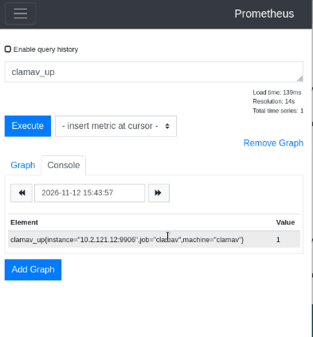
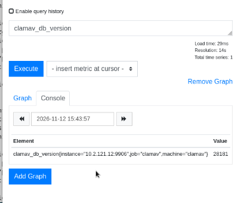
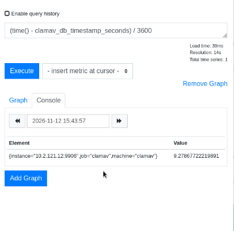
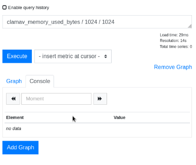

> 💡 L'heure affichée dans le champ « Moment » de Prometheus est en **UTC** (15:43 UTC = 16:43 à Paris).

---

## 6. Étape 5 : script de métriques ClamAV et ClamUI

### 6.1 Principe

`clamav_exporter` dit si `clamd` fonctionne, mais pas ce que font **mes** usages de ClamAV : tri des CV, quarantaine, scan hebdomadaire, analyses lancées depuis ClamUI. Ces informations sont dans des journaux, des dossiers et des fichiers de ClamUI.

J'ai écrit un script qui lit ces sources toutes les 5 minutes et écrit le résultat dans un fichier `.prom`, dans le dossier du **collecteur textfile** de node_exporter. Prometheus récupère alors ces valeurs via le port 9100, qu'il interroge déjà : **aucun port à ouvrir et aucune modification de `prometheus.yml`**.

### 6.2 Inventaire sur la VM ClamAV

Avant d'écrire le script, j'ai vérifié ce qui existe vraiment sur la VM.

```bash
ls -ld /var/lib/prometheus/node-exporter
curl -s localhost:9100/metrics | grep -m5 textfile
```

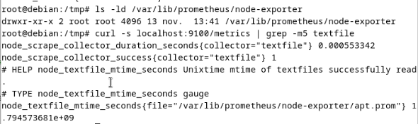

Le dossier existe, et `node_scrape_collector_success{collector="textfile"} 1` montre que le collecteur fonctionne : il lit déjà le `apt.prom` des timers du paquet Debian.

```bash
ls -la /var/quarantaine /var/www/data/cv_incoming /var/www/data/cv_safe /var/www/data/cv_infected
ls -la /var/log/clamav/
systemctl is-active clamonacc clamav-daemon
systemctl list-timers scan-home-hebdo.timer --no-pager
crontab -l
```

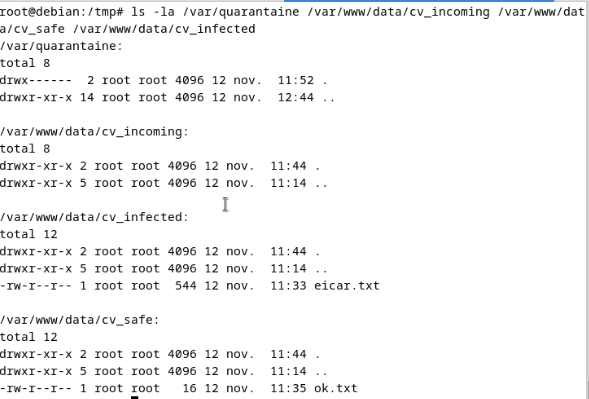
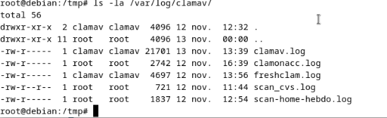
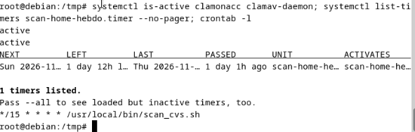

| Source | Emplacement |
|---|---|
| Quarantaine (clamonacc, scan hebdo) | `/var/quarantaine` (vide, `drwx------`) |
| Tri des CV | `/var/www/data/cv_incoming`, `cv_safe`, `cv_infected` |
| Journal du tri des CV | `/var/log/clamav/scan_cvs.log` |
| Journal du temps réel | `/var/log/clamav/clamonacc.log` |
| Journal du scan hebdo | `/var/log/clamav/scan-home-hebdo.log` (timer du dimanche 02:00) |

### 6.3 Le script

```bash
nano /usr/local/bin/clamav_metrics.sh
chmod +x /usr/local/bin/clamav_metrics.sh
```

Contenu complet : [`scripts/clamav_metrics.sh`](scripts/clamav_metrics.sh)

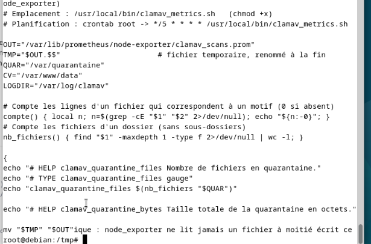

Fonctionnement :

1. Tout ce qui est affiché dans le bloc `{ … }` part dans un fichier **temporaire** (`clamav_scans.prom.<PID>`).
2. Pour chaque métrique, le script écrit une ligne `# HELP` (description), une ligne `# TYPE` (`gauge` = valeur qui monte et descend, `counter` = cumul qui ne fait que monter), puis la valeur.
3. À la fin, le fichier temporaire est **renommé** en `clamav_scans.prom`. Un renommage est atomique : node_exporter ne lit jamais un fichier à moitié écrit.

| Source | Métriques | Calcul |
|---|---|---|
| `/var/quarantaine` | `clamav_quarantine_files`, `clamav_quarantine_bytes` | Nombre et taille des fichiers |
| Dossiers de tri | `clamav_cv_files{dossier="incoming\|safe\|infected"}` | Nombre de fichiers par dossier |
| `scan_cvs.log` | `clamav_cv_scans_total`, `clamav_cv_infected_total` | Lignes horodatées, et lignes finissant par `FOUND` |
| `clamonacc.log` | `clamav_onaccess_detections_total` | Lignes contenant `FOUND` |
| `scan-home-hebdo.log` | `clamav_home_scan_last_timestamp_seconds`, `…_scanned_files`, `…_infected_files` | Date du journal, et derniers `Scanned files:` / `Infected files:` |
| systemd | `clamav_service_active{service="…"}` | `systemctl is-active` pour clamav-daemon, clamonacc et clamav-freshclam |
| Le script | `clamav_metrics_last_run_timestamp_seconds` | Heure d'exécution, pour vérifier qu'il tourne toujours |

### 6.4 Premier lancement

```bash
/usr/local/bin/clamav_metrics.sh && grep -v '^#' /var/lib/prometheus/node-exporter/clamav_scans.prom
curl -s localhost:9100/metrics | grep -E '^clamav_'
```


La première capture montre le fichier écrit par le script, la seconde les mêmes valeurs exposées par node_exporter sur le port 9100 :
- **Tri des CV :** 0 CV en attente, 1 sain (`ok.txt`), 1 infecté (`eicar.txt`). Le journal compte 2 analyses, dont 1 infectée.
- **Scan hebdo :** 4 305 fichiers analysés, 0 infecté. `1794484467` est une date au format epoch (secondes depuis 1970), soit le 12/11 à 12:54.
- **Services :** `clamav-daemon` et `clamonacc` à 1, mais **`clamav-freshclam` à 0** (voir [§ 10.6](#106-clamav-freshclam-arrêté-et-désactivé)).
- node_exporter trie les métriques par ordre alphabétique et écrit les grands nombres en notation scientifique (`1.794484467e+09` = 1794484467).

Deux corrections ont suivi ce premier lancement :

**freshclam relancé :** le service était arrêté et désactivé, donc les signatures n'étaient plus mises à jour.

```bash
systemctl status clamav-freshclam --no-pager
systemctl enable --now clamav-freshclam
```


**Taille de la quarantaine corrigée :** `clamav_quarantine_bytes` valait 4096 avec une quarantaine vide (voir [§ 10.7](#107-taille-de-quarantaine-à-4096-octets-pour-un-dossier-vide)).


freshclam a aussitôt mis à jour la base (`daily.cld` version 28182) et prévenu `clamd` :

```bash
tail -5 /var/log/clamav/freshclam.log
```


### 6.5 Planification par cron

Dans la crontab de root, à côté du tri des CV :

```bash
crontab -e
```

```
*/5 * * * * /usr/local/bin/clamav_metrics.sh
```


Vérification de l'heure du dernier passage, puis preuve dans le journal de cron :

```bash
date -d @$(awk '/^clamav_metrics_last_run/ {print $2}' /var/lib/prometheus/node-exporter/clamav_scans.prom)
journalctl -u cron --since "-20min" --no-pager | grep clamav_metrics
```


La capture 58 (13:56:08) correspond encore à un lancement manuel. Le journal de cron montre ensuite l'exécution automatique de **14:00:01**.

### 6.6 Vérification dans Prometheus

Les métriques arrivent par le job `node`, avec le label `machine="clamav"` :

| Requête | Résultat |
|---|---|
| `clamav_service_active` | 3 services à 1 |
| `clamav_cv_files` | incoming 0, infected 1, safe 1 |
| `time() - clamav_metrics_last_run_timestamp_seconds` | 20 s : âge du dernier passage, doit rester sous 300 s |


### 6.7 Les données de ClamUI

ClamUI est un **Flatpak** lancé par l'utilisateur `thibaut`. Un Flatpak range ses données dans `~/.var/app/<identifiant>/` :

```bash
find /home/thibaut/.var/app/io.github.linx_systems.ClamUI -maxdepth 4 -not -path '*/cache/*' | head -60
find /home/thibaut/.var/app/io.github.linx_systems.ClamUI -type f -not -path '*/cache/*' -exec ls -la {} +
```


Seul `data/clamui/` est utile pour la supervision. Le reste (`CacheStorage`, `WebKitCache`, `hsts-storage.sqlite`, `.ld.so`…) est du cache interne. Les fichiers sont en `-rw-------` (lisibles par `thibaut` seul) : le script, lancé par root, peut les lire.

| Élément | Contenu |
|---|---|
| `logs/log_index.json` | Index de l'onglet **Journaux** de ClamUI |
| `logs/<uuid>.json` | Un fichier par analyse |
| `quarantine.db` | Base **SQLite** de la quarantaine de ClamUI |
| `quarantine/` | Fichiers isolés par ClamUI (distinct de `/var/quarantaine`) |

J'ai lu leur format avec `python3`, déjà présent sur Debian (la base est ouverte en **lecture seule**, `mode=ro`, pour ne pas gêner ClamUI) :

```bash
cd /home/thibaut/.var/app/io.github.linx_systems.ClamUI/data/clamui
python3 -m json.tool logs/log_index.json
python3 -m json.tool logs/9d701c5a-*.json
```


Chaque analyse donne un JSON avec `status` (`clean`, `infected`…), `scanned_files`, `infected_count`, `duration` et `timestamp`. Les heures sont en **UTC** (`+00:00`) : `13:06:14` UTC correspond à 14:06 à Paris.


La table `quarantine` a une colonne **`state`** (`active` = encore isolé, `restored` = restauré, `deleted` = supprimé) et une colonne `file_size`. Les deux tables étaient vides.

J'ai ajouté au script un bloc Python, placé juste avant la ligne `} > "$TMP"`. Il lit tous les journaux d'analyse et interroge la base SQLite :

| Métrique | Signification |
|---|---|
| `clamui_scans_total{status="clean\|infected\|…"}` | Nombre d'analyses par résultat |
| `clamui_scanned_files_total` | Fichiers analysés, toutes analyses confondues |
| `clamui_infected_files_total` | Menaces trouvées, toutes analyses confondues |
| `clamui_last_scan_timestamp_seconds` | Date de la dernière analyse (UTC convertie en epoch) |
| `clamui_last_scan_infected_files` | Menaces trouvées lors de la dernière analyse |
| `clamui_quarantine_files{state="active\|restored\|deleted"}` | Contenu de la quarantaine ClamUI |
| `clamui_quarantine_bytes` | Taille des fichiers encore en quarantaine |

Si ClamUI n'a aucun historique, ou si ses fichiers sont absents, le script affiche des 0 au lieu de s'arrêter.

```bash
/usr/local/bin/clamav_metrics.sh && grep '^clamui' /var/lib/prometheus/node-exporter/clamav_scans.prom
date -d @$(awk '/^clamui_last_scan_timestamp/ {print $2}' /var/lib/prometheus/node-exporter/clamav_scans.prom)
```


**Résultat :** on retrouve mes 2 analyses du 12/11 (1 propre, 1 avec EICAR). La dernière date du **12/11 à 14:18:47** heure de Paris : la conversion depuis l'UTC est correcte.

### 6.8 Test de bout en bout

J'ai vérifié toute la chaîne avec une vraie détection : ClamUI → script (cron) → node_exporter → Prometheus.

En tant que `thibaut`, je copie un fichier de test de ClamAV dans les Téléchargements, puis je lance ClamUI (jamais en root) :

```bash
cp /usr/share/clamav-testfiles/clam.exe ~/Téléchargements/test-supervision.exe
flatpak run io.github.linx_systems.ClamUI
```


J'analyse `/home/thibaut/Téléchargements`, puis je mets les menaces en quarantaine :


L'analyse de 14:24:24 trouve **2 menaces** :
- `test-supervision.exe` (`Clamav.Test.File-6`), le fichier que je venais de copier ;
- `eicar.txt` (`Eicar-Test-Signature`), le fichier EICAR de la veille, resté sur place car il n'avait pas été mis en quarantaine (voir [§ 10.8](#108-fichier-eicar-non-bloqué-par-clamonacc)).

Après le passage du cron, Prometheus affiche :

| Requête | Avant | Après |
|---|---|---|
| `clamui_scans_total{status="infected"}` | 1 | **2** |
| `clamui_quarantine_files{state="active"}` | 0 | **2** |
| `clamui_infected_files_total` | 1 | **3** |


**La chaîne complète fonctionne :** une analyse faite dans ClamUI apparaît dans Prometheus au plus 5 minutes plus tard.

---

## 7. Étape 6 : Grafana relié à Prometheus

Grafana affiche les métriques de Prometheus sous forme de tableaux de bord. Je l'installe sur **SUPERVISION**, à côté de Prometheus. Il ne stocke aucune métrique lui-même : il interroge Prometheus à chaque affichage.

### 7.1 Installation depuis le dépôt officiel

Grafana n'est pas dans les dépôts Debian. J'ajoute le dépôt APT de Grafana Labs, signé par leur clé GPG : `apt` vérifie ainsi que les paquets viennent bien d'eux. Sur SUPERVISION, en root :

```bash
apt update && apt install -y curl gnupg apt-transport-https
mkdir -p /etc/apt/keyrings
curl -fsSL https://apt.grafana.com/gpg.key | gpg --dearmor -o /etc/apt/keyrings/grafana.gpg
echo "deb [signed-by=/etc/apt/keyrings/grafana.gpg] https://apt.grafana.com stable main" > /etc/apt/sources.list.d/grafana.list
apt update && apt install -y grafana
systemctl daemon-reload && systemctl enable --now grafana-server
```

| Élément | Rôle |
|---|---|
| `/etc/apt/keyrings/grafana.gpg` | Clé publique de Grafana Labs, convertie au format binaire par `gpg --dearmor` |
| `signed-by=…` | Cette clé n'est utilisée **que** pour ce dépôt, et pas pour les dépôts Debian |
| `/etc/apt/sources.list.d/grafana.list` | Déclaration du dépôt `stable` de Grafana |

Vérifications :

```bash
systemctl status grafana-server --no-pager
ss -tlnp | grep 3000
grafana server -v
systemctl is-active grafana-server; systemctl is-enabled grafana-server
```


**Résultat :**
- **Grafana 13.3.1** est installé.
- Le service est `active` et `enabled`, donc il redémarre avec la VM.
- Il écoute sur **`*:3000`**, donc il est joignable depuis le réseau.
- Les lignes `plugins-bundled` sont les plugins livrés avec Grafana, dont celui de Prometheus.

### 7.2 Première connexion

Depuis le navigateur de la VM ClamAV, j'ouvre **`http://10.2.121.15:3000`**. Je me connecte avec les identifiants par défaut `admin` / `admin`, et Grafana oblige à changer ce mot de passe dès la première connexion.

> ⚠️ Le nouveau mot de passe est gardé dans un gestionnaire de mots de passe, jamais dans la doc ni dans le dépôt (public). Laisser `admin/admin` permettrait à n'importe qui sur le réseau d'administrer Grafana.
> Ce compte `admin` local restera le **compte de secours** après l'étape 7 (connexion avec l'Active Directory), au cas où l'AD ne répondrait plus.


### 7.3 Ajout de Prometheus comme source de données

Grafana et Prometheus sont sur la même VM : Grafana joint donc Prometheus par `localhost`, sans passer par le réseau.

**Menu ☰ → Connections → Data sources → Add new data source → Prometheus**


| Champ | Valeur |
|---|---|
| Name | `prometheus` |
| Default | Activé (source utilisée par défaut dans les nouveaux panneaux) |
| Prometheus server URL | `http://localhost:9090` |
| Authentication | No Authentication |

**Save & test** affiche **« Successfully queried the Prometheus API »**. Le bouton **Remove default** confirme que c'est la source par défaut.


### 7.4 Vérification dans Explore

**Explore** permet de lancer des requêtes PromQL sans créer de tableau de bord. J'utilise l'éditeur en mode **Code**.


| Requête | Résultat |
|---|---|
| `up` | 4 séries à 1 : prometheus, node supervision, node clamav, clamav (port 9906) |
| `clamav_service_active` | clamav-daemon, clamav-freshclam et clamonacc à 1. freshclam est toujours actif depuis sa réactivation du 13/11. |
| `clamui_infected_files_total` | 3, la valeur atteinte lors du test de bout en bout de l'étape 5 |


Grafana affiche donc bien toutes les métriques collectées par Prometheus : celles des exporters et celles de mon script. Les heures sont affichées dans le fuseau du navigateur (heure de Paris), alors que Prometheus affiche l'UTC.

---

## 8. Étape 7 : connexion à Grafana avec l'Active Directory

Au lieu de créer des comptes locaux dans Grafana, les utilisateurs se connectent avec **leur compte Windows** de l'Active Directory `gsblolo.local` (contrôleur de domaine `10.2.121.2`). Les droits dans Grafana sont donnés par l'appartenance à des **groupes AD** : tout se gère depuis l'AD.

### 8.1 Principe

```
Navigateur ──(L.Bodet + mot de passe)──▶ Grafana (SUPERVISION)
                                          │ 1. se connecte à l'AD avec svc-grafana
                                          │ 2. cherche (sAMAccountName=L.Bodet) dans l'OU Utilisateurs
                                          │ 3. vérifie le mot de passe saisi auprès de l'AD
                                          │ 4. lit ses groupes (memberOf) -> rôle Grafana
                                          ▼
                                 AD-DC 10.2.121.2 (LDAP, port 389)
```

| Groupe AD | Rôle dans Grafana | Membres |
|---|---|---|
| `GG_Grafana_Admins` | **Admin** + administrateur du serveur Grafana | Bodet Loic |
| `GG_Grafana_Lecteurs` | **Viewer** (consultation seule) | Les 7 autres utilisateurs de l'OU |

Un utilisateur qui n'est dans **aucun** de ces groupes, ou qui est hors de l'OU `Utilisateurs`, ne peut pas se connecter.

### 8.2 Préparation de l'AD

Mes utilisateurs sont dans l'OU **Services → Utilisateurs**, soit `OU=Utilisateurs,OU=Services,DC=gsblolo,DC=local`, et mes groupes dans `OU=Groupes,OU=Services,…`.


Sur le contrôleur de domaine, en PowerShell administrateur, je vérifie le chemin de l'OU et les identifiants de connexion (`SamAccountName`, de la forme `L.Bodet`) :

```powershell
Get-ADUser -Filter * -SearchBase "OU=Utilisateurs,OU=Services,DC=gsblolo,DC=local" | Format-Table Name,SamAccountName
```


**Le compte de service.** Grafana doit se connecter à l'AD avec un compte à lui pour chercher les utilisateurs. Son mot de passe est écrit en clair dans un fichier sur SUPERVISION : je n'utilise donc **pas** le compte `Administrateur` du domaine. Si ce fichier était lu, tout le domaine serait compromis. Je crée un compte dédié **sans aucun droit particulier**, car un simple utilisateur peut déjà lire l'annuaire. C'est le principe du **moindre privilège**.

```powershell
New-ADUser -Name "svc-grafana" -SamAccountName "svc-grafana" -UserPrincipalName "svc-grafana@gsblolo.local" -Path "CN=Users,DC=gsblolo,DC=local" -Description "Compte de service LDAP pour Grafana (lecture seule)" -AccountPassword (Read-Host -AsSecureString "Mot de passe de svc-grafana") -Enabled $true -PasswordNeverExpires $true -CannotChangePassword $true

New-ADGroup -Name "GG_Grafana_Admins" -GroupScope Global -GroupCategory Security -Path "OU=Groupes,OU=Services,DC=gsblolo,DC=local" -Description "Administrateurs de Grafana"
New-ADGroup -Name "GG_Grafana_Lecteurs" -GroupScope Global -GroupCategory Security -Path "OU=Groupes,OU=Services,DC=gsblolo,DC=local" -Description "Lecteurs de Grafana (consultation)"
```

| Choix | Raison |
|---|---|
| `svc-grafana` dans `CN=Users`, hors de l'OU Utilisateurs | Le compte de service ne doit pas pouvoir se connecter à Grafana |
| `Read-Host -AsSecureString` | Le mot de passe n'apparaît ni à l'écran ni dans l'historique PowerShell |
| `PasswordNeverExpires` | Évite que la connexion tombe en panne à l'expiration du mot de passe |
| Groupes `GG_…` globaux de sécurité | Convention de nommage des groupes globaux |


```powershell
Add-ADGroupMember -Identity "GG_Grafana_Admins" -Members (Get-ADUser -Filter "Name -eq 'Bodet Loic'")
Add-ADGroupMember -Identity "GG_Grafana_Lecteurs" -Members (Get-ADUser -Filter "Name -ne 'Bodet Loic'" -SearchBase "OU=Utilisateurs,OU=Services,DC=gsblolo,DC=local")
```


### 8.3 Test de l'annuaire depuis SUPERVISION

Avant de configurer Grafana, je vérifie avec `ldapsearch` que SUPERVISION lit bien l'annuaire avec `svc-grafana`. Ce sont exactement les opérations que Grafana fera ensuite. Si ce test réussit, il reste seulement à recopier les paramètres dans Grafana. S'il échoue, le problème vient du réseau ou de l'AD, pas de Grafana.

```bash
apt install -y ldap-utils
ldapsearch -x -H ldap://10.2.121.2 -D "svc-grafana@gsblolo.local" -W \
  -b "OU=Utilisateurs,OU=Services,DC=gsblolo,DC=local" "(sAMAccountName=L.Bodet)" cn sAMAccountName memberOf
```

| Option | Rôle |
|---|---|
| `-x` | Authentification simple, par identifiant et mot de passe |
| `-H ldap://10.2.121.2` | Contrôleur de domaine, port 389 |
| `-D` / `-W` | Compte qui se connecte, et demande de son mot de passe sans l'afficher |
| `-b` | Où chercher : l'OU Utilisateurs |
| `(sAMAccountName=…)` | Qui chercher |


**Résultat :** `result: 0 Success`. `L.Bodet` est membre de `GG_Grafana_Admins` (et de `DSI`), `T.Huet` de `GG_Grafana_Lecteurs`. Une ligne `memberOf::` (deux fois `:`) est une valeur encodée en base64 par `ldapsearch`, parce que le nom du groupe contient des accents.

### 8.4 Configuration de Grafana

**Activation de LDAP** dans `/etc/grafana/grafana.ini` (après une copie de sauvegarde en `.bak`), section `[auth.ldap]` :

```ini
[auth.ldap]
enabled = true
config_file = /etc/grafana/ldap.toml
allow_sign_up = true
```

`allow_sign_up = true` permet à Grafana de créer le compte d'un utilisateur AD à sa première connexion.


![Section [auth.ldap] corrigée](images/105-grafana-ini-corrige.png)

Ma première modification n'avait pas enlevé les `;` en début de ligne, donc LDAP restait désactivé (voir [§ 10.9](#109-ldap-non-activé--lignes-restées-en-commentaire)).

**Paramètres de connexion** dans `/etc/grafana/ldap.toml`. Le modèle, sans le mot de passe, est dans [`config/ldap.toml`](config/ldap.toml) :

| Paramètre | Valeur | Rôle |
|---|---|---|
| `host` / `port` | `10.2.121.2` / `389` | Contrôleur de domaine |
| `bind_dn` / `bind_password` | `svc-grafana@gsblolo.local` / *(secret)* | Compte de service |
| `search_filter` | `(sAMAccountName=%s)` | `%s` est remplacé par l'identifiant saisi |
| `search_base_dns` | `OU=Utilisateurs,OU=Services,…` | Seuls les comptes de cette OU sont cherchés |
| `[servers.attributes]` | `givenName`, `sn`, `sAMAccountName`, `memberOf`, `mail` | Champs AD recopiés dans le profil Grafana |
| `[[servers.group_mappings]]` | `GG_Grafana_Admins` → Admin, `GG_Grafana_Lecteurs` → Viewer | Groupes AD → rôles |


J'ai d'abord écrit le fichier avec `A_REMPLACER` à la place du mot de passe, puis j'ai mis le vrai mot de passe avec `nano`. Sinon, il serait resté dans l'historique de bash. Le fichier est ensuite protégé :

```bash
chown root:grafana /etc/grafana/ldap.toml && chmod 640 /etc/grafana/ldap.toml
systemctl restart grafana-server
```


### 8.5 Tests de connexion

| Test | Compte | Résultat |
|---|---|---|
| Administrateur | `L.Bodet` | Connecté, menu **Administration** disponible, compte créé avec l'origine **LDAP** et l'adresse `l.bodet@gsblolo.local` lue dans l'AD |
| Lecteur | `T.Huet` | Connecté avec le rôle **Viewer** dans *Main Org.* |
| Refus | `svc-grafana` | **Refusé** : « Invalid username or password » |


Le journal de Grafana confirme le fonctionnement :

```bash
journalctl -u grafana-server --since "-5min" --no-pager | grep -iE "ldap|login|auth"
```


| Ligne du journal | Signification |
|---|---|
| `Cannot bind user CN=Huet Thibault… invalid username or password` | Compte trouvé, mais l'AD a refusé le mot de passe saisi : c'est **l'AD** qui vérifie les mots de passe, Grafana ne les stocke pas |
| `did not find a user` (pour `svc-grafana`) | Le compte existe dans l'AD, mais il est hors de l'OU cherchée, donc il est ignoré |

L'écran affiche le même message dans les deux cas : un attaquant ne peut pas savoir si un compte existe.

> 💡 Le compte `admin` local de Grafana reste utilisable : c'est le **compte de secours** si l'AD ne répond plus.

> ⚠️ **Limite :** en LDAP sur le port 389, le mot de passe saisi passe **en clair** entre SUPERVISION et le contrôleur de domaine. Amélioration à prévoir : **LDAPS** (port 636, chiffré), qui demande un certificat sur le contrôleur de domaine.

---

## 9. Étape 8 : tableau de bord et alertes

### 9.1 Le tableau de bord ClamAV

Je n'ai pas créé les panneaux un par un dans l'interface : le tableau de bord est décrit en **JSON**, le format d'export de Grafana, et je l'importe. Le fichier [`config/dashboard-clamav.json`](config/dashboard-clamav.json) est dans le dépôt : on peut donc recréer le tableau de bord à l'identique.

| Ligne | Panneaux |
|---|---|
| **État** | Cibles Prometheus (UP/DOWN), services ClamAV (Actif/Arrêté), clamd joignable, version de la base, âge des signatures (vert < 24 h < orange < 48 h < rouge), dernier passage du script, fichiers en quarantaine (`/var/quarantaine` et ClamUI) |
| **Menaces détectées** | Nouvelles menaces ClamUI, nouveaux CV infectés, nouvelles détections en temps réel (sur la période affichée), menaces du dernier scan hebdomadaire, courbe des cumuls |
| **Analyses et tri des CV** | Dernière analyse ClamUI, dernier scan hebdomadaire, fichiers analysés, analyses ClamUI par résultat, dossiers de tri des CV |
| **Système de la VM ClamAV** | CPU, mémoire disponible, disque `/` (seuil à 85 %) |

**Import :** dans le navigateur de la VM ClamAV, j'ouvre le fichier brut sur GitHub et je copie son contenu. Dans Grafana : **Dashboards → New → Import**, je colle le JSON, je choisis la source **prometheus**, puis **Import**.


J'ai corrigé deux défauts de conception en cours de route, en réimportant le fichier avec **Import (Overwrite)** :

1. **Cumuls toujours rouges :** les cases de menaces affichaient des totaux depuis le début (ClamUI 3, CV 1). Avec un seuil rouge dès 1, elles seraient restées rouges pour toujours. Elles comptent maintenant les **nouvelles** menaces de la période affichée, avec `round(increase(…[$__range]))`. Les cumuls restent visibles dans la courbe.
2. **Valeurs en retard :** les cases d'état utilisaient des requêtes sur une période (*range*). Sur 24 h, Grafana ne prend qu'un point toutes les quelques minutes, et la « dernière valeur » pouvait dater d'avant un changement. clamonacc était réparé, mais il restait affiché « Arrêté » (capture 165). Les 14 requêtes des cases sont passées en **requêtes instantanées** : elles affichent la valeur du moment.


### 9.2 Ce que le tableau de bord a révélé : deux quarantaines

Dès le premier affichage, la case **« Menaces au dernier scan hebdo »** est passée au rouge avec la valeur **2**, alors que `/var/quarantaine` était vide.

```bash
grep -E "FOUND|moved|ERROR|Infected files|Start Date" /var/log/clamav/scan-home-hebdo.log | tail -15
```


Le scan du **dimanche 15/11 à 02:00** a trouvé les 2 fichiers que **ClamUI avait mis dans sa propre quarantaine**. Cette quarantaine est rangée dans `/home/thibaut/.var/app/…`, donc à l'intérieur de `/home`, que le scan hebdomadaire analyse. Il les a déplacés… mais pas dans `/var/quarantaine`, dont la date de modification n'avait pas changé depuis le 12/11.

```bash
stat -c '%y  %n' /var/quarantaine && findmnt -T /var/quarantaine
systemctl cat scan-home-hebdo.service
find / -path /proc -prune -o \( -name '*eicar*' -o -name '*test-supervision*' \) -print 2>/dev/null
journalctl -u scan-home-hebdo --since "2026-11-15 01:55" --until "2026-11-15 03:00" --no-pager
```


**Cause :** sur la VM, le service contenait **`--move=/var/quarantine`**, en orthographe anglaise. Il y avait donc deux dossiers : `/var/quarantaine`, surveillé, et `/var/quarantine`, invisible pour la supervision, avec 3 fichiers infectés.

**Corrections :**

```bash
# Bon dossier + exclusion de la quarantaine de ClamUI
sed -i 's#--move=/var/quarantine #--move=/var/quarantaine --exclude-dir=^/home/[^/]+/.var/app/io.github.linx_systems.ClamUI/data/clamui/quarantine #' /etc/systemd/system/scan-home-hebdo.service
systemctl daemon-reload
# Regroupement des fichiers ; un verrou caché (.clamav-quarantine-lock.*) empêchait rmdir
mv /var/quarantine/* /var/quarantaine/
rm /var/quarantine/.clamav-quarantine-lock.5037.0 && rmdir /var/quarantine
# Vérification immédiate
systemctl start scan-home-hebdo.service
```


Mon script comptait aussi les fichiers cachés : pendant un scan, le verrou de `clamscan` aurait été compté comme un fichier en quarantaine. Il ignore maintenant les noms qui commencent par un point (`! -name '.*'`).


**Remise en ordre de ClamUI :** sa base indiquait toujours 2 fichiers en quarantaine, alors qu'ils n'y étaient plus. Le bouton **Supprimer** échouait avec `Aucun fichier ou dossier de ce nom (os error 2)`. Avec ClamUI fermé, et en tant que `thibaut`, propriétaire de la base, j'ai fait une sauvegarde de `quarantine.db`. J'ai d'abord passé les deux entrées à l'état `deleted`, mais ClamUI les affichait toujours. Je les ai donc supprimées.

```bash
cd ~/.var/app/io.github.linx_systems.ClamUI/data/clamui && cp quarantine.db quarantine.db.bak
python3 -c "import sqlite3; c=sqlite3.connect('quarantine.db'); c.execute(\"DELETE FROM quarantine WHERE state='deleted'\"); c.commit()"
```


> ⚠️ Le script doit tourner en tant que `thibaut`, ClamUI fermé (`flatpak ps` vide). Si root écrivait dans la base, SQLite pourrait créer des fichiers temporaires appartenant à root, et ClamUI ne pourrait plus écrire. Si ClamUI tournait encore, il pourrait réécrire ses propres données en se fermant.

**Limite de l'analyse complète de ClamUI :** une analyse de `/` lancée depuis ClamUI a annoncé « Sain, 0 menace ». En réalité, elle **n'avait pas pu lire 78 161 fichiers**. En mode `daemon`, c'est `clamd`, avec le compte `clamav`, qui lit les fichiers, et il n'a pas accès à une grande partie du système. Le CV infecté de `/var/www/data/cv_infected` n'a pas été signalé, alors que `clamdscan --fdpass` le détecte bien. **« Sain » ne veut pas dire « tout a été analysé ».** L'analyse complète du système est le rôle du scan hebdomadaire, qui tourne en root.


### 9.3 Les alertes

Les alertes sont visibles **dans Grafana**, sans envoi par e-mail, faute de serveur de messagerie. Elles sont décrites dans un fichier de **provisioning** que Grafana charge au démarrage : [`config/alertes-clamav.yaml`](config/alertes-clamav.yaml). C'est plus fiable que 7 règles saisies à la main, et le fichier est versionné dans le dépôt.

| Règle | Se déclenche si… | Délai | Gravité |
|---|---|---|---|
| Cible Prometheus injoignable | `up` = 0 | 2 min | critical |
| Service ClamAV arrêté | `clamav_service_active` = 0 | 5 min | critical |
| clamd injoignable | `clamav_up` = 0 | 5 min | critical |
| Signatures ClamAV trop anciennes | Âge de la base > 48 h | 30 min | warning |
| Script de métriques arrêté | Dernier passage > 15 min | 5 min | warning |
| Nouvelle menace détectée | Une détection ClamUI, CV ou temps réel dans les 15 dernières min | immédiat | critical |
| Menace au scan hebdomadaire | Le scan de moins de 24 h a trouvé des fichiers infectés | immédiat | critical |

Le **délai** (*pending period*) évite les fausses alertes : un service redémarré en quelques secondes ne déclenche rien. Les règles sont évaluées **toutes les minutes**.

Installation sur SUPERVISION :

```bash
curl -fsSL -o /etc/grafana/provisioning/alerting/alertes-clamav.yaml "https://raw.githubusercontent.com/Ghouly-alt/INFRA-SISR-Loic/main/AP%201/Supervision/config/alertes-clamav.yaml"
# UID de la source de données, récupéré automatiquement (sans le recopier à la main)
UID_PROM=$(curl -s -u admin http://localhost:3000/api/datasources/name/prometheus | grep -o '"uid":"[^"]*"' | cut -d'"' -f4)
sed -i -E "/datasourceUid: __expr__/! s/(datasourceUid: ).*/\1$UID_PROM/" /etc/grafana/provisioning/alerting/alertes-clamav.yaml
chown root:grafana /etc/grafana/provisioning/alerting/alertes-clamav.yaml && chmod 640 /etc/grafana/provisioning/alerting/alertes-clamav.yaml
systemctl restart grafana-server
```


Au premier chargement, les 7 règles étaient en erreur **« data source not found »** : le fichier contenait littéralement `TON_UID` (voir [§ 10.14](#1014-alertes--data-source-not-found-)). Avec l'UID récupéré automatiquement, elles sont passées en **Normal**.


> 💡 Dans la liste, les résumés s'affichent avec leurs modèles (`{{ $labels.service }}`). Grafana ne les remplit qu'au moment où une alerte se déclenche.

### 9.4 Test : la panne de clamonacc

Pour tester l'alerte « Service ClamAV arrêté », j'ai arrêté `clamonacc`. L'historique de la règle a montré quelque chose d'inattendu : l'alerte était passée en **Pending dès 14:40:37**, donc **avant** mon arrêt volontaire de 14:41:32.


Après la relance, l'alerte restait en **Firing** : le service était en réalité **`failed`**, une seconde après son démarrage.

```bash
systemctl status clamonacc --no-pager
tail -15 /var/log/clamav/clamonacc.log
```


**Cause :** le service clamonacc de la VM contenait lui aussi **`--move=/var/quarantine`**. Tant que ce dossier existait, clamonacc démarrait. Quand je l'ai supprimé vers 14:00, clamonacc a continué de tourner, car il n'a besoin de ce dossier qu'au démarrage. Dès le premier redémarrage, à 14:36, il a échoué en boucle avec `Failed to get realpath of /var/quarantine` et `can't setup client`. **L'analyse en temps réel a été coupée de 14:36 à 15:53**, et c'est l'alerte qui l'a révélé.

```bash
grep -rn "/var/quarantine" /etc/systemd/system /etc/clamav /usr/local/bin /etc/crontab /var/spool/cron
sed -i 's#/var/quarantine#/var/quarantaine#g' /etc/systemd/system/clamonacc.service
systemctl daemon-reload && systemctl restart clamonacc && sleep 10 && systemctl is-active clamonacc
```


| Heure | Événement | État de la règle |
|---|---|---|
| ~14:00 | Suppression de `/var/quarantine` (clamonacc tourne encore) | Normal |
| 14:36 | Arrêt puis redémarrage : clamonacc échoue | — |
| 14:40:37 | Le script relève clamonacc à 0 | **Pending** |
| 14:45:37 | Confirmé après 5 minutes | **Alerting** |
| 15:49 | Redémarrage de Grafana (étiquette `severity`) : nouvelle instance | Pending |
| 15:53:41 | clamonacc corrigé et relancé | — |
| 15:55:37 | `A=1`, `C=0` | **Normal** |

**Gravité « Unknown » :** sur la page d'accueil, Grafana ne reconnaît que l'étiquette anglaise `severity`. J'ai remplacé `severite: critique` par `severity: critical` (voir [§ 10.15](#1015-gravité--unknown--sur-la-page-daccueil)).


### 9.5 Analyse en temps réel des Téléchargements de thibaut

Le journal de clamonacc le confirmait : seul `/home/flo/Téléchargements` était surveillé. J'ai ajouté les Téléchargements de `thibaut` :

```bash
cp /etc/clamav/clamd.conf /etc/clamav/clamd.conf.bak
echo "OnAccessIncludePath /home/thibaut/Téléchargements" >> /etc/clamav/clamd.conf
systemctl restart clamav-daemon && sleep 30 && systemctl restart clamonacc
```

Le `sleep 30` laisse clamd recharger ses 3,6 millions de signatures. Si clamonacc démarre trop tôt, il échoue avec `can't setup client`. Le redémarrage dure moins d'une minute, donc **aucune alerte** ne s'est déclenchée : le délai de 5 minutes joue bien son rôle.


**Premier test, déroutant :** un fichier de test copié avec `cp` n'a **pas** été détecté. Avec `OnAccessPrevention yes`, clamonacc analyse un fichier **au moment où on l'ouvre pour le lire**. Pendant `cp`, le fichier est encore vide à l'ouverture, et `ls` ne l'ouvre jamais.


**Le vrai test :** ouvrir le fichier, comme le ferait un utilisateur qui double-clique dessus.

```bash
cat ~/Téléchargements/test-onaccess.exe > /dev/null    # en thibaut
```


L'ouverture est **bloquée** (« Opération non permise »), et le fichier est déplacé dans `/var/quarantaine`. Environ 2 minutes après (passage du cron, puis évaluation), le tableau de bord affiche **« Nouvelles détections temps réel » à 1**, et l'alerte **« Nouvelle menace détectée »** passe directement en **Firing**, avec la gravité **critical**.


### 9.6 Analyse dès la création des fichiers (`OnAccessExtraScanning`)

Pour qu'un fichier soit analysé **dès qu'il arrive**, sans attendre qu'on l'ouvre :

```bash
echo "OnAccessExtraScanning yes" >> /etc/clamav/clamd.conf
systemctl restart clamav-daemon && sleep 30 && systemctl restart clamonacc
```


Cette fois, le fichier copié avec `cp` est détecté et déplacé **en moins de 5 secondes**, sans être ouvert. La ligne `ERROR: ClamInotif: could not add element to hash table for …/.clamav-unlink-…` est sans gravité : pendant le déplacement, ClamAV crée puis supprime aussitôt un fichier temporaire, que clamonacc essaie de surveiller.

### 9.7 Bilan : ce que la supervision a trouvé

| Problème | Visible depuis | Détecté par |
|---|---|---|
| `clamav-freshclam` arrêté et désactivé : plus de mises à jour des signatures | 12/11 | `clamav_service_active` (étape 5) |
| Scan hebdomadaire qui isolait les fichiers dans `/var/quarantine`, un dossier non surveillé | Avant le 12/11 | Case « Menaces au dernier scan hebdo » |
| Scan hebdomadaire qui vidait la quarantaine de ClamUI | 15/11 | Même case, puis l'enquête |
| clamonacc en panne après la suppression de `/var/quarantine` | 19/11, 14:36 → 15:53 | Alerte « Service ClamAV arrêté » |
| Téléchargements de `thibaut` non protégés en temps réel | Depuis l'installation | Journal de clamonacc pendant l'enquête |
| Analyse complète ClamUI « Saine » avec 78 161 fichiers non lus | 19/11 | Comparaison avec `clamdscan` |

---

## 10. Dépannage : erreurs rencontrées

### 10.1 `Booting from Hard Disk...` bloqué (GRUB absent)

**Symptôme :** après l'installation, la VM reste bloquée sur `Booting from Hard Disk...` (capture 02).
**Cause :** le chargeur de démarrage GRUB n'avait pas été installé sur le disque.
**Correction :** démarrage sur l'ISO Debian en mode de secours (*Advanced options → Rescue mode*), puis réinstallation de GRUB sur le disque de la VM.

### 10.2 PC Windows sans route vers le réseau du labo

**Symptôme :** impossible de joindre 10.2.121.0/24 depuis mon PC.
**Cause :** le PC est sur un autre réseau, sans route vers le VLAN 800.
**Contournement :** je travaille depuis la VM ClamAV (navigateur pour Prometheus, terminal pour SSH).

### 10.3 `curl` absent sur SUPERVISION

**Symptôme :** `-bash: curl : commande introuvable`, puis `E: L'opération curl n'est pas valable` (capture 16).
**Cause :** Debian minimal n'installe pas `curl`, et `apt curl` n'est pas une commande valide.
**Correction :** `apt install -y curl`.

### 10.4 Cible ClamAV absente de `prometheus.yml`

**Symptôme :** `sed` ne modifie rien et `grep -n "10.2.121"` ne trouve aucune ligne. Targets affiche `node (1/1 up)` et les requêtes sur `machine="clamav"` renvoient *no data* (captures 27 à 29).
**Cause :** la cible `10.2.121.x:9100` n'avait jamais été ajoutée au fichier.
**Correction :** réécriture de la section `scrape_configs` avec les deux cibles (capture 30).

### 10.5 `clamav_memory_used_bytes` sans données

**Symptôme :** *no data* sur `clamav_memory_used_bytes` (capture 45).
**Cause probable :** `clamd` ne renvoie pas ses statistiques mémoire à l'exporter sur cette version. La mémoire de la VM reste visible avec les métriques `node_memory_*`.
**Statut :** non bloquant, à approfondir.

### 10.6 `clamav-freshclam` arrêté et désactivé

**Symptôme :** `clamav_service_active{service="clamav-freshclam"} 0`. `systemctl status` affiche `inactive (dead)` et **`disabled`**, et `freshclam.log` n'avait plus bougé depuis le 12/11 (captures 51 et 53).
**Cause :** le service avait été arrêté et désactivé. C'est souvent le cas quand on lance `freshclam` à la main, car il faut d'abord arrêter le service (erreur « log is locked »). Comme il était `disabled`, il ne serait jamais reparti, même au redémarrage.
**Correction :** `systemctl enable --now clamav-freshclam` (capture 54).
**À retenir :** c'est **la supervision qui a révélé ce problème**. Sans elle, la base de signatures aurait vieilli sans que personne ne le voie.

### 10.7 Taille de quarantaine à 4096 octets pour un dossier vide

**Symptôme :** `clamav_quarantine_files 0` mais `clamav_quarantine_bytes 4096`.
**Cause :** `du -sb` compte aussi la taille du dossier lui-même (4 096 octets sur ext4).
**Correction :** somme des tailles des seuls fichiers :

```bash
find "$QUAR" -maxdepth 1 -type f -printf '%s\n' | awk '{s+=$1} END {print s+0}'
```

### 10.8 Fichier EICAR non bloqué par clamonacc

**Symptôme :** un fichier EICAR est resté dans `/home/thibaut/Téléchargements` depuis le 12/11, sans être bloqué par l'analyse en temps réel.
**Cause :** clamonacc ne surveillait que `/home/flo/Téléchargements` et `/var/www/data/cv_incoming`. Le journal le confirme : `ClamInotif: watching '/home/flo/Téléchargements'`.
**Correction (19/11) :** ajout de `OnAccessIncludePath /home/thibaut/Téléchargements` et de `OnAccessExtraScanning yes` dans `clamd.conf` (voir [§ 9.5](#95-analyse-en-temps-réel-des-téléchargements-de-thibaut)).

### 10.9 LDAP non activé : lignes restées en commentaire

**Symptôme :** après le redémarrage, `journalctl … | grep -i ldap` n'affiche rien (capture 102).
**Cause :** dans `grafana.ini`, j'avais changé les valeurs mais laissé le `;` en début de ligne (`;enabled = true`). Le `;` met la ligne en commentaire, donc Grafana l'ignorait (capture 100).
**Correction :** suppression du `;` sur les trois lignes de la section `[auth.ldap]`, puis redémarrage :

```bash
sed -i '/^\[auth.ldap\]/,/^\[/ s/^;\(enabled = true\|config_file = \|allow_sign_up = true\)/\1/' /etc/grafana/grafana.ini
```

### 10.10 Scan hebdomadaire et clamonacc : `/var/quarantine` au lieu de `/var/quarantaine`

**Symptôme :** le scan hebdomadaire annonce `moved to '/var/quarantine/…'`, mais `/var/quarantaine` reste vide, et sa date de modification ne change pas.
**Cause :** sur la VM, `scan-home-hebdo.service` **et** `clamonacc.service` contenaient `--move=/var/quarantine`, en orthographe anglaise. Les fichiers infectés partaient dans un dossier que la supervision ne regardait pas.
**Correction :** `sed -i 's#/var/quarantine#/var/quarantaine#g'` sur les deux services, puis regroupement des fichiers. Avant de corriger, j'ai cherché toutes les occurrences avec `grep -rn "/var/quarantine" /etc/systemd/system /etc/clamav /usr/local/bin /etc/crontab /var/spool/cron`.
**Conséquence :** supprimer `/var/quarantine` avant d'avoir corrigé clamonacc a fait échouer son redémarrage suivant (§ 9.4). **Il faut corriger toutes les références avant de supprimer un dossier.**

### 10.11 Le scan hebdomadaire vidait la quarantaine de ClamUI

**Symptôme :** le scan du 15/11 trouve 2 menaces, et la quarantaine de ClamUI est vide, alors que sa base en annonce 2.
**Cause :** ClamUI range sa quarantaine dans `/home/thibaut/.var/app/…/clamui/quarantine/`, à l'intérieur de `/home`, et le scan hebdomadaire analyse `/home`.
**Correction :** `--exclude-dir=^/home/[^/]+/.var/app/io.github.linx_systems.ClamUI/data/clamui/quarantine` dans le service.

### 10.12 Verrou caché de `clamscan` / `clamonacc`

**Symptôme :** `rmdir: impossible de supprimer '/var/quarantine': Le dossier n'est pas vide`, alors que `mv *` a tout déplacé.
**Cause :** un fichier caché `.clamav-quarantine-lock.<PID>.0`, créé par ClamAV pendant un déplacement vers la quarantaine (et gardé par clamonacc tant qu'il tourne). Le motif `*` ne prend pas les fichiers dont le nom commence par un point.
**Correction :** suppression du verrou orphelin. Le script de métriques ignore désormais les fichiers cachés (`! -name '.*'`).

### 10.13 ClamUI : « os error 2 » et entrées `deleted` toujours affichées

**Symptôme :** **Supprimer** échoue avec `Aucun fichier ou dossier de ce nom (os error 2)`. Après le passage des entrées à `deleted` dans la base, ClamUI les affiche toujours comme « Mis en quarantaine ».
**Cause :** les fichiers avaient été déplacés par le scan hebdomadaire, et ClamUI affiche toutes les lignes de sa table, quel que soit leur état.
**Correction :** ClamUI fermé, sauvegarde de `quarantine.db`, puis `DELETE FROM quarantine WHERE state='deleted'`, lancé en tant que `thibaut`.

### 10.14 Alertes « data source not found »

**Symptôme :** les 7 règles affichent `failed to build query 'A': data source not found`.
**Cause :** la consigne donnait la commande d'exemple `sed -i "s/PROM_UID/TON_UID/"`. Lancée telle quelle, elle a écrit `TON_UID` dans le fichier, et le `sed` suivant, avec le vrai UID, n'a plus trouvé de `PROM_UID` à remplacer.
**Correction :** récupération de l'UID par l'API et remplacement automatique, sans recopie à la main (voir § 9.3). Vérification : `grep datasourceUid … | sort | uniq -c` doit donner 7 × `__expr__` et 7 × le vrai UID.

### 10.15 Gravité « Unknown » sur la page d'accueil

**Symptôme :** l'encadré **Firing alerts** affiche la gravité `Unknown`.
**Cause :** Grafana ne reconnaît que l'étiquette `severity`, avec des valeurs comme `critical` ou `warning`. Mon fichier utilisait `severite: critique`.
**Correction :** `sed -i 's/severite: critique/severity: critical/; s/severite: avertissement/severity: warning/'`, puis redémarrage de Grafana. Changer une étiquette crée une **nouvelle instance** d'alerte : dans l'historique, l'ancienne se termine en `Normal (MissingSeries)`.

### 10.16 Tableau de bord en retard sur l'alerte

**Symptôme :** l'alerte est revenue en Normal, mais le tableau de bord affiche encore « Arrêté » quelques minutes de plus.
**Cause :** sur une période de 24 h, une requête *range* n'a qu'un point toutes les quelques minutes, et la « dernière valeur » peut être ancienne.
**Correction :** requêtes **instantanées** pour toutes les cases d'état (version 3 du tableau de bord).

### 10.17 Fichier infecté non détecté par clamonacc après un `cp`

**Symptôme :** un fichier de test copié dans un dossier surveillé reste en place, sans `FOUND` dans le journal.
**Cause :** avec `OnAccessPrevention yes`, l'analyse a lieu à l'**ouverture** du fichier. Pendant la copie, le fichier est encore vide quand il est ouvert.
**Correction :** le test valable consiste à ouvrir le fichier (`cat` : ouverture bloquée). Pour analyser dès la création, il faut aussi `OnAccessExtraScanning yes` (§ 9.6).

---

## 11. Récapitulatif

### Ports

| Port | Service | Machine | Accès |
|---|---|---|---|
| 3000 | Grafana | SUPERVISION | Interface web, `http://10.2.121.15:3000` |
| 9090 | Prometheus | SUPERVISION | Interface web, `http://10.2.121.15:9090` |
| 9100 | node_exporter | SUPERVISION et ClamAV | Interrogé par Prometheus |
| 9906 | clamav_exporter | ClamAV | Interrogé par Prometheus |
| 3310 | clamd (TCP) | ClamAV | **Local uniquement** (`127.0.0.1`) |
| 389 | LDAP de l'AD | AD-DC (10.2.121.2) | Interrogé par Grafana avec `svc-grafana` |

### Fichiers

| Fichier | Machine | Rôle |
|---|---|---|
| `/etc/prometheus/prometheus.yml` | SUPERVISION | Cibles de Prometheus |
| `/etc/apt/sources.list.d/grafana.list` | SUPERVISION | Dépôt APT de Grafana (clé : `/etc/apt/keyrings/grafana.gpg`) |
| `/etc/grafana/grafana.ini` | SUPERVISION | Configuration de Grafana (section `[auth.ldap]` activée) |
| [`/etc/grafana/ldap.toml`](config/ldap.toml) | SUPERVISION | Connexion à l'AD et groupes → rôles (`root:grafana`, `640`) |
| [`/etc/grafana/provisioning/alerting/alertes-clamav.yaml`](config/alertes-clamav.yaml) | SUPERVISION | Les 7 règles d'alerte (`root:grafana`, `640`) |
| [`config/dashboard-clamav.json`](config/dashboard-clamav.json) | Dépôt | Tableau de bord ClamAV, à importer dans Grafana |
| `/etc/systemd/system/scan-home-hebdo.service` | ClamAV | Scan hebdomadaire : `--move=/var/quarantaine` + exclusion de la quarantaine ClamUI |
| `/etc/systemd/system/clamonacc.service` | ClamAV | Analyse en temps réel : `--move=/var/quarantaine` |
| `/etc/clamav/clamd.conf` | ClamAV | `TCPSocket 3310`, `TCPAddr 127.0.0.1`, dossiers surveillés (`OnAccessIncludePath`), `OnAccessExtraScanning yes` |
| `/etc/systemd/system/clamav-daemon.socket.d/tcp.conf` | ClamAV | Port TCP du socket systemd de clamd |
| `/usr/local/bin/clamav_exporter` | ClamAV | Binaire de l'exporter (v2.1.13) |
| `/etc/systemd/system/clamav-exporter.service` | ClamAV | Service de l'exporter |
| [`/usr/local/bin/clamav_metrics.sh`](scripts/clamav_metrics.sh) | ClamAV | Script de métriques (cron toutes les 5 min) |
| `/var/lib/prometheus/node-exporter/clamav_scans.prom` | ClamAV | Métriques produites par le script |

### Commandes utiles

```bash
# --- SUPERVISION ---
promtool check config /etc/prometheus/prometheus.yml && systemctl restart prometheus
systemctl status prometheus prometheus-node-exporter grafana-server --no-pager

# --- VM ClamAV ---
systemctl status prometheus-node-exporter clamav-exporter clamav-freshclam --no-pager
curl -s localhost:9906/metrics | grep -E '^clamav_'          # exporter ClamAV
/usr/local/bin/clamav_metrics.sh                             # lancer le script à la main
grep -v '^#' /var/lib/prometheus/node-exporter/clamav_scans.prom
journalctl -u cron --since "-20min" | grep clamav_metrics    # passages du cron
```

### Requêtes PromQL utiles

```
up                                                   # cibles joignables (1) ou non (0)
clamav_up                                            # clamd répond
(time() - clamav_db_timestamp_seconds) / 3600        # âge des signatures, en heures
clamav_service_active == 0                           # services ClamAV arrêtés
time() - clamav_metrics_last_run_timestamp_seconds   # âge du dernier passage du script
clamui_scans_total{status="infected"}                # analyses ClamUI avec menace
clamui_quarantine_files{state="active"}              # fichiers en quarantaine ClamUI
```
