# Supervision Prometheus / Grafana - AP 1 GSBLOLO

Je présente ici la mise en place de la supervision de mon infrastructure avec **Prometheus**, avec mes propres captures d'écran. Le premier objectif est de superviser l'antivirus **ClamAV** et son interface graphique **ClamUI**, installés sur ma VM Debian.

> **Prérequis :** ClamAV et ClamUI sont déjà installés et fonctionnels sur la VM 812 (voir les documentations [ClamAV](../../Structure%20du%20r%C3%A9seau/Docs/ClamAV/ClamAV.md) et [ClamUI](../../Structure%20du%20r%C3%A9seau/Docs/ClamUI/ClamUI.md)).
>
> **Dates de réalisation :** 12/11/2026 (étapes 1 à 4) et 13/11/2026 (étape 5)
> **État :** étapes 1 à 5 terminées. Grafana, l'authentification AD et les alertes viendront ensuite (voir [l'avancement](README.md)).

---

## Sommaire

1. [Présentation et architecture](#1-présentation-et-architecture)
2. [Étape 1 : la VM SUPERVISION](#2-étape-1--la-vm-supervision)
3. [Étape 2 : Prometheus et node_exporter](#3-étape-2--prometheus-et-node_exporter)
4. [Étape 3 : superviser la VM ClamAV](#4-étape-3--superviser-la-vm-clamav)
5. [Étape 4 : l'exporter ClamAV](#5-étape-4--lexporter-clamav)
6. [Étape 5 : script de métriques ClamAV et ClamUI](#6-étape-5--script-de-métriques-clamav-et-clamui)
7. [Dépannage : erreurs rencontrées](#7-dépannage--erreurs-rencontrées)
8. [Récapitulatif](#8-récapitulatif)

---

## 1. Présentation et architecture

| Outil | Rôle |
|---|---|
| **Prometheus** | Interroge régulièrement des « exporters » en HTTP, stocke les valeurs reçues (base de séries temporelles) et permet de les interroger avec le langage **PromQL**. |
| **node_exporter** | Exporter système : CPU, mémoire, disques, réseau… Il sait aussi lire des fichiers `.prom` déposés dans un dossier (**collecteur textfile**). |
| **clamav_exporter** | Interroge le démon `clamd` et expose son état : démon joignable, version de la base de signatures, etc. |
| **Grafana** *(étape 6)* | Tableaux de bord graphiques à partir des données de Prometheus. |

J'ai choisi une **VM dédiée** à la supervision : si la VM ClamAV tombe, la supervision continue de fonctionner et peut le signaler.

```
┌──────────────────────────────┐                ┌──────────────────────────────────────┐
│ VM 804 SUPERVISION           │                │ VM 812 Client-Linux-Debian (ClamAV)   │
│ 10.2.121.15                  │                │ 10.2.121.12                           │
│                              │  HTTP :9100    │                                      │
│  Prometheus :9090  ──────────┼───────────────▶│  node_exporter :9100                 │
│     │                        │                │     └─ textfile : clamav_scans.prom  │
│     │                        │  HTTP :9906    │          ▲ (cron 5 min)              │
│     │          ──────────────┼───────────────▶│  clamav_exporter :9906               │
│     │                        │                │     └─ clamd TCP 127.0.0.1:3310      │
│     └─▶ node_exporter :9100  │                │  clamav_metrics.sh                   │
│         (la VM elle-même)    │                │     ├─ journaux et dossiers ClamAV   │
│                              │                │     └─ données de ClamUI (Flatpak)   │
└──────────────────────────────┘                └──────────────────────────────────────┘
```

| VM | Nom | IP | Rôle |
|---|---|---|---|
| 804 | SUPERVISION | 10.2.121.15 (fixe) | Prometheus, node_exporter (puis Grafana) |
| 812 | Client-Linux-Debian | 10.2.121.12 (fixe) | ClamAV, ClamUI, node_exporter, clamav_exporter, script de métriques |

---

## 2. Étape 1 : la VM SUPERVISION

### 2.1 Installation de Debian 12

J'ai créé la VM **804 SUPERVISION** dans mon pool Proxmox, sur le réseau 10.2.121.0/24 (VLAN 800), et installé **Debian 12** sans environnement de bureau.

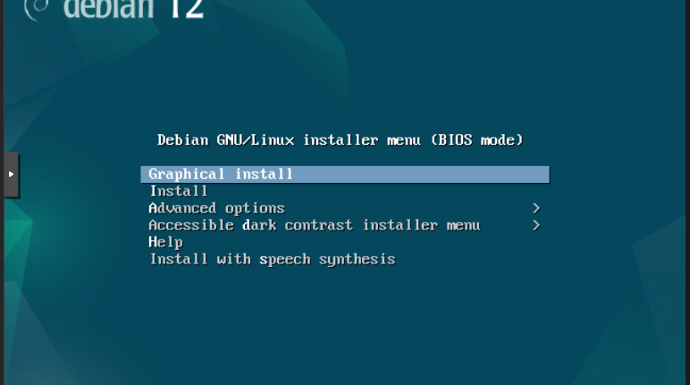

Pendant l'installation, l'installeur lance automatiquement une configuration **DHCP**. Pour donner une IP fixe, j'ai **annulé** cette configuration automatique, puis choisi la configuration manuelle du réseau :

| Paramètre | Valeur |
|---|---|
| Nom d'hôte | `Supervision` |
| Adresse IP | `10.2.121.15/24` |
| Passerelle | `10.2.121.1` |
| DNS | Mon contrôleur de domaine (`10.2.121.2`) |
| Utilisateur | `supervison1` |

Au premier redémarrage, la VM est restée bloquée sur `Booting from Hard Disk...` : GRUB n'avait pas été installé sur le disque (voir [§ 7.1](#71-booting-from-hard-disk-bloqué-grub-absent)).

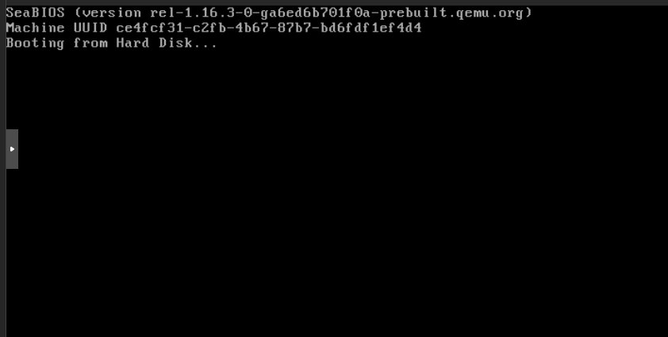

### 2.2 Vérification du réseau et de SSH

```bash
ip a
ping -c 2 deb.debian.org
```

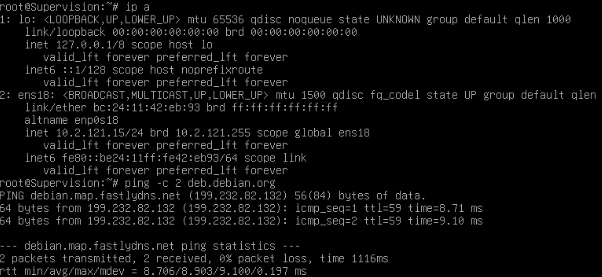

**Résultat :** l'interface `ens18` a bien l'adresse `10.2.121.15/24`, et la VM joint Internet (les dépôts Debian répondent).

J'ai ensuite testé le serveur SSH en local :

```bash
ssh supervison1@10.2.121.15
```

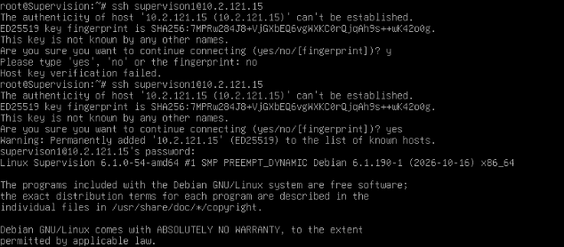

À la première connexion, SSH demande de valider l'empreinte de la machine. Il faut taper **`yes`** en entier : une simple réponse `y` est refusée (`Host key verification failed`).

### 2.3 Poste de travail

Mon PC Windows est sur un autre réseau et n'a pas de route vers 10.2.121.0/24 (voir [§ 7.2](#72-pc-windows-sans-route-vers-le-réseau-du-labo)). Je travaille donc depuis la **VM ClamAV**, qui a un bureau : son navigateur me sert pour l'interface de Prometheus, et son terminal pour me connecter en SSH à SUPERVISION.

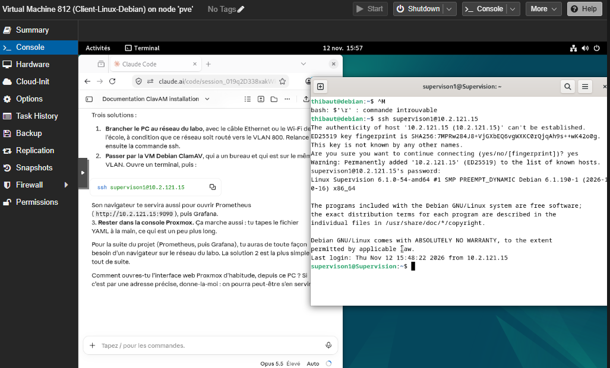

---

## 3. Étape 2 : Prometheus et node_exporter

### 3.1 Installation

J'utilise le paquet Debian (version 2.42), plus simple à maintenir qu'une installation manuelle :

```bash
apt update
apt install -y prometheus
```

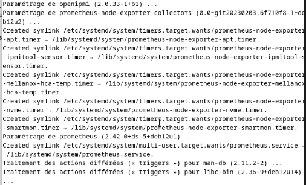

**Résultat :** le paquet `prometheus` (2.42.0) installe aussi **`prometheus-node-exporter`** et ses collecteurs. Ceux-ci ajoutent des timers systemd (`apt`, `smartmon`, `nvme`…) qui déposent des fichiers `.prom` dans `/var/lib/prometheus/node-exporter/`. C'est ce même mécanisme que j'utilise à l'étape 5.

```bash
systemctl status prometheus prometheus-node-exporter --no-pager
```

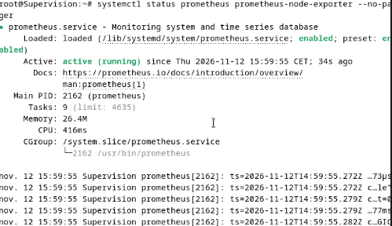
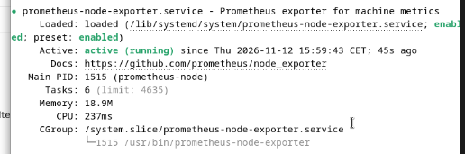

Les deux services sont `active (running)` et `enabled` : ils redémarrent avec la VM.

### 3.2 Configuration

La configuration se trouve dans `/etc/prometheus/prometheus.yml`. J'y ai ajouté un label **`machine`** sur chaque cible, pour savoir d'un coup d'œil de quelle VM vient une métrique. Après chaque modification, je vérifie la syntaxe avec `promtool` avant de redémarrer :

```bash
promtool check config /etc/prometheus/prometheus.yml && systemctl restart prometheus
```

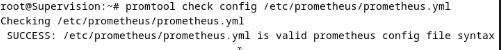

### 3.3 Interface web

L'interface est accessible sur **`http://10.2.121.15:9090`** :

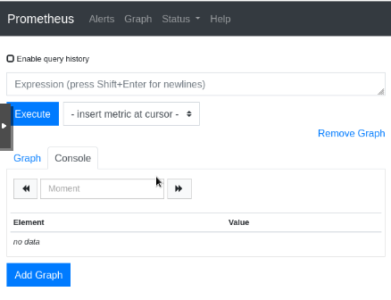

Dans **Status → Targets**, les deux cibles sont **UP** :

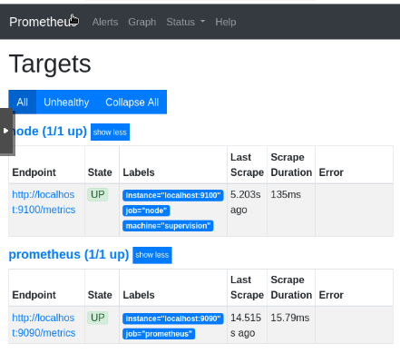

La requête `up` vaut **1** pour chaque cible joignable :

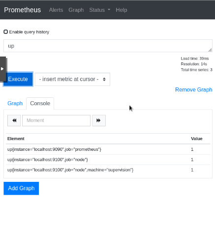

On voit 3 lignes pour 2 cibles : la ligne `localhost:9100` **sans** label `machine` est l'ancienne série, d'avant l'ajout du label. Prometheus la garde affichée quelques minutes, puis elle disparaît.

---

## 4. Étape 3 : superviser la VM ClamAV

### 4.1 node_exporter sur la VM ClamAV

Sur la VM 812, en root :

```bash
apt install -y prometheus-node-exporter
systemctl status prometheus-node-exporter --no-pager
ss -tlnp | grep 9100
```

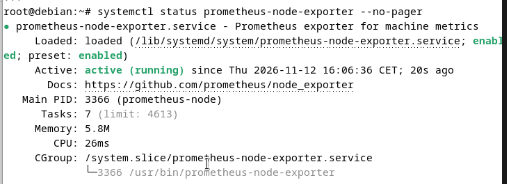
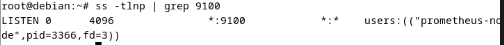

**Résultat :** le service tourne et écoute sur le port **9100**, sur toutes les interfaces (`*:9100`), donc il est joignable depuis SUPERVISION.

### 4.2 Test depuis SUPERVISION : la VM ClamAV avait changé d'IP

Au moment de cette étape, la VM ClamAV avait l'adresse `10.2.121.10` :

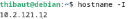

Le test depuis SUPERVISION a d'abord échoué parce que `curl` n'était pas installé (voir [§ 7.3](#73-curl-absent-sur-supervision)) :

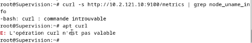

Une fois `curl` installé, il n'y avait toujours **aucune réponse** :

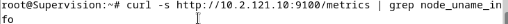

J'ai cherché la cause pas à pas :

| Test | Résultat | Conclusion |
|---|---|---|
| `ping 10.2.121.10` depuis SUPERVISION | `Destination Host Unreachable` | Aucune machine ne répond à cette adresse |
| `curl -v …:9100` | `Aucun chemin d'accès pour atteindre l'hôte cible` | Ce n'est pas un pare-feu : l'hôte est introuvable |
| `ping 10.2.121.15` depuis la VM ClamAV | OK | Le réseau entre les deux VM fonctionne |
| `ip neigh show 10.2.121.10` | `FAILED` | Aucune réponse ARP : l'adresse n'est plus utilisée |
| `ip a` sur la VM ClamAV | `10.2.121.12/24 … dynamic` | **La VM ClamAV avait reçu une nouvelle IP par DHCP** |

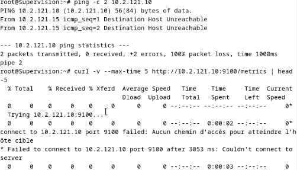
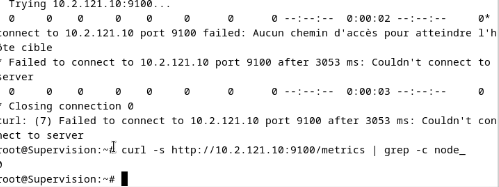
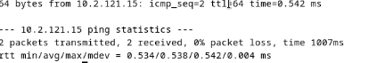
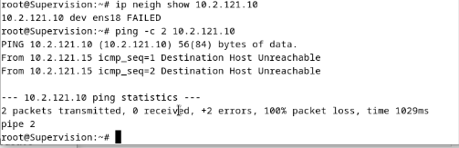
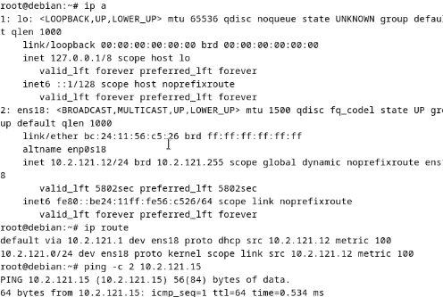

Avec la nouvelle adresse, `node_exporter` répond bien :

```bash
curl -s http://10.2.121.12:9100/metrics | grep node_uname_info
```

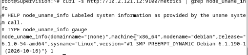

### 4.3 Passage de la VM ClamAV en IP fixe

Une machine supervisée doit garder la même adresse. J'ai d'abord identifié le serveur DHCP :

```bash
nmcli -f DHCP4 device show ens18 | grep -i server
```

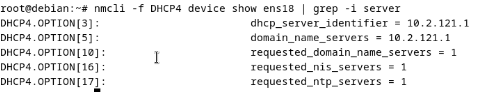

Le DHCP est fourni par la passerelle `10.2.121.1`. La VM ayant un bureau, son réseau est géré par **NetworkManager** : je fixe donc l'adresse avec `nmcli`, en gardant `10.2.121.12`.

```bash
nmcli connection modify "Wired connection 1" ipv4.method manual \
  ipv4.addresses 10.2.121.12/24 ipv4.gateway 10.2.121.1 ipv4.dns "10.2.121.2 10.2.121.1"
nmcli connection up "Wired connection 1"
ip a show ens18
```

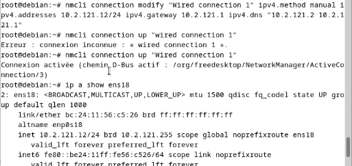

> ⚠️ Le nom de la connexion respecte les majuscules : `"wired connection 1"` donne `Erreur : connexion inconnue`.

L'adresse n'est plus `dynamic`, la route par défaut est maintenant `proto static`, et Internet répond toujours :

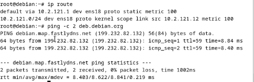

> 💡 La plage du serveur DHCP n'est pas connue : il faudra vérifier que `10.2.121.12` et `10.2.121.15` sont en dehors, pour éviter un conflit d'adresses.

### 4.4 Ajout de la cible dans Prometheus

J'ai voulu remplacer `10.2.121.10` par `10.2.121.12` avec `sed`, mais `grep` ne trouvait aucune ligne : la cible ClamAV n'avait **jamais été ajoutée** au fichier (voir [§ 7.4](#74-cible-clamav-absente-de-prometheusyml)). Prometheus n'avait donc qu'une cible `node` :

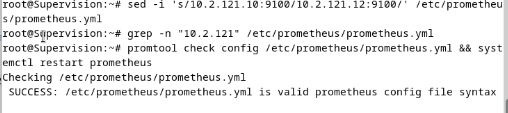
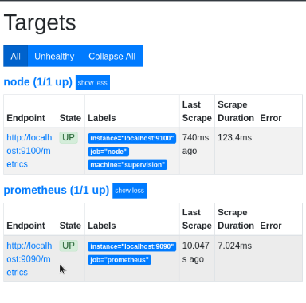
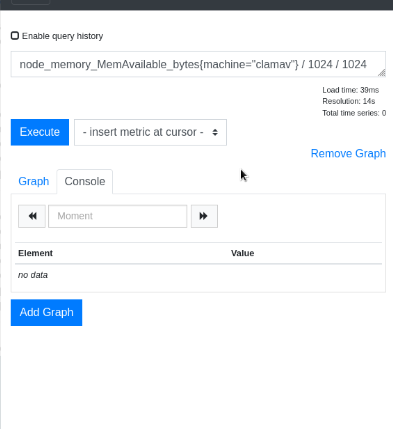

J'ai réécrit la section `scrape_configs` avec les deux cibles `node` :

```yaml
scrape_configs:
  - job_name: "prometheus"
    static_configs:
      - targets: ["localhost:9090"]

  - job_name: "node"
    static_configs:
      - targets: ["localhost:9100"]
        labels:
          machine: "supervision"
      - targets: ["10.2.121.12:9100"]
        labels:
          machine: "clamav"
```

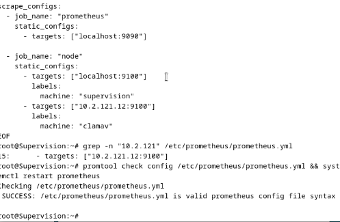

**Résultat :** le job `node` a maintenant **2 cibles sur 2 UP** :

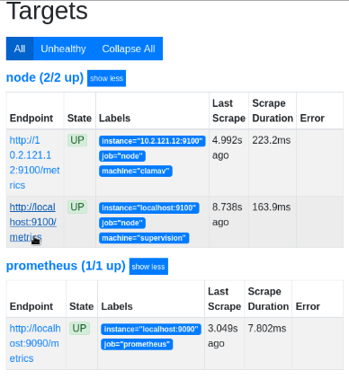

Premier test d'une vraie métrique, la mémoire disponible de la VM ClamAV en Mo :

```
node_memory_MemAvailable_bytes{machine="clamav"} / 1024 / 1024
```

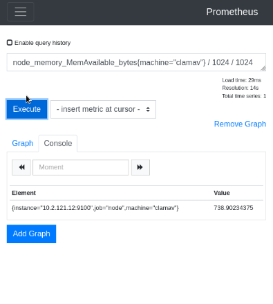

---

## 5. Étape 4 : l'exporter ClamAV

### 5.1 clamd en TCP

`clamav_exporter` dialogue avec `clamd`. Par défaut, `clamd` n'écoute que sur un socket Unix. Je lui ajoute un socket **TCP limité à la machine elle-même** (`127.0.0.1`), pour qu'il ne soit pas exposé sur le réseau.

```bash
cat >> /etc/clamav/clamd.conf <<'EOF'
TCPSocket 3310
TCPAddr 127.0.0.1
EOF

mkdir -p /etc/systemd/system/clamav-daemon.socket.d
cat > /etc/systemd/system/clamav-daemon.socket.d/tcp.conf <<'EOF'
[Socket]
ListenStream=127.0.0.1:3310
EOF

systemctl daemon-reload
systemctl restart clamav-daemon.socket clamav-daemon
ss -tlnp | grep 3310
```

Sur Debian, `clamd` est lancé par **activation de socket** (`clamav-daemon.socket`) : c'est systemd qui ouvre les ports. Il faut donc déclarer le port à la fois dans `clamd.conf` et dans un drop-in du socket systemd.

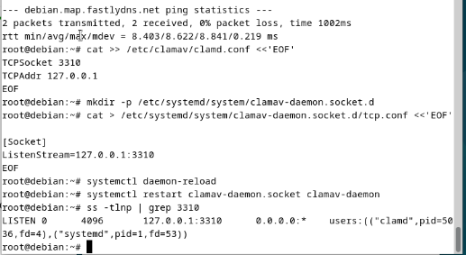

### 5.2 Installation de clamav_exporter

J'utilise [sergeymakinen/clamav_exporter](https://github.com/sergeymakinen/clamav_exporter) en version **2.1.13**. Il n'existe pas en paquet Debian : je télécharge le binaire depuis la page des releases et je vérifie son empreinte SHA-256 avant de l'installer.

```bash
cd /tmp
curl -LO https://github.com/sergeymakinen/clamav_exporter/releases/download/v2.1.13/clamav_exporter_2.1.13_linux_amd64.tar.gz
echo "<empreinte publiée sur la release>  clamav_exporter_2.1.13_linux_amd64.tar.gz" | sha256sum -c
tar xzf clamav_exporter_2.1.13_linux_amd64.tar.gz
install -m 0755 clamav_exporter /usr/local/bin/
clamav_exporter --version
```

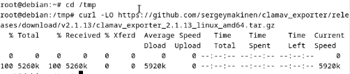
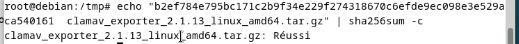
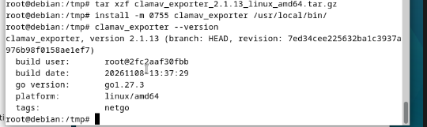

### 5.3 Service systemd

L'exporter tourne sous un **compte système dédié**, sans shell ni dossier personnel : il n'a pas besoin des droits root.

```bash
useradd --system --no-create-home --shell /usr/sbin/nologin clamav_exporter
```

`/etc/systemd/system/clamav-exporter.service` :

```ini
[Unit]
Description=Prometheus ClamAV exporter
After=network-online.target clamav-daemon.service
Wants=network-online.target

[Service]
User=clamav_exporter
ExecStart=/usr/local/bin/clamav_exporter --clamav.address=tcp://127.0.0.1:3310
Restart=on-failure

[Install]
WantedBy=multi-user.target
```

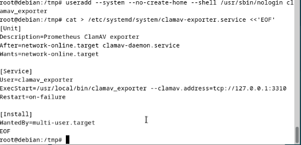

```bash
systemctl daemon-reload && systemctl enable --now clamav-exporter
systemctl status clamav-exporter --no-pager
curl -s http://localhost:9906/metrics | grep -E '^clamav_(up|version|db_)'
```

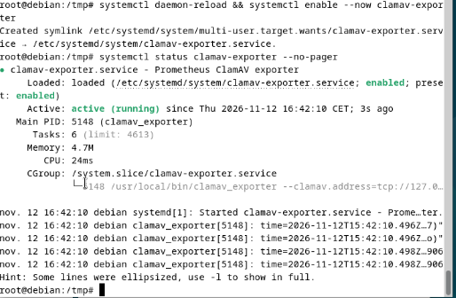
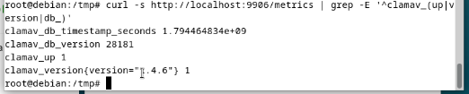

**Résultat :** l'exporter écoute sur le port **9906** :
- `clamav_up 1` : il joint bien `clamd` ;
- `clamav_version` : ClamAV 1.4.6 ;
- `clamav_db_version 28181` : version de la base de signatures ;
- `clamav_db_timestamp_seconds` : date de cette base.

### 5.4 Job clamav dans Prometheus

Sur SUPERVISION :

```bash
cat >> /etc/prometheus/prometheus.yml <<'EOF'

  - job_name: "clamav"
    static_configs:
      - targets: ["10.2.121.12:9906"]
        labels:
          machine: "clamav"
EOF
promtool check config /etc/prometheus/prometheus.yml && systemctl restart prometheus
```

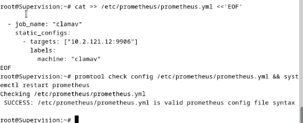
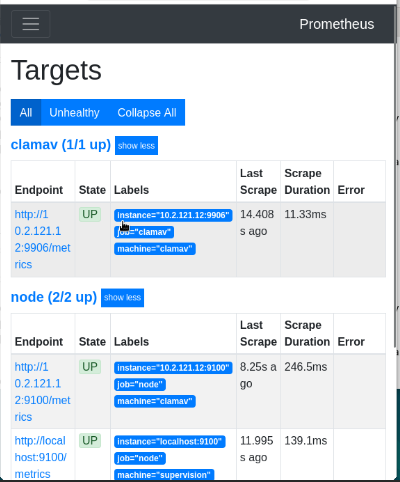

Requêtes de vérification :

| Requête | Valeur | Signification |
|---|---|---|
| `clamav_up` | 1 | `clamd` répond |
| `clamav_db_version` | 28181 | Version de la base `daily` |
| `(time() - clamav_db_timestamp_seconds) / 3600` | 9,28 | Âge des signatures en heures, futur seuil d'alerte |
| `clamav_memory_used_bytes / 1024 / 1024` | *no data* | Voir [§ 7.5](#75-clamav_memory_used_bytes-sans-données) |

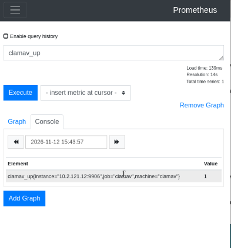
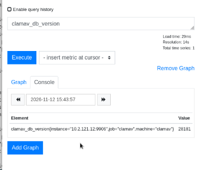
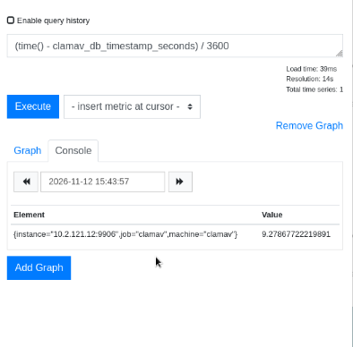
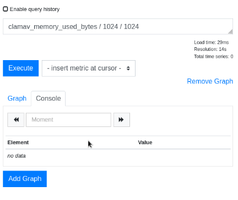

> 💡 L'heure affichée dans le champ « Moment » de Prometheus est en **UTC** (15:43 UTC = 16:43 à Paris).

---

## 6. Étape 5 : script de métriques ClamAV et ClamUI

### 6.1 Principe

`clamav_exporter` dit si `clamd` fonctionne, mais pas ce que font **mes** usages de ClamAV : tri des CV, quarantaine, scan hebdomadaire, analyses lancées depuis ClamUI. Ces informations sont dans des journaux, des dossiers et des fichiers de ClamUI.

J'ai écrit un script qui lit ces sources toutes les 5 minutes et écrit le résultat dans un fichier `.prom`, dans le dossier du **collecteur textfile** de node_exporter. Prometheus récupère alors ces valeurs via le port 9100, qu'il interroge déjà : **aucun port à ouvrir et aucune modification de `prometheus.yml`**.

### 6.2 Inventaire sur la VM ClamAV

Avant d'écrire le script, j'ai vérifié ce qui existe vraiment sur la VM.

```bash
ls -ld /var/lib/prometheus/node-exporter
curl -s localhost:9100/metrics | grep -m5 textfile
```

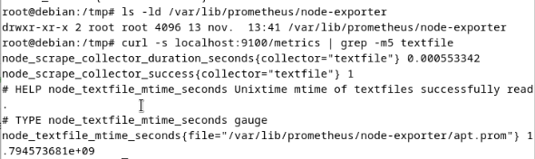

Le dossier existe, et `node_scrape_collector_success{collector="textfile"} 1` montre que le collecteur fonctionne : il lit déjà le `apt.prom` des timers du paquet Debian.

```bash
ls -la /var/quarantaine /var/www/data/cv_incoming /var/www/data/cv_safe /var/www/data/cv_infected
ls -la /var/log/clamav/
systemctl is-active clamonacc clamav-daemon
systemctl list-timers scan-home-hebdo.timer --no-pager
crontab -l
```

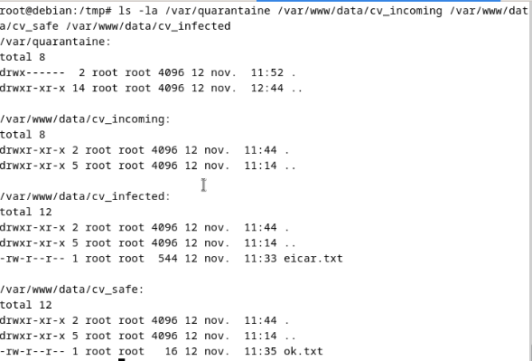
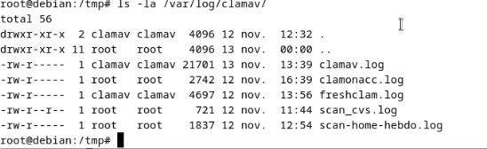
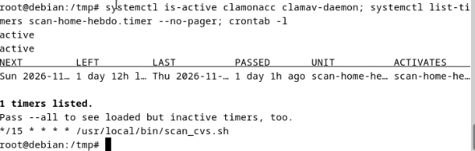

| Source | Emplacement |
|---|---|
| Quarantaine (clamonacc, scan hebdo) | `/var/quarantaine` (vide, `drwx------`) |
| Tri des CV | `/var/www/data/cv_incoming`, `cv_safe`, `cv_infected` |
| Journal du tri des CV | `/var/log/clamav/scan_cvs.log` |
| Journal du temps réel | `/var/log/clamav/clamonacc.log` |
| Journal du scan hebdo | `/var/log/clamav/scan-home-hebdo.log` (timer du dimanche 02:00) |

### 6.3 Le script

```bash
nano /usr/local/bin/clamav_metrics.sh
chmod +x /usr/local/bin/clamav_metrics.sh
```

Contenu complet : [`scripts/clamav_metrics.sh`](scripts/clamav_metrics.sh)

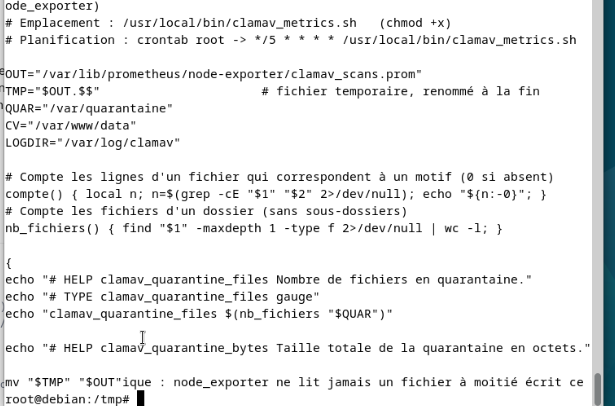

Fonctionnement :

1. Tout ce qui est affiché dans le bloc `{ … }` part dans un fichier **temporaire** (`clamav_scans.prom.<PID>`).
2. Pour chaque métrique, le script écrit une ligne `# HELP` (description), une ligne `# TYPE` (`gauge` = valeur qui monte et descend, `counter` = cumul qui ne fait que monter), puis la valeur.
3. À la fin, le fichier temporaire est **renommé** en `clamav_scans.prom`. Un renommage est atomique : node_exporter ne lit jamais un fichier à moitié écrit.

| Source | Métriques | Calcul |
|---|---|---|
| `/var/quarantaine` | `clamav_quarantine_files`, `clamav_quarantine_bytes` | Nombre et taille des fichiers |
| Dossiers de tri | `clamav_cv_files{dossier="incoming\|safe\|infected"}` | Nombre de fichiers par dossier |
| `scan_cvs.log` | `clamav_cv_scans_total`, `clamav_cv_infected_total` | Lignes horodatées, et lignes finissant par `FOUND` |
| `clamonacc.log` | `clamav_onaccess_detections_total` | Lignes contenant `FOUND` |
| `scan-home-hebdo.log` | `clamav_home_scan_last_timestamp_seconds`, `…_scanned_files`, `…_infected_files` | Date du journal, et derniers `Scanned files:` / `Infected files:` |
| systemd | `clamav_service_active{service="…"}` | `systemctl is-active` pour clamav-daemon, clamonacc et clamav-freshclam |
| Le script | `clamav_metrics_last_run_timestamp_seconds` | Heure d'exécution, pour vérifier qu'il tourne toujours |

### 6.4 Premier lancement

```bash
/usr/local/bin/clamav_metrics.sh && grep -v '^#' /var/lib/prometheus/node-exporter/clamav_scans.prom
curl -s localhost:9100/metrics | grep -E '^clamav_'
```


La première capture montre le fichier écrit par le script, la seconde les mêmes valeurs exposées par node_exporter sur le port 9100 :
- **Tri des CV :** 0 CV en attente, 1 sain (`ok.txt`), 1 infecté (`eicar.txt`). Le journal compte 2 analyses, dont 1 infectée.
- **Scan hebdo :** 4 305 fichiers analysés, 0 infecté. `1794484467` est une date au format epoch (secondes depuis 1970), soit le 12/11 à 12:54.
- **Services :** `clamav-daemon` et `clamonacc` à 1, mais **`clamav-freshclam` à 0** (voir [§ 7.6](#76-clamav-freshclam-arrêté-et-désactivé)).
- node_exporter trie les métriques par ordre alphabétique et écrit les grands nombres en notation scientifique (`1.794484467e+09` = 1794484467).

Deux corrections ont suivi ce premier lancement :

**freshclam relancé :** le service était arrêté et désactivé, donc les signatures n'étaient plus mises à jour.

```bash
systemctl status clamav-freshclam --no-pager
systemctl enable --now clamav-freshclam
```


**Taille de la quarantaine corrigée :** `clamav_quarantine_bytes` valait 4096 avec une quarantaine vide (voir [§ 7.7](#77-taille-de-quarantaine-à-4096-octets-pour-un-dossier-vide)).


freshclam a aussitôt mis à jour la base (`daily.cld` version 28182) et prévenu `clamd` :

```bash
tail -5 /var/log/clamav/freshclam.log
```


### 6.5 Planification par cron

Dans la crontab de root, à côté du tri des CV :

```bash
crontab -e
```

```
*/5 * * * * /usr/local/bin/clamav_metrics.sh
```


Vérification de l'heure du dernier passage, puis preuve dans le journal de cron :

```bash
date -d @$(awk '/^clamav_metrics_last_run/ {print $2}' /var/lib/prometheus/node-exporter/clamav_scans.prom)
journalctl -u cron --since "-20min" --no-pager | grep clamav_metrics
```


La capture 58 (13:56:08) correspond encore à un lancement manuel. Le journal de cron montre ensuite l'exécution automatique de **14:00:01**.

### 6.6 Vérification dans Prometheus

Les métriques arrivent par le job `node`, avec le label `machine="clamav"` :

| Requête | Résultat |
|---|---|
| `clamav_service_active` | 3 services à 1 |
| `clamav_cv_files` | incoming 0, infected 1, safe 1 |
| `time() - clamav_metrics_last_run_timestamp_seconds` | 20 s : âge du dernier passage, doit rester sous 300 s |


### 6.7 Les données de ClamUI

ClamUI est un **Flatpak** lancé par l'utilisateur `thibaut`. Un Flatpak range ses données dans `~/.var/app/<identifiant>/` :

```bash
find /home/thibaut/.var/app/io.github.linx_systems.ClamUI -maxdepth 4 -not -path '*/cache/*' | head -60
find /home/thibaut/.var/app/io.github.linx_systems.ClamUI -type f -not -path '*/cache/*' -exec ls -la {} +
```


Seul `data/clamui/` est utile pour la supervision. Le reste (`CacheStorage`, `WebKitCache`, `hsts-storage.sqlite`, `.ld.so`…) est du cache interne. Les fichiers sont en `-rw-------` (lisibles par `thibaut` seul) : le script, lancé par root, peut les lire.

| Élément | Contenu |
|---|---|
| `logs/log_index.json` | Index de l'onglet **Journaux** de ClamUI |
| `logs/<uuid>.json` | Un fichier par analyse |
| `quarantine.db` | Base **SQLite** de la quarantaine de ClamUI |
| `quarantine/` | Fichiers isolés par ClamUI (distinct de `/var/quarantaine`) |

J'ai lu leur format avec `python3`, déjà présent sur Debian (la base est ouverte en **lecture seule**, `mode=ro`, pour ne pas gêner ClamUI) :

```bash
cd /home/thibaut/.var/app/io.github.linx_systems.ClamUI/data/clamui
python3 -m json.tool logs/log_index.json
python3 -m json.tool logs/9d701c5a-*.json
```


Chaque analyse donne un JSON avec `status` (`clean`, `infected`…), `scanned_files`, `infected_count`, `duration` et `timestamp`. Les heures sont en **UTC** (`+00:00`) : `13:06:14` UTC correspond à 14:06 à Paris.


La table `quarantine` a une colonne **`state`** (`active` = encore isolé, `restored` = restauré, `deleted` = supprimé) et une colonne `file_size`. Les deux tables étaient vides.

J'ai ajouté au script un bloc Python, placé juste avant la ligne `} > "$TMP"`. Il lit tous les journaux d'analyse et interroge la base SQLite :

| Métrique | Signification |
|---|---|
| `clamui_scans_total{status="clean\|infected\|…"}` | Nombre d'analyses par résultat |
| `clamui_scanned_files_total` | Fichiers analysés, toutes analyses confondues |
| `clamui_infected_files_total` | Menaces trouvées, toutes analyses confondues |
| `clamui_last_scan_timestamp_seconds` | Date de la dernière analyse (UTC convertie en epoch) |
| `clamui_last_scan_infected_files` | Menaces trouvées lors de la dernière analyse |
| `clamui_quarantine_files{state="active\|restored\|deleted"}` | Contenu de la quarantaine ClamUI |
| `clamui_quarantine_bytes` | Taille des fichiers encore en quarantaine |

Si ClamUI n'a aucun historique, ou si ses fichiers sont absents, le script affiche des 0 au lieu de s'arrêter.

```bash
/usr/local/bin/clamav_metrics.sh && grep '^clamui' /var/lib/prometheus/node-exporter/clamav_scans.prom
date -d @$(awk '/^clamui_last_scan_timestamp/ {print $2}' /var/lib/prometheus/node-exporter/clamav_scans.prom)
```


**Résultat :** on retrouve mes 2 analyses du 12/11 (1 propre, 1 avec EICAR). La dernière date du **12/11 à 14:18:47** heure de Paris : la conversion depuis l'UTC est correcte.

### 6.8 Test de bout en bout

J'ai vérifié toute la chaîne avec une vraie détection : ClamUI → script (cron) → node_exporter → Prometheus.

En tant que `thibaut`, je copie un fichier de test de ClamAV dans les Téléchargements, puis je lance ClamUI (jamais en root) :

```bash
cp /usr/share/clamav-testfiles/clam.exe ~/Téléchargements/test-supervision.exe
flatpak run io.github.linx_systems.ClamUI
```


J'analyse `/home/thibaut/Téléchargements`, puis je mets les menaces en quarantaine :


L'analyse de 14:24:24 trouve **2 menaces** :
- `test-supervision.exe` (`Clamav.Test.File-6`), le fichier que je venais de copier ;
- `eicar.txt` (`Eicar-Test-Signature`), le fichier EICAR de la veille, resté sur place car il n'avait pas été mis en quarantaine (voir [§ 7.8](#78-fichier-eicar-non-bloqué-par-clamonacc)).

Après le passage du cron, Prometheus affiche :

| Requête | Avant | Après |
|---|---|---|
| `clamui_scans_total{status="infected"}` | 1 | **2** |
| `clamui_quarantine_files{state="active"}` | 0 | **2** |
| `clamui_infected_files_total` | 1 | **3** |


**La chaîne complète fonctionne :** une analyse faite dans ClamUI apparaît dans Prometheus au plus 5 minutes plus tard.

---

## 7. Dépannage : erreurs rencontrées

### 7.1 `Booting from Hard Disk...` bloqué (GRUB absent)

**Symptôme :** après l'installation, la VM reste bloquée sur `Booting from Hard Disk...` (capture 02).
**Cause :** le chargeur de démarrage GRUB n'avait pas été installé sur le disque.
**Correction :** démarrage sur l'ISO Debian en mode de secours (*Advanced options → Rescue mode*), puis réinstallation de GRUB sur le disque de la VM.

### 7.2 PC Windows sans route vers le réseau du labo

**Symptôme :** impossible de joindre 10.2.121.0/24 depuis mon PC.
**Cause :** le PC est sur un autre réseau, sans route vers le VLAN 800.
**Contournement :** je travaille depuis la VM ClamAV (navigateur pour Prometheus, terminal pour SSH).

### 7.3 `curl` absent sur SUPERVISION

**Symptôme :** `-bash: curl : commande introuvable`, puis `E: L'opération curl n'est pas valable` (capture 16).
**Cause :** Debian minimal n'installe pas `curl`, et `apt curl` n'est pas une commande valide.
**Correction :** `apt install -y curl`.

### 7.4 Cible ClamAV absente de `prometheus.yml`

**Symptôme :** `sed` ne modifie rien et `grep -n "10.2.121"` ne trouve aucune ligne. Targets affiche `node (1/1 up)` et les requêtes sur `machine="clamav"` renvoient *no data* (captures 27 à 29).
**Cause :** la cible `10.2.121.x:9100` n'avait jamais été ajoutée au fichier.
**Correction :** réécriture de la section `scrape_configs` avec les deux cibles (capture 30).

### 7.5 `clamav_memory_used_bytes` sans données

**Symptôme :** *no data* sur `clamav_memory_used_bytes` (capture 45).
**Cause probable :** `clamd` ne renvoie pas ses statistiques mémoire à l'exporter sur cette version. La mémoire de la VM reste visible avec les métriques `node_memory_*`.
**Statut :** non bloquant, à approfondir.

### 7.6 `clamav-freshclam` arrêté et désactivé

**Symptôme :** `clamav_service_active{service="clamav-freshclam"} 0`. `systemctl status` affiche `inactive (dead)` et **`disabled`**, et `freshclam.log` n'avait plus bougé depuis le 12/11 (captures 51 et 53).
**Cause :** le service avait été arrêté et désactivé. C'est souvent le cas quand on lance `freshclam` à la main, car il faut d'abord arrêter le service (erreur « log is locked »). Comme il était `disabled`, il ne serait jamais reparti, même au redémarrage.
**Correction :** `systemctl enable --now clamav-freshclam` (capture 54).
**À retenir :** c'est **la supervision qui a révélé ce problème**. Sans elle, la base de signatures aurait vieilli sans que personne ne le voie.

### 7.7 Taille de quarantaine à 4096 octets pour un dossier vide

**Symptôme :** `clamav_quarantine_files 0` mais `clamav_quarantine_bytes 4096`.
**Cause :** `du -sb` compte aussi la taille du dossier lui-même (4 096 octets sur ext4).
**Correction :** somme des tailles des seuls fichiers :

```bash
find "$QUAR" -maxdepth 1 -type f -printf '%s\n' | awk '{s+=$1} END {print s+0}'
```

### 7.8 Fichier EICAR non bloqué par clamonacc

**Symptôme :** un fichier EICAR est resté dans `/home/thibaut/Téléchargements` depuis le 12/11 sans être bloqué par l'analyse en temps réel.
**Cause probable :** d'après ma configuration ClamAV, clamonacc surveille `/home/flo/Téléchargements` et `/var/www/data/cv_incoming`, mais pas les Téléchargements de `thibaut`.
**À faire :** vérifier avec `grep OnAccessIncludePath /etc/clamav/clamd.conf`, ajouter `OnAccessIncludePath /home/thibaut/Téléchargements`, puis redémarrer `clamav-daemon` et `clamonacc`.

---

## 8. Récapitulatif

### Ports

| Port | Service | Machine | Accès |
|---|---|---|---|
| 9090 | Prometheus | SUPERVISION | Interface web, `http://10.2.121.15:9090` |
| 9100 | node_exporter | SUPERVISION et ClamAV | Interrogé par Prometheus |
| 9906 | clamav_exporter | ClamAV | Interrogé par Prometheus |
| 3310 | clamd (TCP) | ClamAV | **Local uniquement** (`127.0.0.1`) |

### Fichiers

| Fichier | Machine | Rôle |
|---|---|---|
| `/etc/prometheus/prometheus.yml` | SUPERVISION | Cibles de Prometheus |
| `/etc/clamav/clamd.conf` | ClamAV | `TCPSocket 3310`, `TCPAddr 127.0.0.1` |
| `/etc/systemd/system/clamav-daemon.socket.d/tcp.conf` | ClamAV | Port TCP du socket systemd de clamd |
| `/usr/local/bin/clamav_exporter` | ClamAV | Binaire de l'exporter (v2.1.13) |
| `/etc/systemd/system/clamav-exporter.service` | ClamAV | Service de l'exporter |
| [`/usr/local/bin/clamav_metrics.sh`](scripts/clamav_metrics.sh) | ClamAV | Script de métriques (cron toutes les 5 min) |
| `/var/lib/prometheus/node-exporter/clamav_scans.prom` | ClamAV | Métriques produites par le script |

### Commandes utiles

```bash
# --- SUPERVISION ---
promtool check config /etc/prometheus/prometheus.yml && systemctl restart prometheus
systemctl status prometheus prometheus-node-exporter --no-pager

# --- VM ClamAV ---
systemctl status prometheus-node-exporter clamav-exporter clamav-freshclam --no-pager
curl -s localhost:9906/metrics | grep -E '^clamav_'          # exporter ClamAV
/usr/local/bin/clamav_metrics.sh                             # lancer le script à la main
grep -v '^#' /var/lib/prometheus/node-exporter/clamav_scans.prom
journalctl -u cron --since "-20min" | grep clamav_metrics    # passages du cron
```

### Requêtes PromQL utiles

```
up                                                   # cibles joignables (1) ou non (0)
clamav_up                                            # clamd répond
(time() - clamav_db_timestamp_seconds) / 3600        # âge des signatures, en heures
clamav_service_active == 0                           # services ClamAV arrêtés
time() - clamav_metrics_last_run_timestamp_seconds   # âge du dernier passage du script
clamui_scans_total{status="infected"}                # analyses ClamUI avec menace
clamui_quarantine_files{state="active"}              # fichiers en quarantaine ClamUI
```
