# Sauvegarde et PRA - AP 2 GSBLOLO

Je présente ici la mise en place de la sauvegarde de mon infrastructure, avec mes propres captures d'écran. Le cahier des charges complet (objectifs RPO / RTO, architecture, scénarios de PRA) est dans le [README de l'AP 2](../../README.md).

> **Prérequis :** TrueNAS (VM 803, 10.2.121.14) est installé, relié à l'annuaire et partage déjà les dossiers des services (voir la documentation [TrueNAS](../../../Structure%20du%20r%C3%A9seau/Docs/TrueNAS/TrueNAS.md)).
>
> **Date de réalisation :** 27/11/2026 (étapes 1 et 2)
> **État :** étapes 1 et 2 terminées et testées.

---

## Sommaire

1. [Étape 1 : pool Sauvegardes, compte de service et partages](#1-étape-1--pool-sauvegardes-compte-de-service-et-partages)
2. [Dépannage : erreurs rencontrées](#2-dépannage--erreurs-rencontrées)
3. [Étape 2 : snapshots des partages et Versions précédentes](#3-étape-2--snapshots-des-partages-et-versions-précédentes)

---

## 1. Étape 1 : pool Sauvegardes, compte de service et partages

L'objectif est d'avoir un **second disque**, séparé de celui des données des services, pour y déposer les sauvegardes. Seul un compte de service dédié et les administrateurs du domaine peuvent y accéder.

### 1.1 Ajouter un disque à la VM TrueNAS

Depuis le shell du nœud Proxmox, j'ai ajouté un troisième disque de **50 Gio** à la VM 803, avec un numéro de série. Sans numéro de série, TrueNAS refuse de créer le pool (erreur déjà rencontrée pour le pool `Stockage`).

```bash
qm set 803 --scsi2 Raid5-VMs:50,iothread=1,serial=TRUENAS0003
```

Dans **Storage > Disks**, TrueNAS voit le nouveau disque `sdc` avec le numéro de série `TRUENAS0003`.

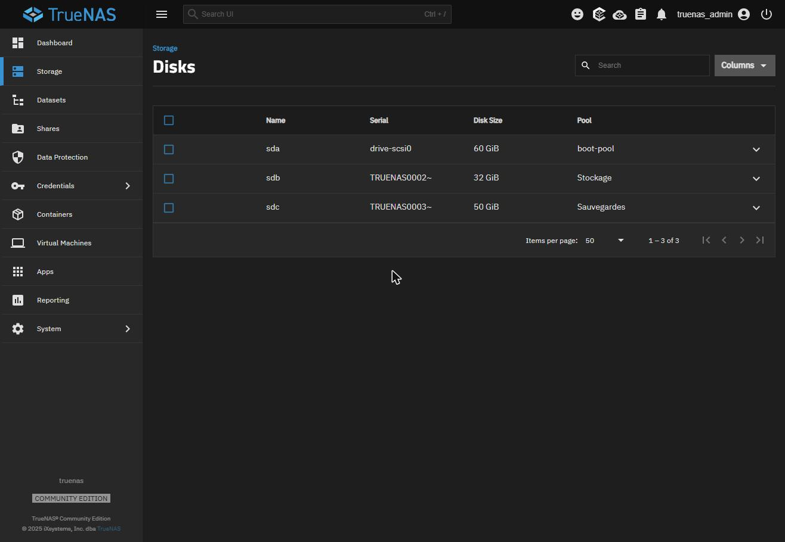

| Disque | N° de série | Taille | Pool |
| --- | --- | --- | --- |
| sda | drive-scsi0 | 60 Gio | boot-pool (système) |
| sdb | TRUENAS0002 | 32 Gio | Stockage (données des services) |
| sdc | TRUENAS0003 | 50 Gio | **Sauvegardes** |

### 1.2 Créer le pool Sauvegardes

Dans **Storage > Create Pool**, j'ai créé le pool **Sauvegardes** sur `sdc`, en disque simple (un seul disque, sans redondance). Le tableau de bord indique 47,48 Gio utilisables, l'état **Online, no errors** et un scrub programmé le dimanche à 00:00.

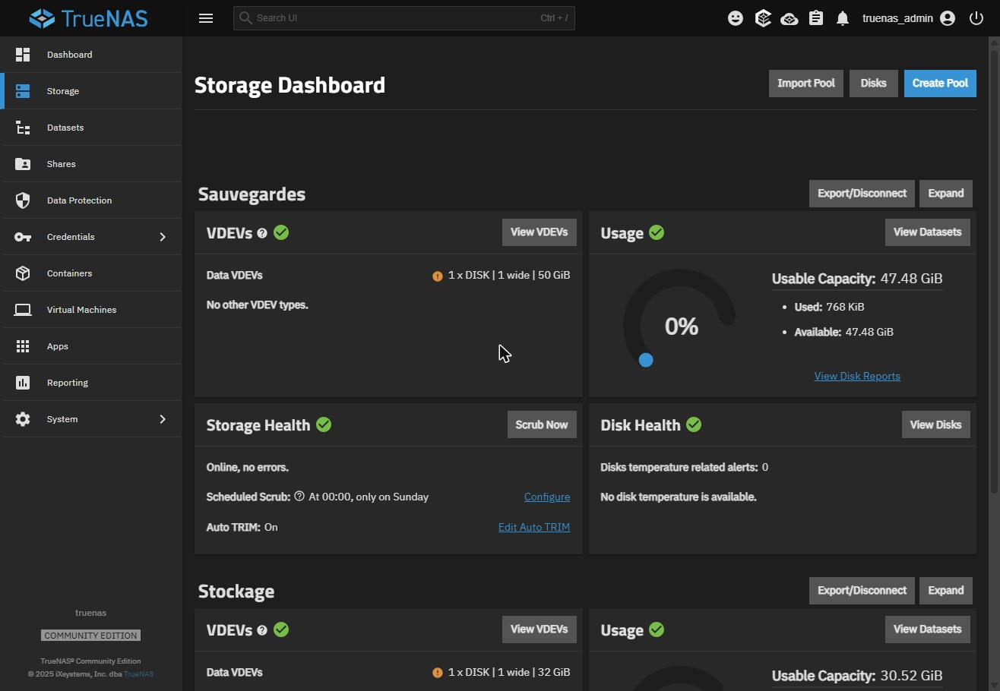

### 1.3 Créer le compte de service et le groupe

Sur AD-DC, j'ai créé le compte de service **svc-sauvegarde** et le groupe de sécurité **sauvegarde**, puis j'ai ajouté le compte au groupe. Ce compte sera utilisé par la sauvegarde de AD-DC (étape 4) et par les VM Linux (étape 5) pour écrire sur TrueNAS.

```powershell
New-ADUser -Name "svc-sauvegarde" -SamAccountName "svc-sauvegarde" -UserPrincipalName "svc-sauvegarde@gsblolo.local" -Description "Compte de service des sauvegardes" -AccountPassword (Read-Host -AsSecureString "Mot de passe de svc-sauvegarde") -Enabled $true -PasswordNeverExpires $true -CannotChangePassword $true
New-ADGroup -Name "sauvegarde" -GroupScope Global -GroupCategory Security -Path "OU=Groupes,OU=Services,DC=gsblolo,DC=local" -Description "Accès aux partages de sauvegarde"
Add-ADGroupMember -Identity "sauvegarde" -Members "svc-sauvegarde"
```

Le mot de passe du compte n'apparaît ni dans ce dépôt ni dans les scripts.

### 1.4 Créer les datasets

Dans le pool, j'ai créé les datasets `Sauvegardes/AD` (état du système de AD-DC) et `Sauvegardes/Linux` (configurations des VM Linux) avec le préréglage **SMB**.

Je n'ai **pas** créé `Sauvegardes/Services` : c'est la tâche de réplication de l'étape 3 qui le créera. Si le dataset existe déjà sans snapshots, TrueNAS refuse la réplication ou propose d'écraser son contenu.

### 1.5 Donner les droits

Dans **Datasets > Permissions > Edit** de chaque dataset, j'ai mis la même ACL :

| Entrée | Droit |
| --- | --- |
| `owner@` (root) | Full Control |
| `group@` (root) | Modify |
| `GSBLOLO\sauvegarde` | Full Control |
| `GSBLOLO\admins du domaine` | Full Control |

J'ai retiré les entrées trop larges que TrueNAS avait mises par défaut :
- `everyone@` (droit de traverser) sur `AD` ;
- `builtin_users` (Modify) sur `Linux`. Ce groupe contient **tous les utilisateurs du domaine** : n'importe quel employé aurait pu modifier ou supprimer les sauvegardes ;
- `builtin_administrators` sur `Linux`, remplacé par le groupe `admins du domaine`, pour avoir la même ACL sur les deux datasets.

 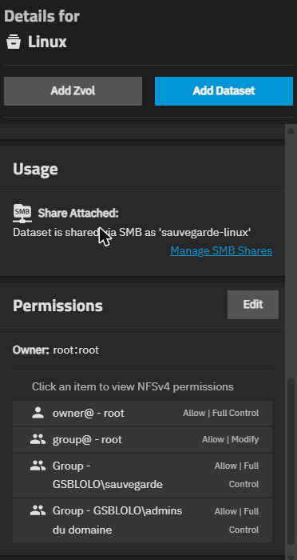

### 1.6 Créer les partages SMB

Dans **Shares > Windows (SMB) Shares**, j'ai créé les partages `sauvegarde-ad` (`/mnt/Sauvegardes/AD`) et `sauvegarde-linux` (`/mnt/Sauvegardes/Linux`). Le service SMB est **RUNNING** et TrueNAS a maintenant 10 partages : les 8 des services et les 2 de sauvegarde.

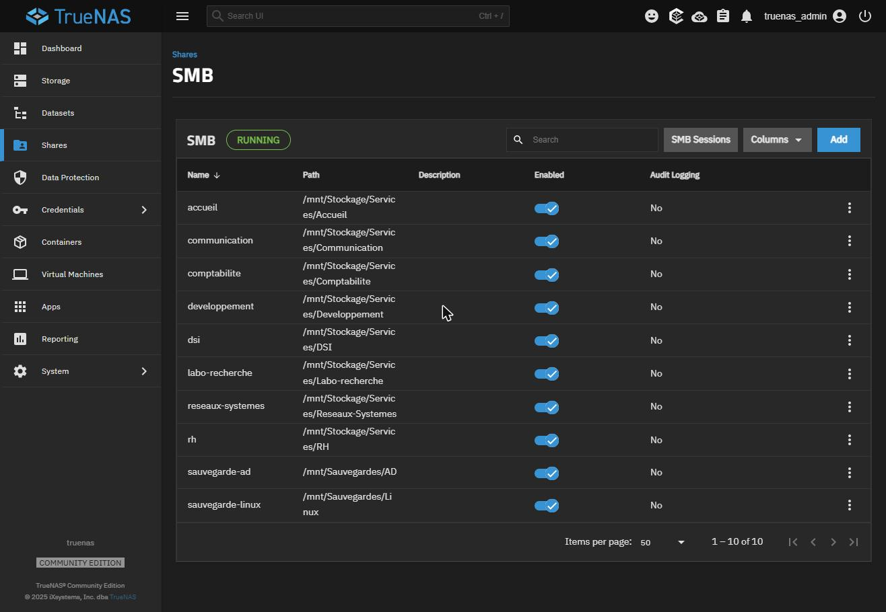

### 1.7 Tests

Je fais les tests depuis **Client1** (VM 810), en invite de commandes. La commande `net use` permet de choisir le compte utilisé pour chaque connexion. Windows n'accepte qu'un seul compte à la fois vers un même serveur : je coupe donc toutes les connexions avec `net use * /delete /y` entre deux tests.

**Test 1 : le compte de service peut écrire.** Avec `svc-sauvegarde`, la connexion à `sauvegarde-ad` réussit et je crée le fichier `test-acces.txt`.

```
net use Z: \\10.2.121.14\sauvegarde-ad /user:GSBLOLO\svc-sauvegarde
echo test > Z:\test-acces.txt
dir Z:\
```

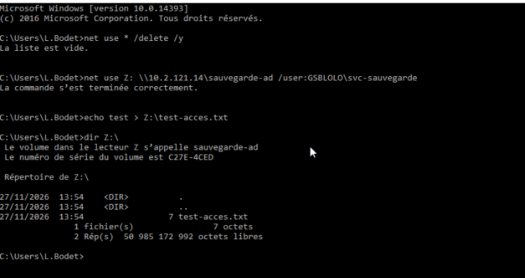

**Test 2 : un utilisateur de l'Accueil est refusé.** Avec `Y.braite`, membre du service Accueil, la commande `net use` réussit, mais la lecture (`dir`) répond **Accès refusé** sur les deux partages, et l'écriture (`echo`) aussi sur `sauvegarde-linux`. Avec TrueNAS, la connexion au partage n'est pas bloquée : ce sont les droits du dossier (ACL) qui sont vérifiés à chaque lecture ou écriture.

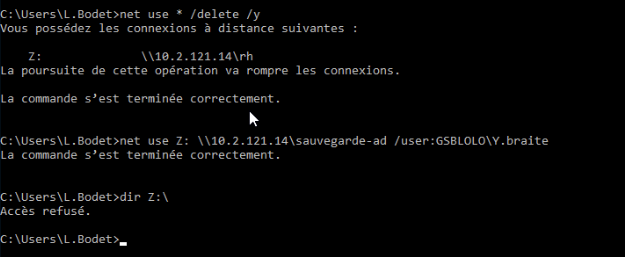

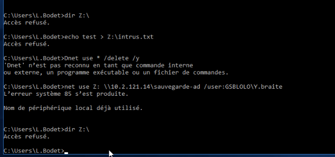

**Test 3 : les partages des services fonctionnent toujours.** Après la nouvelle jonction de TrueNAS au domaine (voir le [dépannage](#21-truenas-nest-plus-relié-à-lactive-directory)), je vérifie que les droits des services n'ont pas changé : `L.Bodet` (DSI) voit le dossier `Test_Truenas` de l'AP 1 dans `dsi`, et `rh` lui est refusé.

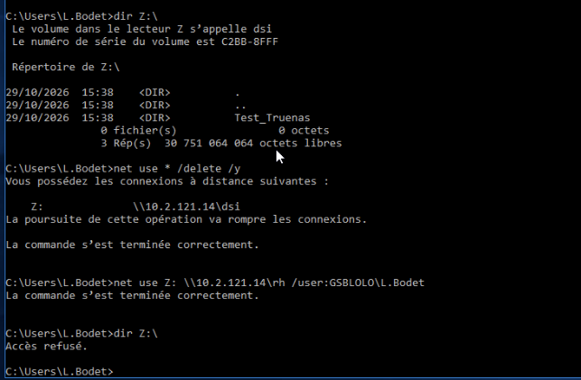

| Test | Compte | Résultat attendu | Résultat obtenu |
| --- | --- | --- | --- |
| Écriture dans `sauvegarde-ad` | `svc-sauvegarde` | Autorisé | ✅ Autorisé |
| Lecture de `sauvegarde-ad` | `Y.braite` (Accueil) | Accès refusé | ✅ Accès refusé |
| Lecture et écriture dans `sauvegarde-linux` | `Y.braite` (Accueil) | Accès refusé | ✅ Accès refusé |
| Lecture de `dsi` | `L.Bodet` (DSI) | Autorisé | ✅ Autorisé |
| Lecture de `rh` | `L.Bodet` (DSI) | Accès refusé | ✅ Accès refusé |

---

## 2. Dépannage : erreurs rencontrées

### 2.1 TrueNAS n'est plus relié à l'Active Directory

**Constat (27/11/2026) :** en voulant donner les droits au groupe `sauvegarde`, les groupes du domaine n'étaient plus proposés. Dans **Credentials > Directory Services**, l'état était **FAULTED** avec le message :

```
Active Directory secrets file lacks an entry for this TrueNAS server.
```

Une alerte `SECRETS/MACHINE_PASSWORD/GSBLOLO` datait du **26/11/2026 à 09:54**. TrueNAS avait perdu le mot de passe de son compte machine dans le domaine.

**Conséquence :** le **service SMB était arrêté**. Plus aucun partage n'était accessible, y compris ceux des 8 services. Sans supervision de TrueNAS, la panne est passée inaperçue pendant une journée.

**Première tentative (échec) :** dans la configuration Active Directory, passer **Credential Type** de `Kerberos Principal` (le compte machine `TRUENAS$`, justement cassé) à `Kerberos User`, saisir le compte `Administrateur` et enregistrer. TrueNAS affichait de nouveau l'erreur `SECRETS/MACHINE_PASSWORD/GSBLOLO` : il se croyait toujours membre du domaine et ne relançait pas la jonction.

**Solution :**
1. Noter la configuration actuelle pour la ressaisir à l'identique :

   | Champ | Valeur |
   | --- | --- |
   | TrueNAS Hostname | `truenas` |
   | Domain Name | `GSBLOLO.LOCAL` |
   | Site Name | `Default-First-Site-Name` |
   | IDMAP | `RID`, domaine `GSBLOLO`, plage `100000001` à `200000000` |

   Les plages IDMAP doivent rester identiques. Sinon, les droits déjà posés sur les partages des services ne correspondraient plus aux bons comptes.
2. **Clear Config** : efface seulement la configuration AD de TrueNAS, sans rien toucher dans l'annuaire ni dans les données.
3. Reconfigurer l'Active Directory avec les valeurs notées et le compte `Administrateur` (Credential Type `Kerberos User`), puis enregistrer : TrueNAS rejoint le domaine.
4. Vérifier l'état **HEALTHY**, puis démarrer le service SMB dans **System > Services**. Le démarrage automatique était bien coché, mais le service était resté arrêté.

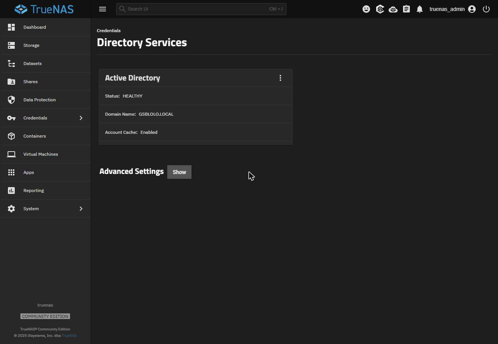

Le test 3 (§ 1.7) confirme que les partages des services fonctionnent de nouveau avec les mêmes droits qu'avant.

**Leçon pour le PRA :** cette panne justifie d'ajouter TrueNAS à la supervision (état de l'annuaire et du service SMB), comme les alertes de sauvegarde prévues à l'étape 6.

### 2.2 Partage en double sur le dataset AD

Le dataset `Sauvegardes/AD` était partagé deux fois : sous le nom `sauvegarde-ad` et sous le nom `ad` (probablement créé par l'option de partage du préréglage SMB à la création du dataset). J'ai supprimé le partage `ad` (**Shares > SMB > Delete**). TrueNAS précise que seule la configuration du partage est supprimée, pas les données.

### 2.3 Erreurs pendant les tests

| Erreur | Cause | Correction |
| --- | --- | --- |
| `La syntaxe de la commande n'est pas correcte.` | J'avais tapé le nom entre chevrons : `/user:GSBLOLO\<Y.braite>`. Windows lit `<` et `>` comme des redirections. | Taper `/user:GSBLOLO\Y.braite` |
| `L'erreur système 85 s'est produite. Nom de périphérique local déjà utilisé.` | Le lecteur `Z:` était encore connecté au partage précédent (faute de frappe dans `net use * /delete /y`). | Couper les connexions avant chaque test |
| `net use` réussit pour un utilisateur de l'Accueil | Normal avec TrueNAS : la connexion au partage n'est pas bloquée, ce sont les ACL du dossier qui refusent l'accès. | Toujours tester avec `dir` et `echo`, pas seulement `net use` |

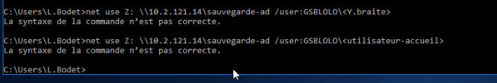

---

## 3. Étape 2 : snapshots des partages et Versions précédentes

Un **snapshot ZFS** est une photo instantanée d'un dataset, en lecture seule. Il ne copie pas les données : il garde seulement les blocs modifiés ou supprimés après sa création, donc il prend très peu de place. Il permet de retrouver un fichier tel qu'il était à l'heure du snapshot.

**Intérêt contre les rançongiciels :** un poste infecté peut chiffrer les fichiers d'un partage, mais il ne peut pas modifier ni supprimer les snapshots, qui ne sont gérés que depuis TrueNAS.

### 3.1 Tâches de snapshots périodiques

Dans **Data Protection > Periodic Snapshot Tasks > Add**, j'ai créé deux tâches sur `Stockage/Services`, en **récursif** pour inclure les 8 datasets des services :

| Tâche | Nom des snapshots | Planification (cron) | Conservation | Snapshots vides |
| --- | --- | --- | --- | --- |
| Horaire | `horaire-%Y-%m-%d_%H-%M` | `0 8-19 * * mon-fri` : toutes les heures de 8 h à 19 h, du lundi au vendredi | 2 jours | Non |
| Quotidienne | `quotidien-%Y-%m-%d_%H-%M` | `0 20 * * *` : tous les jours à 20 h | 14 jours | Oui |

Mes choix :
- **Deux noms différents** : TrueNAS supprime les snapshots expirés d'après le nom de la tâche. Avec le même nom (`auto-...` par défaut), une tâche pourrait supprimer les snapshots de l'autre.
- **Pas de snapshot horaire vide** : si personne n'a rien modifié dans l'heure, le snapshot n'apporterait rien.
- **Un snapshot quotidien même vide** : la réplication de l'étape 3 s'appuiera sur ces snapshots quotidiens.
- **Plages horaires** : les heures de bureau suffisent pour les snapshots horaires. Le RPO visé pour les fichiers est donc d'1 h en journée.

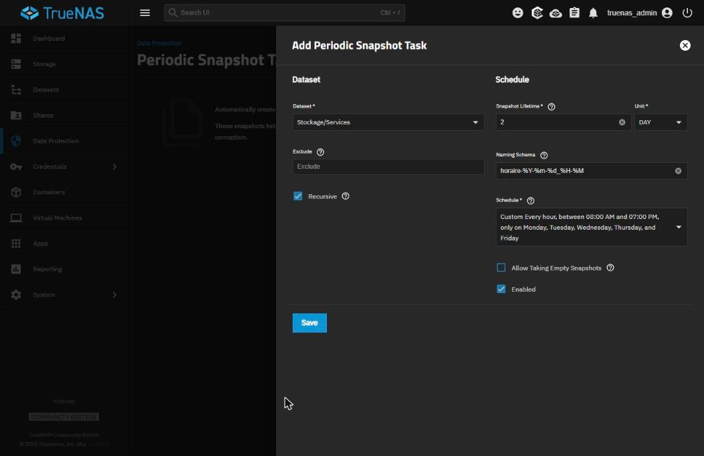

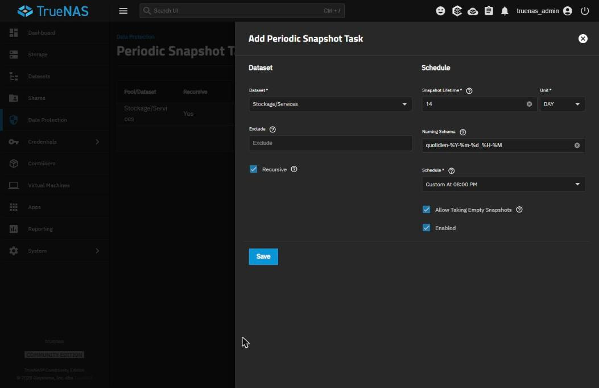

Les deux tâches apparaissent dans la liste, à l'état **PENDING** en attendant leur première exécution.

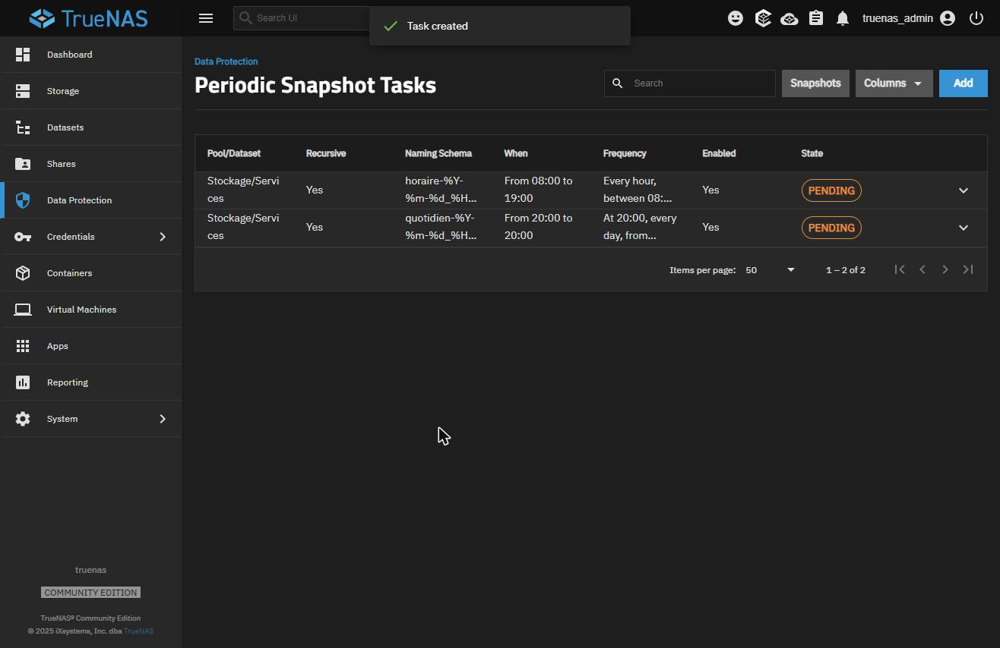

### 3.2 Premier snapshot manuel

Pour tester sans attendre l'heure suivante, j'ai pris un snapshot manuel récursif depuis **Datasets > Stockage/Services > Take Snapshot** (case **Recursive** cochée). Le snapshot `manual-2026-11-27_14-22` est créé sur les 9 datasets.

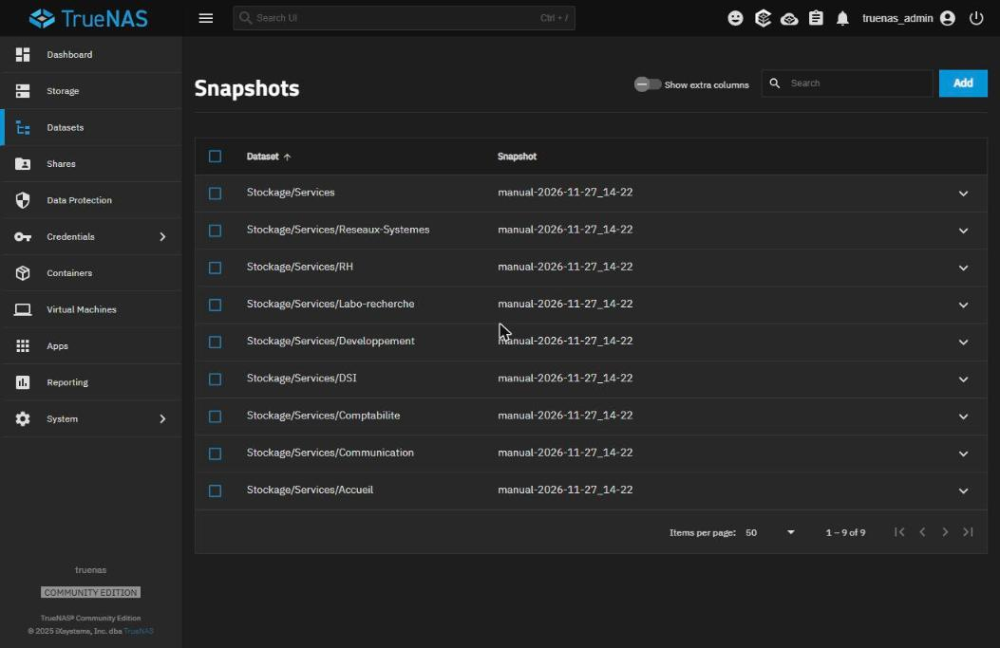

### 3.3 Versions précédentes sous Windows

Dans TrueNAS 25.10, le formulaire des partages SMB (objectif **Default Share**) n'a plus d'option « Shadow Copies » : les snapshots ZFS sont proposés directement à Windows comme **Versions précédentes**. Je n'ai donc rien modifié sur les partages.

### 3.4 Test de restauration

Depuis Client1, connecté avec `L.Bodet` (DSI) :

1. Dans `\\10.2.121.14\dsi`, clic droit sur le dossier `Test_Truenas`, puis **Propriétés > Versions précédentes** : la version du snapshot de 14:22 apparaît.

   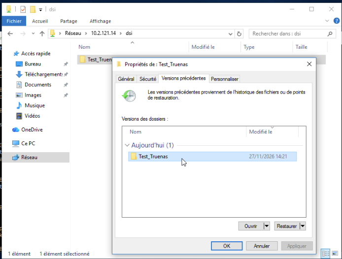

2. Je supprime le dossier `Test_Truenas`.
3. Clic droit dans le vide à la racine de `dsi`, **Propriétés > Versions précédentes**, je sélectionne la version de 14:22 puis **Ouvrir** : le snapshot s'ouvre en lecture seule et `Test_Truenas` y est encore.

   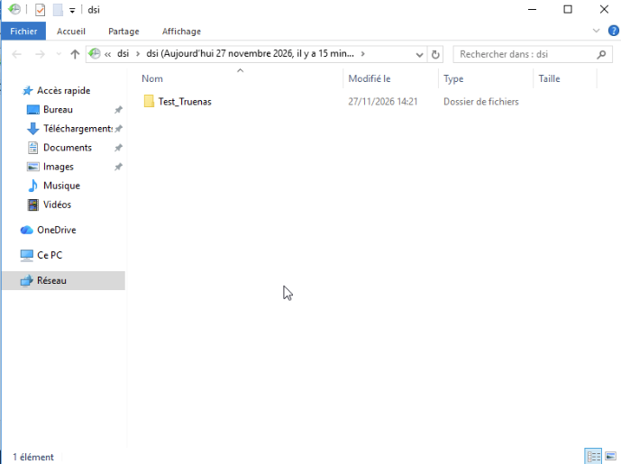

4. Je copie `Test_Truenas` depuis le snapshot et je le colle dans `dsi` : le dossier est revenu, avec sa date d'origine (29/10/2026).

   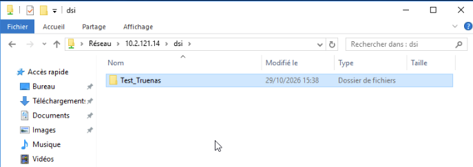

L'utilisateur restaure lui-même son dossier, en moins de 5 minutes et sans intervention de la DSI. C'est le scénario **S2** du PRA, que je rejouerai avec la Comptabilité.

> Le bouton **Restaurer** remet tout le dossier sélectionné à l'état du snapshot, y compris en effaçant les modifications faites depuis. Pour un seul fichier, **Ouvrir** puis copier-coller est plus sûr.

| Test | Résultat attendu | Résultat obtenu |
| --- | --- | --- |
| Tâches de snapshots créées | 2 tâches activées sur `Stockage/Services` | ✅ |
| Snapshot récursif | Un snapshot par dataset des services | ✅ 9 snapshots |
| Onglet **Versions précédentes** | Le snapshot de 14:22 apparaît | ✅ |
| Restauration d'un dossier supprimé | Dossier récupéré par l'utilisateur | ✅ |
| Snapshot horaire automatique | Un snapshot par heure de 8 h à 19 h en semaine (si des fichiers ont changé) | ⏳ à vérifier le prochain jour ouvré |

### 3.5 Erreur rencontrée : accès refusé à `dsi` depuis l'Explorateur

En ouvrant `\\10.2.121.14\dsi` dans l'Explorateur avec la session `L.Bodet`, Windows a refusé l'accès, alors que `L.Bodet` a bien les droits.

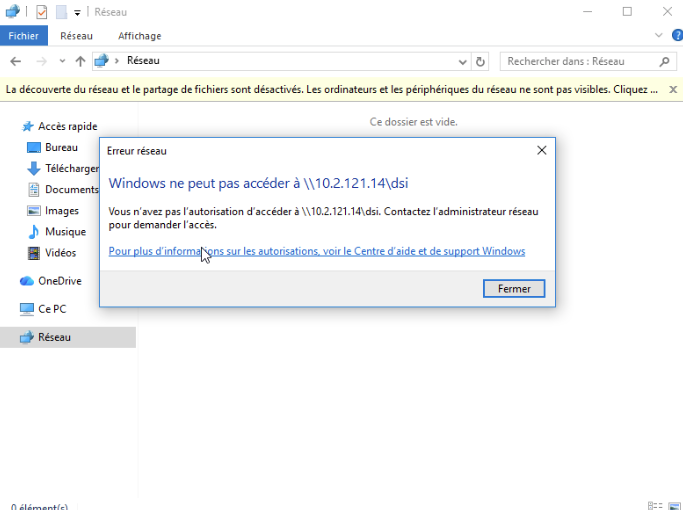

**Cause :** Windows n'ouvre qu'**une seule session SMB par serveur**. La dernière commande des tests de l'étape 1 avait connecté `sauvegarde-ad` avec le compte `Y.braite` (Accueil). Windows réutilisait cette session pour tout `10.2.121.14`, et `Y.braite` n'a pas accès à `dsi`. `whoami` (`gsblolo\l.bodet`) et `cmdkey /list` (aucun identifiant enregistré pour TrueNAS) ne montraient rien d'anormal.

**Correction :** couper toutes les connexions (`net use * /delete /y`), vider les tickets Kerberos (`klist purge`) et fermer toutes les fenêtres de l'Explorateur, puis rouvrir le partage.
