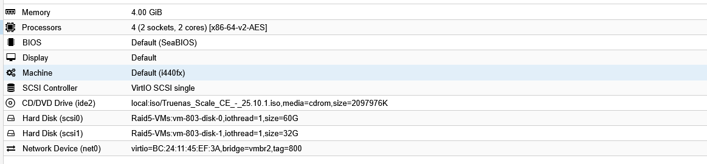
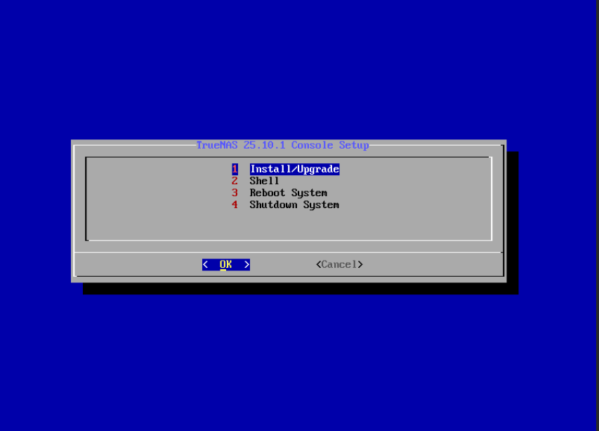
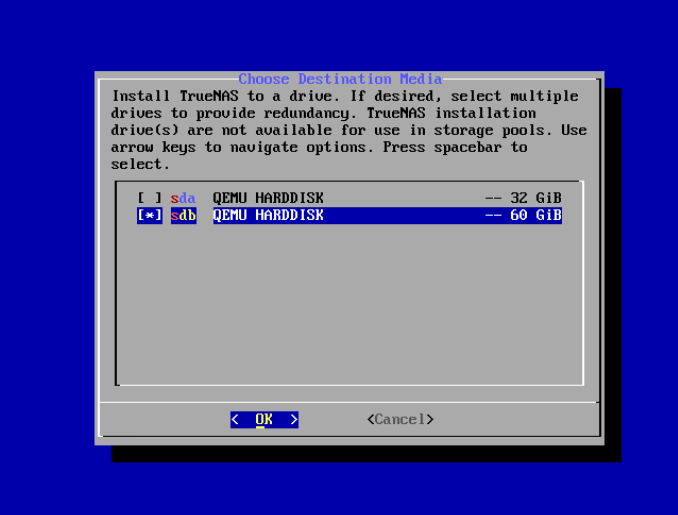
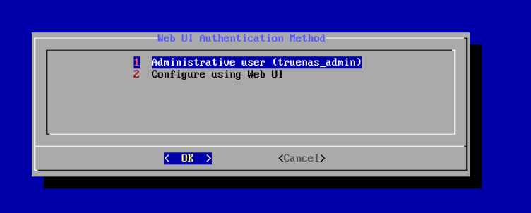
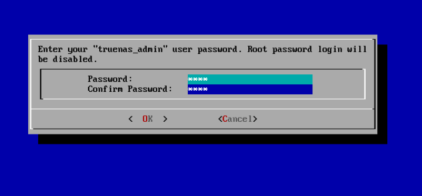
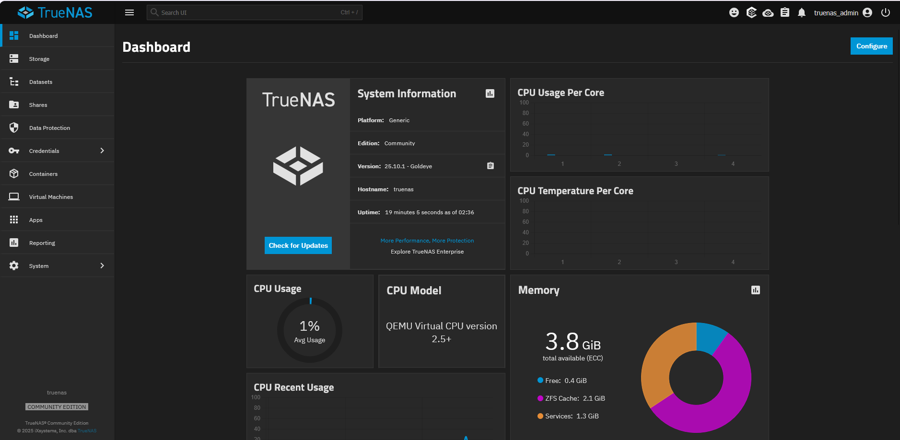

# TrueNAS - AP 2 GSBLOLO

Je présente ici la mise en place du serveur de stockage **TrueNAS** sur Proxmox VE, avec mes propres captures d'écran.

## 1. Créer la machine virtuelle

J'ai créé une VM **TrueNAS** avec le **VMID 803**, sur le même réseau que le reste de l'infrastructure.

| Paramètre | Valeur |
| --- | --- |
| Mémoire | 4 Gio |
| Processeurs | 4 (2 sockets × 2 cœurs), type `x86-64-v2-AES` |
| BIOS / machine | SeaBIOS (par défaut) / i440fx |
| Contrôleur SCSI | VirtIO SCSI single |
| Lecteur CD/DVD | ISO `Truenas_Scale_CE_-_25.10.1.iso` (stockage `local`) |
| Disque scsi0 | 60 Gio sur `Raid5-VMs` |
| Disque scsi1 | 32 Gio sur `Raid5-VMs` |
| Réseau | VirtIO, pont **vmbr2**, **VLAN tag 800** |

## 2. Installer TrueNAS

Au démarrage sur l'ISO, je lance **Start TrueNAS SCALE Installation** depuis le menu GRUB.

Dans la console d'installation **TrueNAS 25.10.1**, je choisis **Install/Upgrade**.

Je sélectionne le disque de **60 Gio** (`sdb`) comme disque système. Le disque de 32 Gio (`sda`) reste libre pour le stockage.

L'installateur prévient que toutes les partitions de `sdb` seront effacées. Je confirme avec **Yes**.

Pour l'accès à l'interface web, je choisis l'utilisateur administrateur **truenas_admin** et je définis son mot de passe. La connexion par mot de passe de `root` est alors désactivée.

Je réponds **Yes** à la question sur le démarrage EFI.

## 3. Vérifier le fonctionnement

Après le redémarrage, l'interface web est accessible avec **truenas_admin**. Le tableau de bord indique **TrueNAS Community Edition 25.10.1 (Goldeye)**, le nom d'hôte **truenas** et la mémoire disponible.

La console de la VM affiche le menu de configuration (interfaces réseau, paramètres réseau, routes statiques, mot de passe de l'administrateur local, shell).

## 4. Intégration au domaine

Dans **Utilisateurs et ordinateurs Active Directory** de **gsblolo.local**, l'ordinateur **TRUENAS** apparaît dans le conteneur **Computers** : le serveur est bien rattaché au domaine.

