# ClamAV - GSBLOLO

Je présente ici la mise en place de l'antivirus open source **ClamAV** sur un serveur **Debian 12 (bookworm)**, avec mes propres captures d'écran.

> **Objectifs :** analyser automatiquement les CV déposés par le serveur web, surveiller certains dossiers en temps réel, et scanner `/home` chaque semaine.
>
> **Date de réalisation :** 12/11/2026 — **Version :** ClamAV 1.4.6 (paquet `1.4.6+dfsg-0+deb12u1`)
> **Source complémentaire :** [IT-Connect — Guide ClamAV : installer et configurer un antivirus sur Linux](https://www.it-connect.fr/guide-clamav-installer-et-configurer-un-antivirus-sur-linux)

---

## Sommaire

1. [Présentation de ClamAV](#1-présentation-de-clamav)
2. [Architecture mise en place](#2-architecture-mise-en-place)
3. [Prérequis](#3-prérequis)
4. [Installation](#4-installation)
5. [Mise à jour des signatures (freshclam)](#5-mise-à-jour-des-signatures-freshclam)
6. [Démon clamd](#6-démon-clamd)
7. [Premiers tests de détection](#7-premiers-tests-de-détection)
8. [Cas d'usage 1 : analyse des CV déposés sur le serveur web](#8-cas-dusage-1--analyse-des-cv-déposés-sur-le-serveur-web)
9. [Cas d'usage 2 : analyse en temps réel (clamonacc)](#9-cas-dusage-2--analyse-en-temps-réel-clamonacc)
10. [Cas d'usage 3 : scan hebdomadaire de /home (timer systemd)](#10-cas-dusage-3--scan-hebdomadaire-de-home-timer-systemd)
11. [Dépannage : erreurs rencontrées](#11-dépannage--erreurs-rencontrées)
12. [Récapitulatif des fichiers et commandes utiles](#12-récapitulatif-des-fichiers-et-commandes-utiles)
13. [Limites et bonnes pratiques](#13-limites-et-bonnes-pratiques)

Fichiers fournis dans ce dossier :

| Fichier | Destination sur le serveur |
|---|---|
| [`scripts/scan_cvs.sh`](scripts/scan_cvs.sh) | `/usr/local/bin/scan_cvs.sh` |
| [`systemd/clamonacc.service`](systemd/clamonacc.service) | `/etc/systemd/system/clamonacc.service` |
| [`systemd/scan-home-hebdo.service`](systemd/scan-home-hebdo.service) | `/etc/systemd/system/scan-home-hebdo.service` |
| [`systemd/scan-home-hebdo.timer`](systemd/scan-home-hebdo.timer) | `/etc/systemd/system/scan-home-hebdo.timer` |
| [`config/clamd-onaccess.conf`](config/clamd-onaccess.conf) | À ajouter à la fin de `/etc/clamav/clamd.conf` |
| [`config/extend.conf`](config/extend.conf) | `/etc/systemd/system/clamav-daemon.service.d/extend.conf` (créé par le paquet) |

---

## 1. Présentation de ClamAV

ClamAV est un moteur antivirus libre (licence GPL), maintenu par Cisco Talos. Il détecte les virus, chevaux de Troie, malwares et documents piégés à l'aide d'une base de signatures.

| Composant | Rôle |
|---|---|
| `clamscan` | Scanner en ligne de commande. Il charge toute la base à chaque lancement (lent au démarrage, ~15 s). |
| `clamd` (`clamav-daemon`) | Démon résident qui garde la base en mémoire. Il répond aux demandes d'analyse via un socket local. |
| `clamdscan` | Client de `clamd` : même usage que `clamscan`, mais beaucoup plus rapide car la base est déjà chargée. |
| `freshclam` (`clamav-freshclam`) | Service de mise à jour automatique des signatures. |
| `clamonacc` | Analyse à l'accès (temps réel) basée sur `fanotify`. Il transmet les fichiers à `clamd`. |

---

## 2. Architecture mise en place

```
                     ┌──────────────────────────┐
                     │  freshclam (MAJ signatures)│
                     └─────────────┬────────────┘
                                   │ /var/lib/clamav/*.cvd
                                   ▼
┌──────────────┐   socket   ┌──────────────┐
│  clamonacc   │──────────▶│    clamd     │   (clamav-daemon)
│ temps réel   │            └──────────────┘
└──────┬───────┘
       │ surveille : /home/flo/Téléchargements, ...
       └──▶ fichier infecté déplacé vers /var/quarantaine

┌──────────────────────┐   cron */15 min
│  scan_cvs.sh         │──▶ /var/www/data/cv_incoming
│  (clamscan)          │      ├─ sain     ──▶ cv_safe
└──────────────────────┘      └─ infecté  ──▶ cv_infected

┌──────────────────────┐   timer systemd : dimanche 02h00
│  scan-home-hebdo     │──▶ /home  (infectés ──▶ /var/quarantaine)
└──────────────────────┘
```

---

## 3. Prérequis

- Serveur **Debian 12 (bookworm)** avec un accès `root` (ou `sudo`).
- **Accès Internet et DNS fonctionnels** : indispensable pour `apt` et pour télécharger les signatures.
- **2 Go de RAM minimum** : `clamd` charge environ 3,6 millions de signatures et consomme près de **1 Go** de mémoire (962 Mo mesurés, voir § 6).

Vérifier la connectivité avant de commencer :

```bash
ping -c 2 deb.debian.org
cat /etc/resolv.conf
```

---

## 4. Installation

### 4.1 Mise à jour de l'index des paquets

```bash
apt update
```

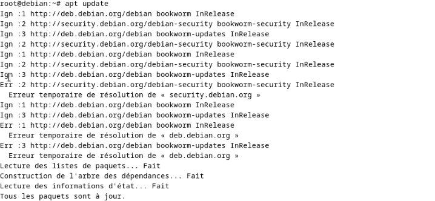

> ⚠️ **Problème rencontré :** lors du premier essai, `apt update` n'a pas pu joindre les dépôts.
> Le message `Erreur temporaire de résolution de « deb.debian.org »` indique un **problème de résolution DNS**, pas un problème de dépôt.
> La solution est détaillée au [§ 11.1](#111-apt-update--erreur-temporaire-de-résolution).
> Attention : la ligne finale `Tous les paquets sont à jour` est trompeuse. Les listes n'ont pas été rafraîchies.

### 4.2 Installation des paquets

```bash
apt install -y clamav clamav-daemon
```

Paquets installés (dépendances automatiques comprises) :

| Paquet | Contenu |
|---|---|
| `clamav` | `clamscan`, outils en ligne de commande |
| `clamav-daemon` | `clamd`, `clamonacc` et le service systemd associé |
| `clamav-freshclam` | Mise à jour des signatures |
| `clamav-base`, `libclamav12` | Fichiers communs et bibliothèque du moteur |
| `clamdscan` | Client de `clamd` |

Paquet optionnel, utile pour les tests (fichiers de test inoffensifs reconnus par ClamAV) :

```bash
apt install -y clamav-testfiles
```

Vérifier que `clamonacc` est bien présent :

```bash
clamonacc --help
```

---

## 5. Mise à jour des signatures (freshclam)

Juste après l'installation, la base de signatures est **vide ou incomplète**. Il faut forcer une première mise à jour avant tout test.
Le service `clamav-freshclam` verrouille le fichier de log : on l'arrête le temps de la mise à jour manuelle.

```bash
systemctl stop clamav-freshclam
freshclam
systemctl start clamav-freshclam
systemctl enable clamav-freshclam
```

Vérifier la présence des bases :

```bash
ls -l /var/lib/clamav/
# bytecode.cvd  daily.cvd (ou daily.cld)  freshclam.dat  main.cvd
```

Le journal des mises à jour se trouve dans `/var/log/clamav/freshclam.log`.

---

## 6. Démon clamd

### 6.1 Activation

```bash
systemctl enable --now clamav-daemon
systemctl status clamav-daemon
```

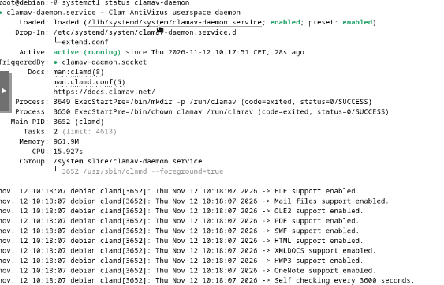

Points à vérifier dans la sortie :

| Élément | Valeur observée | Signification |
|---|---|---|
| `Loaded` | `enabled` | Le service démarre au boot. |
| `Active` | `active (running)` | Le démon tourne. |
| `TriggeredBy` | `clamav-daemon.socket` | Le démon peut aussi être activé par son socket. |
| `Drop-In` | `/etc/systemd/system/clamav-daemon.service.d/extend.conf` | Surcharge fournie par le paquet Debian (voir ci-dessous). |
| `Process … ExecStartPre` | `mkdir -p /run/clamav`, `chown clamav /run/clamav` | Création du dossier du socket. |
| `Main PID` | `/usr/sbin/clamd --foreground=true` | Processus principal. |
| `Memory` | `961.9M` | Toute la base est chargée en RAM. |
| Journal | `ELF / Mail / OLE2 / PDF / HTML … support enabled` | Formats analysés. |
| Journal | `Self checking every 3600 seconds` | `clamd` recharge la base si elle a changé, toutes les heures. |

Le fichier Drop-In `extend.conf` est créé automatiquement par le paquet. Son contenu est reproduit dans [`config/extend.conf`](config/extend.conf). Aucune modification n'est nécessaire.

On peut aussi vérifier le processus :

```bash
ps -edf | grep clam
```

### 6.2 Socket local

`clamd` écoute sur un **socket Unix local** : `/var/run/clamav/clamd.ctl`.
Cette valeur correspond à la directive `LocalSocket` de `/etc/clamav/clamd.conf`.
Préférer ce socket local à un port TCP exposé sur le réseau.

---

## 7. Premiers tests de détection

### 7.1 Avec les fichiers de test de ClamAV

Le paquet `clamav-testfiles` fournit des fichiers inoffensifs, dans de nombreux formats (exe, pdf, doc, zip, cab…), que ClamAV doit détecter.

```bash
clamscan /usr/share/clamav-testfiles/
```

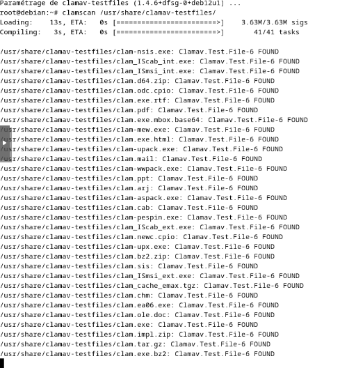

**Résultat :** chaque fichier est détecté comme `Clamav.Test.File-6 FOUND`.
Le chargement de la base (3,63 M signatures) prend environ 13 s, puis 3 s de compilation. C'est le coût de `clamscan` à chaque lancement.

### 7.2 Avec le fichier EICAR

Le fichier EICAR est une chaîne de test standard. Tous les antivirus la reconnaissent, mais elle est totalement inoffensive.

Deux façons de l'obtenir :

```bash
# a) Le créer localement
echo 'X5O!P%@AP[4\PZX54(P^)7CC)7}$EICAR-STANDARD-ANTIVIRUS-TEST-FILE!$H+H*' > eicar.txt

# b) Le télécharger depuis le site officiel
mkdir -p /home/flo/Téléchargements
curl -o /home/flo/Téléchargements/eicar.txt https://secure.eicar.org/eicar.com.txt
```

```bash
clamscan /home/flo/Téléchargements/eicar.txt
```

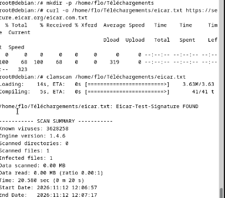

**Résultat :**

```
/home/flo/Téléchargements/eicar.txt: Eicar-Test-Signature FOUND
----------- SCAN SUMMARY -----------
Known viruses: 3628258
Engine version: 1.4.6
Scanned files: 1
Infected files: 1
Time: 20.580 sec (0 m 20 s)
```

Options utiles de `clamscan` :

| Option | Effet |
|---|---|
| `-r` / `--recursive` | Parcourt les sous-dossiers |
| `-i` / `--infected` | N'affiche que les fichiers infectés |
| `--remove` | Supprime les fichiers infectés (à éviter : préférer `--move`) |
| `--move=DOSSIER` | Déplace les fichiers infectés vers une quarantaine |
| `--log=FICHIER` | Écrit le rapport dans un fichier |
| `--exclude-dir=REGEX` | Exclut des dossiers |

Codes de retour de `clamscan` : **0** = aucun virus, **1** = virus trouvé, **2** = erreur.

---

## 8. Cas d'usage 1 : analyse des CV déposés sur le serveur web

**Besoin :** les candidats déposent leur CV via un formulaire web. Les fichiers arrivent dans `/var/www/data/cv_incoming`.
Ils doivent être analysés, puis triés entre un dossier **sain** et un dossier **infecté**, avant tout traitement par le service RH.

### 8.1 Préparer les dossiers et un jeu de test

```bash
mkdir -p /var/www/data/cv_incoming /var/www/data/cv_safe /var/www/data/cv_infected

# Fichier "infecté" : copie d'un fichier de test ClamAV
cp /usr/share/clamav-testfiles/clam.exe /var/www/data/cv_incoming/eicar.txt

# Fichier sain
echo 'Ceci est mon CV' > /var/www/data/cv_incoming/ok.txt
```

### 8.2 Test manuel du dossier

```bash
clamscan -r -i /var/www/data/cv_incoming/
```

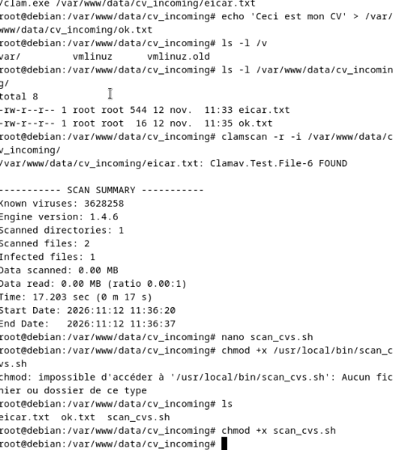

**Résultat :** `eicar.txt: Clamav.Test.File-6 FOUND`, 2 fichiers analysés, 1 infecté, en 17,2 s.

### 8.3 Le script de tri

Créer le script **dans `/usr/local/bin/`** :

```bash
nano /usr/local/bin/scan_cvs.sh
chmod +x /usr/local/bin/scan_cvs.sh
```

Contenu complet : [`scripts/scan_cvs.sh`](scripts/scan_cvs.sh)

```bash
#!/bin/bash
INCOMING="/var/www/data/cv_incoming"
SAFE="/var/www/data/cv_safe"
INFECTED="/var/www/data/cv_infected"
LOG="/var/log/clamav/scan_cvs.log"

mkdir -p "$SAFE" "$INFECTED"

for file in "$INCOMING"/*; do
    [ -e "$file" ] || continue

    result=$(clamscan --stdout "$file" 2>&1)
    ret=$?

    echo "$(date '+%F %T') - $result" >> "$LOG"

    case "$ret" in
        0) mv -- "$file" "$SAFE"/ ;;
        1) mv -- "$file" "$INFECTED"/ ;;
        *) mv -- "$file" "$INFECTED"/ ;;
    esac
done
```

Fonctionnement :

1. Le script parcourt chaque fichier de `cv_incoming`. La ligne `[ -e "$file" ] || continue` évite une erreur quand le dossier est vide.
2. Il analyse le fichier avec `clamscan` et récupère le **code de retour** dans `$ret`.
3. Il journalise le résultat, horodaté, dans `/var/log/clamav/scan_cvs.log`.
4. Il déplace le fichier selon le code : `0` vers `cv_safe`, `1` vers `cv_infected`.
5. En cas d'erreur d'analyse (code `2`), le fichier part aussi dans `cv_infected`, **par précaution**.

> ⚠️ **Erreur rencontrée :** le script a d'abord été créé par erreur dans `cv_incoming` (`nano scan_cvs.sh` lancé depuis ce dossier).
> La commande `chmod +x /usr/local/bin/scan_cvs.sh` a alors échoué avec `impossible d'accéder à '/usr/local/bin/scan_cvs.sh': Aucun fichier ou dossier de ce type`.
> Un script placé dans `cv_incoming` serait **lui-même analysé et déplacé** à la première exécution. Il doit impérativement se trouver dans `/usr/local/bin/`.

### 8.4 Exécution et vérification

```bash
/usr/local/bin/scan_cvs.sh
ls /var/www/data/cv_incoming/ /var/www/data/cv_infected/ /var/www/data/cv_safe/
```

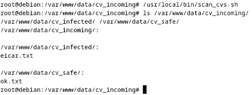

**Résultat attendu et obtenu :**

| Dossier | Contenu |
|---|---|
| `cv_incoming/` | vide |
| `cv_infected/` | `eicar.txt` |
| `cv_safe/` | `ok.txt` |

### 8.5 Automatisation par cron

```bash
crontab -e
```

Ajouter la ligne suivante (exécution toutes les 15 minutes) :

```
*/15 * * * * /usr/local/bin/scan_cvs.sh
```

> 💡 **Amélioration possible :** `clamscan` recharge toute la base (~15 s) **pour chaque fichier**. Avec beaucoup de CV, remplacer `clamscan` par `clamdscan --fdpass` dans le script. Les codes de retour sont identiques et l'analyse passe par `clamd`, déjà chargé en mémoire.

---

## 9. Cas d'usage 2 : analyse en temps réel (clamonacc)

**Besoin :** analyser un fichier **au moment où il est ouvert ou créé**, et bloquer l'accès s'il est infecté.
`clamonacc` utilise l'API noyau `fanotify` et délègue l'analyse à `clamd`.

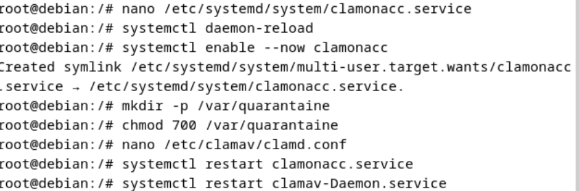

### 9.1 Créer le dossier de quarantaine

```bash
mkdir -p /var/quarantaine
chmod 700 /var/quarantaine
```

Le `chmod 700` réserve l'accès à `root` : les fichiers isolés ne doivent pas être lisibles par les utilisateurs.

### 9.2 Configurer l'analyse à l'accès dans clamd.conf

```bash
nano /etc/clamav/clamd.conf
```

Ajouter à la fin du fichier (voir [`config/clamd-onaccess.conf`](config/clamd-onaccess.conf)) :

```
OnAccessPrevention yes
OnAccessIncludePath /home/flo/Téléchargements
OnAccessIncludePath /var/www/data/cv_incoming
OnAccessExcludeUname clamav
OnAccessExcludeRootUID yes
OnAccessExcludePath /proc
OnAccessExcludePath /dev
OnAccessExcludePath /sys
```

| Directive | Rôle |
|---|---|
| `OnAccessPrevention yes` | Bloque l'ouverture du fichier tant qu'il n'est pas déclaré sain. |
| `OnAccessIncludePath` | Dossier à surveiller. Une ligne par dossier. |
| `OnAccessExcludeUname clamav` | **Obligatoire.** `clamd` lit lui-même les fichiers : sans cette exclusion, il se scannerait en boucle. |
| `OnAccessExcludeRootUID yes` | Ignore les accès de `root`. Sur un poste de travail, mettre `no` pour une protection plus stricte. |
| `OnAccessExcludePath` | Pseudo-systèmes de fichiers à ne jamais analyser. |

### 9.3 Créer le service clamonacc

```bash
nano /etc/systemd/system/clamonacc.service
```

Contenu (voir [`systemd/clamonacc.service`](systemd/clamonacc.service)) :

```ini
[Unit]
Description=ClamAV On-Access Scanner
Requires=clamav-daemon.service
After=clamav-daemon.service syslog.target network.target

[Service]
Type=simple
User=root
ExecStart=/usr/sbin/clamonacc -F --fdpass --log=/var/log/clamav/clamonacc.log --move=/var/quarantaine
Restart=on-failure

[Install]
WantedBy=multi-user.target
```

| Option de `clamonacc` | Rôle |
|---|---|
| `-F` | Reste au premier plan (adapté à systemd, `Type=simple`). |
| `--fdpass` | Transmet un descripteur de fichier à `clamd`. Évite les erreurs de permission, car `clamd` tourne sous l'utilisateur `clamav`. |
| `--log=` | Journal des détections et des erreurs. |
| `--move=` | Déplace les fichiers infectés vers la quarantaine. |

> ⚠️ Le paquet Debian fournit déjà une unité `clamav-clamonacc.service`. Pour éviter deux instances concurrentes, vérifier qu'elle est inactive :
> `systemctl is-enabled clamav-clamonacc` puis, si besoin, `systemctl disable --now clamav-clamonacc`.

### 9.4 Activer et redémarrer les services

```bash
systemctl daemon-reload
systemctl enable --now clamonacc
systemctl restart clamonacc.service
systemctl restart clamav-daemon.service
```

> ⚠️ **Attention à la casse :** les noms d'unités systemd sont sensibles à la casse. `clamav-Daemon.service` (avec un D majuscule) n'existe pas. Le nom correct est `clamav-daemon.service`.

### 9.5 Test du temps réel

Dans un premier terminal, suivre le journal :

```bash
tail -f /var/log/clamav/clamonacc.log
```

Dans un second terminal, déposer un fichier EICAR dans un dossier surveillé :

```bash
curl -o /home/flo/Téléchargements/eicar.txt https://secure.eicar.org/eicar.com.txt
```

**Résultat attendu :** le journal signale `Eicar-Test-Signature FOUND`, puis le fichier est déplacé dans `/var/quarantaine`.

---

## 10. Cas d'usage 3 : scan hebdomadaire de /home (timer systemd)

**Besoin :** analyser tout `/home` une fois par semaine, la nuit, sans pénaliser les autres services.
Un **timer systemd** est préféré à cron : journalisation dans `journalctl`, rattrapage des exécutions manquées (`Persistent=true`) et contrôle des priorités.

### 10.1 Le service

```bash
nano /etc/systemd/system/scan-home-hebdo.service
```

Contenu (voir [`systemd/scan-home-hebdo.service`](systemd/scan-home-hebdo.service)) :

```ini
[Unit]
Description=Scan ClamAV hebdomadaire de /home
Requires=clamav-daemon.service
After=clamav-daemon.service

[Service]
Type=oneshot
Nice=19
IOSchedulingClass=idle
SuccessExitStatus=1
ExecStart=/usr/bin/clamscan -r -i --move=/var/quarantaine --log=/var/log/clamav/scan-home-hebdo.log /home
```

| Directive | Rôle |
|---|---|
| `Type=oneshot` | Tâche qui s'exécute puis se termine. |
| `Nice=19` | Priorité CPU la plus basse. |
| `IOSchedulingClass=idle` | Le scan n'utilise le disque que lorsqu'il est libre. |
| `SuccessExitStatus=1` | `clamscan` renvoie `1` s'il trouve un virus. Sans cette ligne, systemd marquerait le service en échec. |

Pour exclure les caches des utilisateurs, ajouter `--exclude-dir="^/home/[^/]+/\.cache"` avant `/home`.

### 10.2 Le timer

```bash
nano /etc/systemd/system/scan-home-hebdo.timer
```

Contenu (voir [`systemd/scan-home-hebdo.timer`](systemd/scan-home-hebdo.timer)) :

```ini
[Unit]
Description=Lance le scan ClamAV de /home chaque semaine

[Timer]
OnCalendar=Sun *-*-* 02:00:00
Persistent=true

[Install]
WantedBy=timers.target
```

Vérifier la syntaxe calendaire **avant** d'activer :

```bash
systemd-analyze calendar "Sun *-*-* 02:00:00"
```

Pour changer de jour, remplacer `Sun` par `Mon`, `Tue`, `Wed`, `Thu`, `Fri` ou `Sat`.

### 10.3 Activation

```bash
systemctl daemon-reload
systemctl enable --now scan-home-hebdo.timer
systemctl list-timers scan-home-hebdo.timer
```

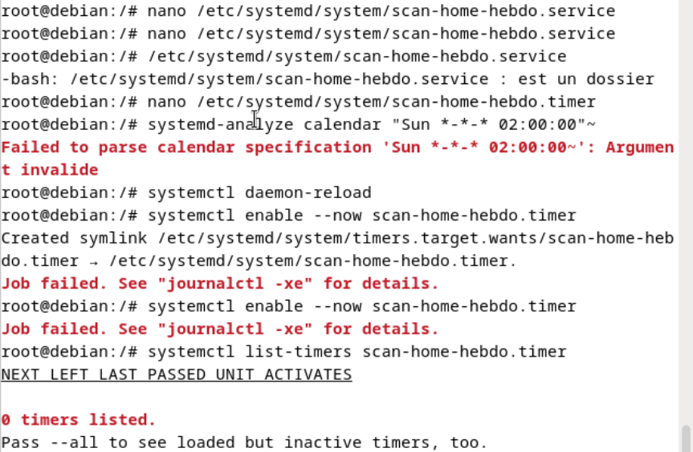

> ⚠️ **Erreurs rencontrées au premier essai** (détail au [§ 11.2](#112-timer--job-failed-et-0-timers-listed)) :
> - `/etc/systemd/system/scan-home-hebdo.service : est un dossier` : un **dossier** portait le nom du service à la place du fichier.
> - `Failed to parse calendar specification 'Sun *-*-* 02:00:00~'` : un caractère `~` parasite avait été tapé après les guillemets.
> - `Job failed. See "journalctl -xe" for details.` puis `0 timers listed.` : conséquence de la première erreur.

Après correction, le timer est bien programmé :

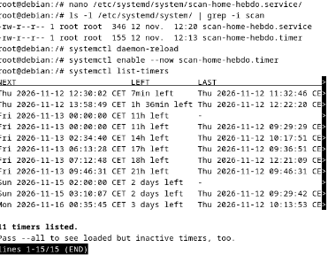

```bash
ls -l /etc/systemd/system/ | grep -i scan
# -rw-r--r-- 1 root root 346 12 nov. 12:20 scan-home-hebdo.service
# -rw-r--r-- 1 root root 155 12 nov. 12:19 scan-home-hebdo.timer
```

### 10.4 Lancer un scan immédiatement (test)

Sans attendre dimanche :

```bash
systemctl start scan-home-hebdo.service
tail -f /var/log/clamav/scan-home-hebdo.log
```

### 10.5 Vérification

```bash
systemctl list-timers | grep scan
tail -n 15 /var/log/clamav/scan-home-hebdo.log
```

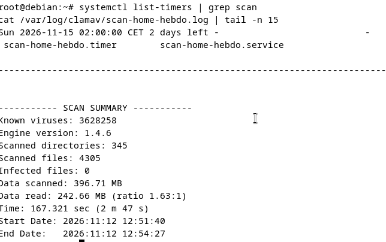

**Rapport du scan de test :**

| Indicateur | Valeur |
|---|---|
| Prochaine exécution | dim. 15/11/2026 02:00:00 CET |
| Dossiers analysés | 345 |
| Fichiers analysés | 4 305 |
| Fichiers infectés | 0 |
| Données analysées | 396,71 Mo |
| Durée | 167 s (2 min 47 s) |

```bash
systemctl status scan-home-hebdo.service --no-pager
```

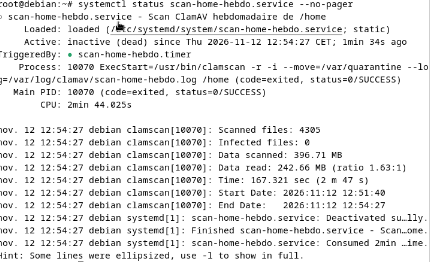

Lecture du statut :

- `Loaded: … ; static` : **normal**. Le service n'a pas de section `[Install]`, car c'est le timer qui le déclenche.
- `Active: inactive (dead)` : **normal** pour un service `oneshot` terminé.
- `TriggeredBy: scan-home-hebdo.timer` : le lien avec le timer est en place.
- `code=exited, status=0/SUCCESS` : le scan s'est terminé sans erreur et sans virus.
- `CPU: 2min 44.025s` : coût du scan complet de `/home`.

---

## 11. Dépannage : erreurs rencontrées

### 11.1 `apt update` : Erreur temporaire de résolution

**Symptôme :**

```
Err :1 http://deb.debian.org/debian bookworm InRelease
  Erreur temporaire de résolution de « deb.debian.org »
```

**Cause :** la machine ne résout pas les noms de domaine (DNS absent ou mauvais, carte réseau non connectée, mauvais mode réseau dans l'hyperviseur).

**Diagnostic et correction :**

```bash
ip a                          # la carte a-t-elle une adresse IP ?
ip route                      # y a-t-il une passerelle par défaut ?
ping -c 2 1.1.1.1             # Internet joignable par IP ?
ping -c 2 deb.debian.org      # résolution DNS fonctionnelle ?
cat /etc/resolv.conf          # quel serveur DNS est utilisé ?
```

- Si le ping vers `1.1.1.1` échoue : vérifier la carte réseau (mode NAT/pont de la VM, `systemctl restart networking`).
- Si seul le ping vers le nom échoue : corriger le DNS, par exemple `echo "nameserver 1.1.1.1" > /etc/resolv.conf`, ou utiliser le DNS de l'infrastructure.

Relancer ensuite `apt update`, sans aucune ligne `Err`.

### 11.2 Timer : Job failed et 0 timers listed

| Message | Cause | Correction |
|---|---|---|
| `scan-home-hebdo.service : est un dossier` | Un dossier a été créé à la place du fichier d'unité. | `rm -r /etc/systemd/system/scan-home-hebdo.service`, puis recréer le **fichier** avec `nano`. |
| `Failed to parse calendar specification '…~'` | Caractère `~` tapé en trop. | Retaper la commande sans le `~`. |
| `Job failed. See "journalctl -xe"` | Le timer ne trouve pas de service valide. | Corriger le service, puis `systemctl daemon-reload` et `systemctl enable --now scan-home-hebdo.timer`. |
| `0 timers listed.` | Le timer n'est pas actif. | Même correction. Vérifier avec `systemctl list-timers --all`. |

Commande de diagnostic générale :

```bash
journalctl -xeu scan-home-hebdo.timer
journalctl -xeu scan-home-hebdo.service
```

### 11.3 Script de tri : « impossible d'accéder à /usr/local/bin/scan_cvs.sh »

**Cause :** le script a été créé dans le dossier courant (`cv_incoming`) et non dans `/usr/local/bin/`.
**Correction :**

```bash
mv /var/www/data/cv_incoming/scan_cvs.sh /usr/local/bin/
chmod +x /usr/local/bin/scan_cvs.sh
```

### 11.4 Unité introuvable : `clamav-Daemon.service`

**Cause :** majuscule dans le nom. Les noms d'unités systemd sont sensibles à la casse.
**Correction :** `systemctl restart clamav-daemon.service`.

---

## 12. Récapitulatif des fichiers et commandes utiles

### Fichiers et dossiers

| Chemin | Rôle |
|---|---|
| `/etc/clamav/clamd.conf` | Configuration du démon et de l'analyse à l'accès |
| `/etc/clamav/freshclam.conf` | Configuration des mises à jour |
| `/var/lib/clamav/` | Bases de signatures |
| `/var/run/clamav/clamd.ctl` | Socket local de `clamd` |
| `/etc/systemd/system/clamonacc.service` | Service temps réel |
| `/etc/systemd/system/scan-home-hebdo.service` / `.timer` | Scan hebdomadaire |
| `/usr/local/bin/scan_cvs.sh` | Script de tri des CV |
| `/var/quarantaine/` | Quarantaine (`chmod 700`) |
| `/var/www/data/cv_incoming`, `cv_safe`, `cv_infected` | Dépôt et tri des CV |

### Journaux

| Journal | Contenu |
|---|---|
| `/var/log/clamav/freshclam.log` | Mises à jour des signatures |
| `/var/log/clamav/clamav.log` | Démon `clamd` |
| `/var/log/clamav/clamonacc.log` | Détections en temps réel |
| `/var/log/clamav/scan_cvs.log` | Script de tri des CV |
| `/var/log/clamav/scan-home-hebdo.log` | Scan hebdomadaire de `/home` |

### Commandes

```bash
# État des services
systemctl status clamav-daemon clamav-freshclam clamonacc
systemctl list-timers | grep scan

# Mise à jour manuelle des signatures
systemctl stop clamav-freshclam && freshclam && systemctl start clamav-freshclam

# Scan ponctuel
clamscan -r -i /chemin            # autonome (lent au démarrage)
clamdscan --fdpass -m /chemin     # via clamd (rapide)

# Quarantaine
ls -l /var/quarantaine/
```

---

## 13. Limites et bonnes pratiques

- **Détection par signatures :** ClamAV ne détecte que les menaces connues. Il ne protège pas contre les attaques « 0-day » et ne remplace pas un EDR.
- **Signatures à jour :** surveiller `freshclam.log`. Un antivirus aux signatures anciennes donne un faux sentiment de sécurité.
- **Charge serveur :** un scan complet consomme du CPU et des I/O (2 min 44 s de CPU pour 4 305 fichiers). Ne pas multiplier les scans fréquents, et toujours les planifier la nuit avec `Nice` et `IOSchedulingClass`.
- **Mémoire :** `clamd` occupe environ 1 Go de RAM. Dimensionner la VM en conséquence.
- **Quarantaine plutôt que suppression :** `--move` permet d'analyser un faux positif. `--remove` supprime définitivement le fichier.
- **Socket local :** ne pas exposer `clamd` sur un port TCP réseau.
- **Réglages avancés** dans `clamd.conf` : taille maximale des fichiers analysés (`MaxFileSize`, `MaxScanSize`), types d'archives, nombre de threads (`MaxThreads`).
