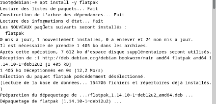
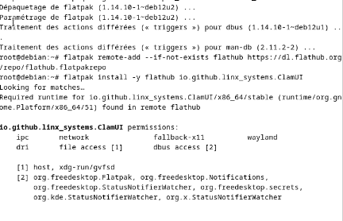
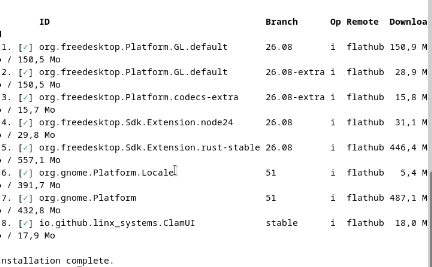
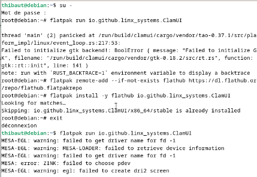
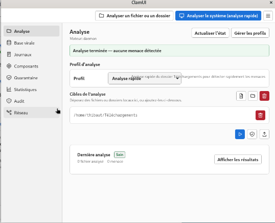
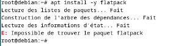

# ClamUI - GSBLOLO

Je présente ici l'installation de **ClamUI**, une interface graphique pour l'antivirus ClamAV, sur mon serveur **Debian 12 (bookworm)**, avec mes propres captures d'écran.

> **Prérequis :** ClamAV doit déjà être installé et fonctionnel sur la machine (voir la documentation [ClamAV](../ClamAV/ClamAV.md)).
> ClamUI n'embarque ni le moteur antivirus ni les signatures : il pilote les outils ClamAV de la machine (`clamscan`, `clamdscan`, `freshclam`).
>
> **Date de réalisation :** 12/11/2026 — **Méthode :** Flatpak (dépôt Flathub)
> **Sources :** [IT-Connect — Tuto ClamUI](https://www.it-connect.fr/tuto-clamui-linux-interface-graphique-clamav/) · [Projet ClamUI sur GitHub](https://github.com/linx-systems/clamui)

---

## Sommaire

1. [Présentation de ClamUI](#1-présentation-de-clamui)
2. [Prérequis](#2-prérequis)
3. [Installer Flatpak](#3-installer-flatpak)
4. [Ajouter le dépôt Flathub](#4-ajouter-le-dépôt-flathub)
5. [Installer ClamUI](#5-installer-clamui)
6. [Lancer ClamUI](#6-lancer-clamui)
7. [Découverte de l'interface](#7-découverte-de-linterface)
8. [Dépannage : erreurs rencontrées](#8-dépannage--erreurs-rencontrées)
9. [Récapitulatif des commandes](#9-récapitulatif-des-commandes)

---

## 1. Présentation de ClamUI

ClamAV s'utilise normalement en ligne de commande. **ClamUI** ajoute une interface graphique moderne (GTK 4 / libadwaita) pour :

- lancer une analyse de fichiers ou de dossiers en quelques clics ;
- enregistrer des **profils d'analyse** (analyse rapide, analyse complète…) ;
- consulter l'état de la base de signatures, les journaux et les statistiques ;
- gérer la **quarantaine**.

ClamUI est distribué en **Flatpak** sur Flathub (méthode recommandée) et en paquet `.deb` sur la page GitHub du projet.
J'ai choisi le Flatpak : l'application tourne dans un bac à sable, avec ses propres bibliothèques, sans toucher à celles du système.

---

## 2. Prérequis

| Élément | Détail |
|---|---|
| Système | Debian 12 (bookworm) **avec un environnement de bureau** (ClamUI est une application graphique) |
| ClamAV | Installé, signatures à jour, démon `clamav-daemon` actif ([doc ClamAV](../ClamAV/ClamAV.md)) |
| Réseau | Accès Internet et **DNS fonctionnel** (dépôts Debian et Flathub) |
| Disque | Environ **1,3 Go** libres : Flatpak télécharge aussi les environnements d'exécution (runtimes) GNOME et freedesktop |
| Comptes | `root` pour l'installation, **un compte utilisateur normal** pour le lancement |

---

## 3. Installer Flatpak

En `root` :

```bash
apt install -y flatpak
```



**Résultat :** le paquet `flatpak` (version `1.14.10-1~deb12u2`, 1 405 ko) est téléchargé depuis `deb.debian.org`, puis installé.

> ⚠️ **Erreur rencontrée :** le premier essai a échoué avec `E: Impossible de trouver le paquet flatpack`.
> Le nom avait été mal tapé : le paquet s'appelle **`flatpak`**, sans « c » (voir [§ 8.1](#81-e-impossible-de-trouver-le-paquet-flatpack)).

---

## 4. Ajouter le dépôt Flathub

Flathub est le dépôt principal d'applications Flatpak. On l'ajoute une seule fois :

```bash
flatpak remote-add --if-not-exists flathub https://dl.flathub.org/repo/flathub.flatpakrepo
```

L'option `--if-not-exists` évite une erreur si le dépôt est déjà déclaré.
Vérification :

```bash
flatpak remotes
```

---

## 5. Installer ClamUI

L'identifiant de l'application sur Flathub est **`io.github.linx_systems.ClamUI`** :

```bash
flatpak install -y flathub io.github.linx_systems.ClamUI
```



Flatpak trouve l'application, ainsi que l'environnement d'exécution nécessaire : `org.gnome.Platform/x86_64/51`.
Il affiche ensuite les **permissions** accordées au bac à sable :

| Permission | Utilité pour ClamUI |
|---|---|
| `ipc`, `wayland`, `fallback-x11`, `dri` | Affichage de la fenêtre (Wayland, sinon X11) et accélération graphique |
| `network` | Accès réseau |
| File access : `host`, `xdg-run/gvfsd` | Lecture des fichiers de la machine, nécessaire pour les **analyser** |
| D-Bus : `org.freedesktop.Flatpak` | Lancement des commandes ClamAV **sur la machine hôte**, hors du bac à sable |
| D-Bus : `org.freedesktop.Notifications` | Notifications de bureau (fin d'analyse, menace détectée) |
| D-Bus : `StatusNotifierWatcher` (freedesktop, KDE, X) | Icône dans la zone de notification |
| D-Bus : `org.freedesktop.secrets` | Trousseau de clés du bureau |

> L'accès à `org.freedesktop.Flatpak` est important : c'est grâce à lui que ClamUI, isolé dans son bac à sable, peut appeler le ClamAV installé sur le système.



Composants téléchargés et installés :

| # | Composant | Branche | Taille |
|---|---|---|---|
| 1 | `org.freedesktop.Platform.GL.default` | 26.08 | 150,9 Mo |
| 2 | `org.freedesktop.Platform.GL.default` | 26.08-extra | 28,9 Mo |
| 3 | `org.freedesktop.Platform.codecs-extra` | 26.08-extra | 15,8 Mo |
| 4 | `org.freedesktop.Sdk.Extension.node24` | 26.08 | 31,1 Mo |
| 5 | `org.freedesktop.Sdk.Extension.rust-stable` | 26.08 | 446,4 Mo |
| 6 | `org.gnome.Platform.Locale` | 51 | 5,4 Mo |
| 7 | `org.gnome.Platform` | 51 | 487,1 Mo |
| 8 | **`io.github.linx_systems.ClamUI`** | stable | **18,0 Mo** |

L'application elle-même ne pèse que 18 Mo. Le reste correspond aux runtimes partagés, réutilisés par les autres applications Flatpak.
Le message **`Installation complete.`** confirme la fin de l'installation.

Vérification :

```bash
flatpak list --app
```

---

## 6. Lancer ClamUI

> ⚠️ **ClamUI doit être lancé avec un compte utilisateur normal, jamais en `root`.**
> La session `root` ouverte avec `su -` n'a pas accès à l'affichage graphique de l'utilisateur connecté.

Depuis un terminal de l'utilisateur (ici `thibaut`) :

```bash
flatpak run io.github.linx_systems.ClamUI
```

L'application est aussi disponible dans le menu **Applications** du bureau (recherche « ClamUI »). L'icône n'y apparaît qu'après une déconnexion/reconnexion ou un redémarrage.



Cette capture montre les deux cas :

1. **En `root` (après `su -`) : échec.** L'application s'arrête avec `thread 'main' (2) panicked` et `Failed to initialize gtk backend! BoolError { message: "Failed to initialize GTK" … }`. Explication au [§ 8.2](#82-failed-to-initialize-gtk-backend-en-root).
2. **En utilisateur (après `exit`) : succès.** Des avertissements `MESA-EGL` / `ZINK` s'affichent dans le terminal, mais la fenêtre s'ouvre. Ces messages sont **sans gravité** (voir [§ 8.3](#83-avertissements-mesa-egl--zink)).

> Remarque : relancer `flatpak install` alors que ClamUI est déjà présent affiche simplement `Skipping: io.github.linx_systems.ClamUI/x86_64/stable is already installed`.

---

## 7. Découverte de l'interface



### 7.1 Barre supérieure

| Bouton | Action |
|---|---|
| **Analyser un fichier ou un dossier** | Ouvre un sélecteur pour analyser une cible précise |
| **Analyser le système (analyse rapide)** | Lance directement le profil d'analyse rapide |
| ☰ (menu) | Préférences et informations sur l'application |

### 7.2 Menu latéral

| Section | Rôle |
|---|---|
| **Analyse** | Lancement des analyses, choix du profil et des cibles (page affichée ci-dessus) |
| **Base virale** | État et mise à jour des signatures (`freshclam`) |
| **Journaux** | Historique des analyses effectuées |
| **Composants** | État des outils ClamAV détectés sur la machine (`clamscan`, `clamd`, `freshclam`…) |
| **Quarantaine** | Fichiers isolés : restauration ou suppression définitive |
| **Statistiques** | Synthèse des analyses et des détections |
| **Audit** | Contrôle de la configuration (non exploré ici) |
| **Réseau** | Paramètres réseau de l'application (non exploré ici) |

### 7.3 Page Analyse

| Zone | Ce que j'observe |
|---|---|
| **Moteur : daemon** | ClamUI utilise le démon **`clamd`** de la machine (configuré dans la doc ClamAV). Les analyses sont rapides, car la base est déjà chargée en mémoire. |
| **Actualiser l'état** / **Gérer les profils** | Rafraîchit l'état du moteur / crée ou modifie des profils d'analyse |
| Bandeau vert | `Analyse terminée — aucune menace détectée` |
| **Profil d'analyse** | Profil **Analyse rapide** : « analyse rapide du dossier Téléchargements pour détecter rapidement les menaces » |
| **Cibles de l'analyse** | `/home/thibaut/Téléchargements`. On peut ajouter des fichiers ou des dossiers par glisser-déposer ou avec les boutons, et retirer une cible avec l'icône rouge. |
| Boutons ▶ / 🛡 / ⤴ | Lancer l'analyse / options d'analyse / exporter |
| **Dernière analyse** | Statut **Sain** : 0 fichier analysé, 0 menace. Le bouton **Afficher les résultats** ouvre le détail. |

> Le compteur « 0 fichier analysé » signifie que le dossier cible ne contenait aucun fichier au moment de l'analyse.
> Pour valider la détection depuis l'interface, déposer un fichier de test EICAR dans `~/Téléchargements`, puis relancer l'analyse rapide :
>
> ```bash
> curl -o ~/Téléchargements/eicar.txt https://secure.eicar.org/eicar.com.txt
> ```
>
> ClamUI doit alors signaler `Eicar-Test-Signature` et proposer la mise en quarantaine.
> Attention : si l'analyse en temps réel (`clamonacc`) surveille aussi ce dossier, le fichier peut être mis en quarantaine dès son téléchargement.

---

## 8. Dépannage : erreurs rencontrées

### 8.1 `E: Impossible de trouver le paquet flatpack`



**Cause :** faute de frappe. Le paquet s'appelle `flatpak`, pas `flatpack`.
**Correction :** `apt install -y flatpak`.

Si l'erreur persiste avec le bon nom, la liste des paquets n'est pas à jour. Lancer `apt update` et vérifier qu'aucune ligne `Err` n'apparaît (problème DNS : voir la [doc ClamAV, § 11.1](../ClamAV/ClamAV.md#111-apt-update--erreur-temporaire-de-résolution)).

### 8.2 `Failed to initialize gtk backend` en root

```
thread 'main' (2) panicked at /run/build/clamui/cargo/vendor/tao-0.37.1/src/platform_impl/linux/event_loop.rs:217:53:
Failed to initialize gtk backend!: BoolError { message: "Failed to initialize GTK" ... }
```

**Cause :** l'application a été lancée en `root` après `su -`. Cette session n'a pas accès à l'affichage graphique (Wayland ou X11) de l'utilisateur connecté au bureau, donc GTK ne peut pas ouvrir de fenêtre.
**Correction :** quitter la session root avec `exit` et lancer ClamUI avec son compte utilisateur.

### 8.3 Avertissements `MESA-EGL` / `ZINK`

```
MESA-EGL: warning: failed to get driver name for fd -1
MESA-LOADER: failed to retrieve device information
MESA: error: ZINK: failed to choose pdev
MESA-EGL: warning: egl: failed to create dri2 screen
```

**Cause :** la machine virtuelle n'a pas de carte graphique 3D. Les bibliothèques graphiques (Mesa) ne trouvent pas de pilote matériel et basculent sur le **rendu logiciel**.
**Impact :** aucun. Ce sont des avertissements : l'interface s'affiche et fonctionne normalement.

---

## 9. Récapitulatif des commandes

```bash
# --- En root ---
apt install -y flatpak
flatpak remote-add --if-not-exists flathub https://dl.flathub.org/repo/flathub.flatpakrepo
flatpak install -y flathub io.github.linx_systems.ClamUI

# --- En utilisateur normal ---
flatpak run io.github.linx_systems.ClamUI

# --- Maintenance ---
flatpak list --app                                  # applications installées
flatpak update                                      # mise à jour de ClamUI et des runtimes
flatpak info io.github.linx_systems.ClamUI          # version installée
flatpak uninstall io.github.linx_systems.ClamUI     # désinstallation
flatpak uninstall --unused                          # supprime les runtimes devenus inutiles
```
