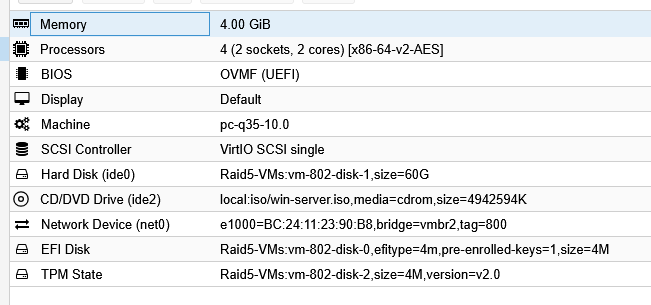

# Contrôleur de domaine secondaire - Structure du réseau GSBLOLO

Je présente ici la mise en place d'un second contrôleur de domaine, **DC-SECONDAIRE**, relié au contrôleur principal **AD-DC** pour le domaine **GSBLOLO.local**. Il assure la redondance de l'annuaire et du DNS : si AD-DC tombe, les postes peuvent encore s'authentifier.

## 1. Créer la machine virtuelle

J'ai créé la VM **DC-SECONDAIRE** avec le **VMID 802** sur Proxmox VE, avec la même base matérielle que AD-DC.

| Paramètre | Valeur |
| --- | --- |
| Mémoire | 4 Gio |
| Processeurs | 4 (2 sockets × 2 cœurs), type `x86-64-v2-AES` |
| BIOS | OVMF (UEFI) |
| Machine | pc-q35-10.0 |
| Contrôleur SCSI | VirtIO SCSI single |
| Disque (ide0) | 60 Gio sur `Raid5-VMs` |
| Lecteur CD/DVD (ide2) | ISO `win-server.iso` (stockage `local`) |
| Réseau | Intel E1000, pont **vmbr2**, **VLAN tag 800** |
| Disque EFI | 4 Mio sur `Raid5-VMs` |
| État TPM | 4 Mio sur `Raid5-VMs`, version 2.0 |



## 2. Nom et adresse réseau

| Élément | Valeur |
| --- | --- |
| Nom | DC-SECONDAIRE |
| Adresse IP | 10.2.121.3 |
| Masque | 255.255.255.0 |
| Passerelle | 10.2.121.1 |
| DNS préféré | 10.2.121.2 (AD-DC) |

Le DNS préféré pointe vers AD-DC : c'est lui qui connaît le domaine **GSBLOLO.local**, indispensable pour que le serveur le trouve avant la promotion.

## 3. Relier la DC secondaire au DC principal

Les captures de cette partie seront ajoutées après la réalisation.

1. Sur DC-SECONDAIRE, installer le rôle **Services AD DS** depuis le Gestionnaire de serveur (**Gérer > Ajouter des rôles et fonctionnalités**). En PowerShell : `Install-WindowsFeature AD-Domain-Services -IncludeManagementTools`.
2. Cliquer sur **Promouvoir ce serveur en contrôleur de domaine** et choisir **Ajouter un contrôleur de domaine à un domaine existant** (et non une nouvelle forêt), avec le domaine **GSBLOLO.local**.
3. S'authentifier avec un compte administrateur du domaine (par exemple `GSBLOLO\Administrateur`).
4. Cocher **Serveur DNS** et **Catalogue global (GC)**, puis définir le mot de passe DSRM.
5. Laisser AD-DC comme source de réplication, garder les chemins NTDS et SYSVOL par défaut, puis lancer l'installation. Le serveur redémarre.

Équivalent en PowerShell :

```powershell
Install-ADDSDomainController -DomainName "GSBLOLO.local" -InstallDns -Credential (Get-Credential)
```

## 4. Vérifier la réplication

Après le redémarrage, je vérifie que les deux contrôleurs sont bien reliés :

- **Utilisateurs et ordinateurs Active Directory** : DC-SECONDAIRE apparaît dans l'OU **Domain Controllers**, et les OU, groupes et comptes de AD-DC sont présents.
- `repadmin /replsummary` : aucune erreur de réplication entre AD-DC et DC-SECONDAIRE.
- `dcdiag` : tous les tests réussissent.

Une fois la promotion terminée, j'ajoute **10.2.121.3** comme DNS auxiliaire sur AD-DC et sur les postes clients, pour que la résolution continue si AD-DC est arrêté.
