# TrueNAS - AP 1 GSBLOLO

Je présente ici la mise en place du serveur de stockage **TrueNAS** sur Proxmox VE, avec mes propres captures d'écran.

## 1. Créer la machine virtuelle

J'ai créé une VM **TrueNAS** avec le **VMID 803**, sur le même réseau que le reste de l'infrastructure.

| Paramètre | Valeur |
| --- | --- |
| Mémoire | 4 Gio |
| Processeurs | 4 (2 sockets × 2 cœurs), type `x86-64-v2-AES` |
| BIOS / machine | SeaBIOS (par défaut) / i440fx |
| Contrôleur SCSI | VirtIO SCSI single |
| Lecteur CD/DVD | ISO `Truenas_Scale_CE_-_25.10.1.iso` (stockage `local`) |
| Disque scsi0 | 60 Gio sur `Raid5-VMs` |
| Disque scsi1 | 32 Gio sur `Raid5-VMs` |
| Réseau | VirtIO, pont **vmbr2**, **VLAN tag 800** |


## 2. Installer TrueNAS

Au démarrage sur l'ISO, je lance **Start TrueNAS SCALE Installation** depuis le menu GRUB.

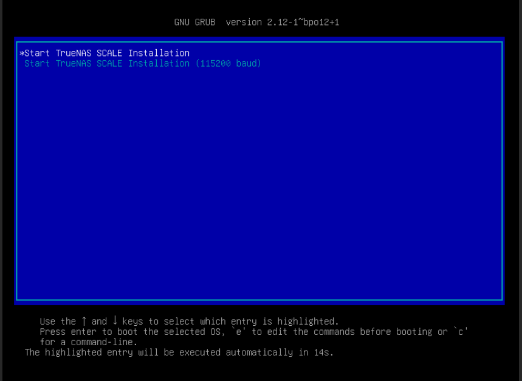

Dans la console d'installation **TrueNAS 25.10.1**, je choisis **Install/Upgrade**.


Je sélectionne le disque de **60 Gio** (`sdb`) comme disque système. Le disque de 32 Gio (`sda`) reste libre pour le stockage.


L'installateur prévient que toutes les partitions de `sdb` seront effacées. Je confirme avec **Yes**.

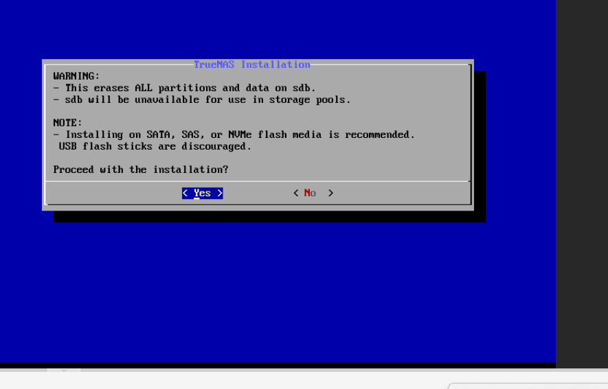

Pour l'accès à l'interface web, je choisis l'utilisateur administrateur **truenas_admin** et je définis son mot de passe. La connexion par mot de passe de `root` est alors désactivée.


Je réponds **Yes** à la question sur le démarrage EFI.

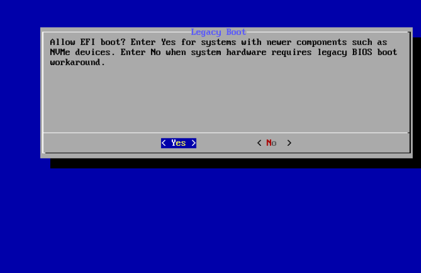

## 3. Adresse réseau

Le serveur TrueNAS utilise l'adresse **10.2.121.14**, dans le réseau **10.2.121.0/24** (VLAN 800) de l'infrastructure.

## 4. Vérifier le fonctionnement

Après le redémarrage, l'interface web est accessible avec **truenas_admin**. Le tableau de bord indique **TrueNAS Community Edition 25.10.1 (Goldeye)**, le nom d'hôte **truenas** et la mémoire disponible.


La console de la VM affiche le menu de configuration (interfaces réseau, paramètres réseau, routes statiques, mot de passe de l'administrateur local, shell).

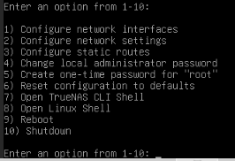

## 5. Intégration au domaine

Dans **Utilisateurs et ordinateurs Active Directory** de **gsblolo.local**, l'ordinateur **TRUENAS** apparaît dans le conteneur **Computers** : le serveur est bien rattaché au domaine.

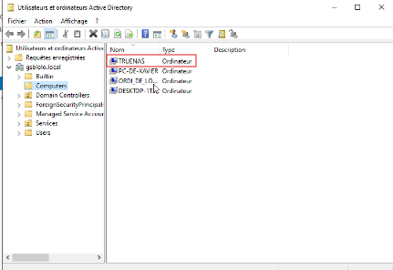

## 6. Créer le pool de stockage

Pour créer le pool dans **Storage > Create Pool**, TrueNAS a d'abord refusé avec l'erreur **Disks have duplicate serial numbers: None (sda, sdb)**. Les disques virtuels Proxmox n'ont pas de numéro de série, or TrueNAS en exige un unique par disque.

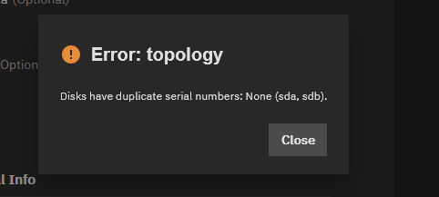

J'ai donné un numéro de série à chaque disque depuis le shell du nœud Proxmox, puis j'ai éteint et redémarré complètement la VM :

```bash
qm set 803 --scsi0 Raid5-VMs:vm-803-disk-0,iothread=1,serial=TRUENAS0001
qm set 803 --scsi1 Raid5-VMs:vm-803-disk-1,iothread=1,serial=TRUENAS0002
```

J'ai ensuite créé le pool **Stockage** sur le disque de 32 Gio (le disque de 60 Gio contient le système). Il n'y a qu'un disque, donc la disposition est un simple disque (sans redondance), suffisante pour ce projet. Le tableau de bord indique 30,52 Gio utilisables, l'état **Online, no errors** et un scrub programmé le dimanche à 00:00.

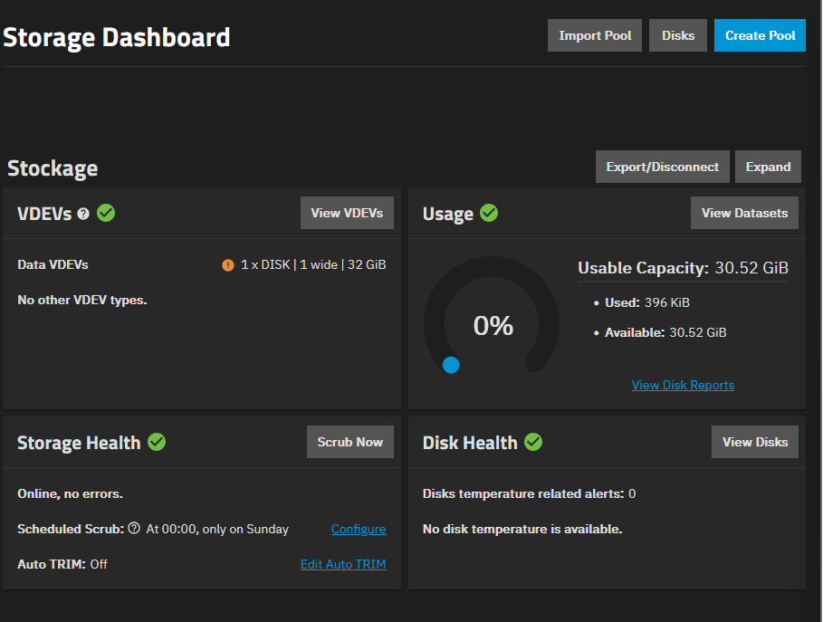

## 7. Créer les datasets

J'ai créé le dataset **Services** (`Stockage/Services`), puis un dataset par service dedans avec le préréglage **SMB** : `Accueil`, `Communication`, `Comptabilite`, `Developpement`, `DSI`, `Labo-recherche`, `Reseaux-Systemes` et `RH`. Je n'ai pas mis d'accents ni de `&` dans les noms.

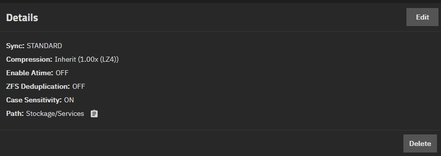

## 8. Donner les droits aux groupes AD

Pour chaque dataset, j'ai ouvert **Permissions > Edit** et ajouté une entrée de type **Group** pour le groupe de sécurité du service, avec le niveau **Modify** et l'héritage activé. Par exemple, `GSBLOLO\accueil` pour le dataset `Accueil`. Les groupes du domaine sont proposés dans la liste, et l'état de l'annuaire dans **Credentials > Directory Services** est **Healthy** : TrueNAS est donc bien relié à l'annuaire **GSBLOLO.local**. L'entrée `everyone@` ne garde que le droit de traverser, sans lister ni lire le contenu.

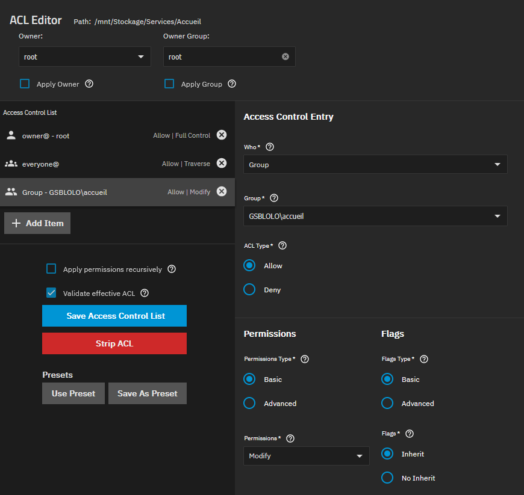

## 9. Créer les partages SMB

Dans **Shares > Windows (SMB) Shares**, j'ai créé un partage par service, avec le chemin du dataset (par exemple `/mnt/Stockage/Services/Accueil`) et le même nom, puis j'ai démarré le service SMB. Depuis le poste **Client1** (VM 810, Windows 10 Entreprise), `\\10.2.121.14` affiche les 8 partages.

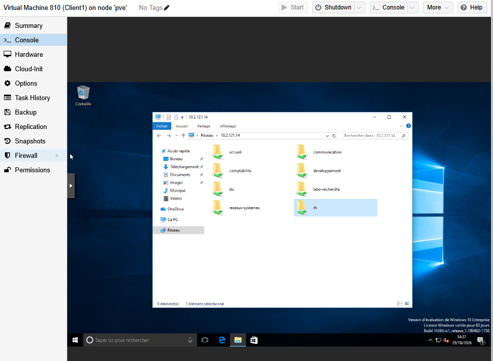

## 10. Tester les droits

Depuis Client1, je me connecte avec le compte du domaine **GSBLOLO\L.Bodet**, membre du service DSI, puis j'ouvre `\\10.2.121.14\dsi` et je crée un dossier `Test_Truenas` : l'accès est autorisé.

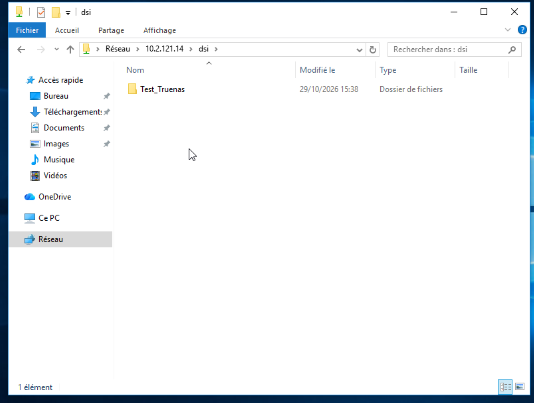

Le même compte essaie ensuite d'ouvrir `\\10.2.121.14\rh` : Windows refuse l'accès. Les droits par groupe fonctionnent donc comme prévu : chaque service n'accède qu'à son propre partage.

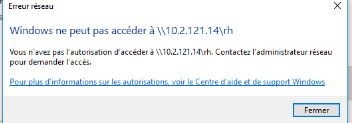
